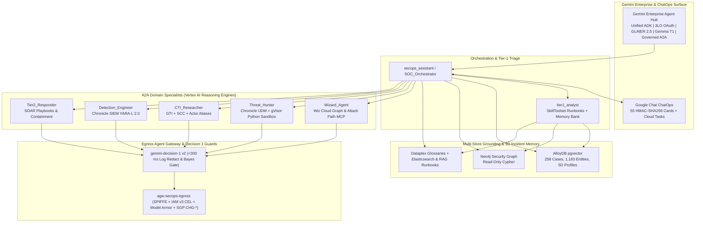
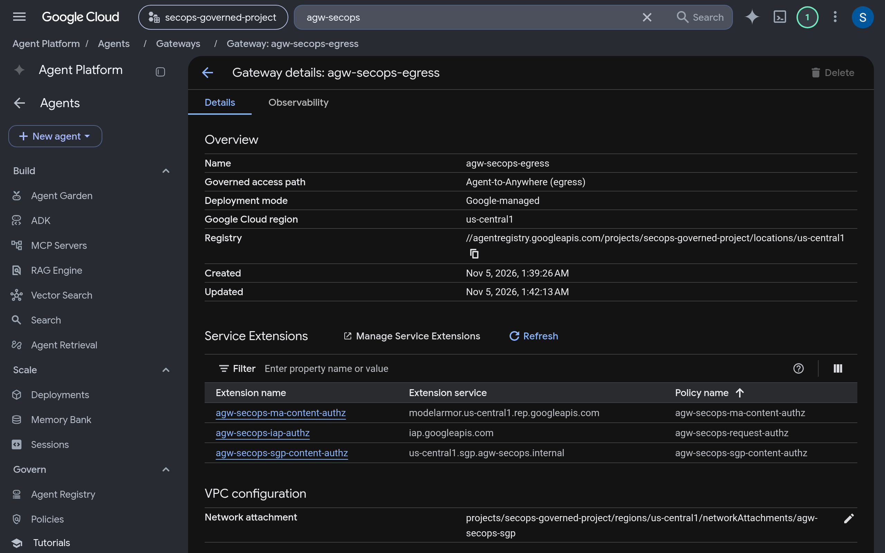

# Agentic SOC for Gemini Enterprise

Autonomous multi-agent Security Operations Center (SOC) reference platform built with [Google ADK](https://google.github.io/adk-docs/), Vertex AI Agent Engine, Google Security Operations (Chronicle SIEM and SOAR), Wiz Cloud Security Graph, Google Threat Intelligence (GTI), Security Command Center (SCC), and Gemini Enterprise.

**Documentation site:** [https://dandye.github.io/agentic_soc_gemini_enterprise/](https://dandye.github.io/agentic_soc_gemini_enterprise/) (WCAG 2.1 Level AA Sphinx site, buildable locally with `just docs-serve`).

[](https://www.youtube.com/watch?v=KB2dJQEpjsw)

## Five Core Capabilities

1. **Full-Lifecycle Multi-Agent SOC and `Wizard_Agent`**: `secops_assistant` / `SOC_Orchestrator` coordinates `tier1_analyst` (`SkillToolset` modular runbooks) alongside five domain specialists over Agent-to-Agent (A2A) protocol: `Wizard_Agent` (Wiz Cloud Graph, Attack Paths, Toxic Combinations, AI-SPM, and Terraform remediation via Wiz Remote MCP), `Threat_Hunter` (Chronicle SIEM UDM hunting plus Vertex Agent Engine Cloud MicroVM/gVisor Python `code_executor` for DGA Shannon entropy, C2 beacon jitter, and dropper forensics), `CTI_Researcher` (GTI, SCC, and Dataplex Threat Actor Glossaries), `Detection_Engineer` (Chronicle SIEM YARA-L 2.0 authoring and validation), and `Tier2_Responder` (SOAR playbooks, Case Wall synthesis, and containment).
2. **Multi-Store Enterprise Grounding and 5D Incident Memory**: AlloyDB `pgvector` similarity engine over 258 harvested investigations and 1,183 entities (`S_sem`, IDF `S_ent`, MITRE `S_ttp`, `S_flow`, and 14-day `S_time` across 5 operational profiles), Neo4j Operational Security Graph (`_reject_write_cypher`), Dataplex Knowledge Catalog and Threat Actor Glossaries, Elasticsearch and Vertex AI RAG runbooks, Vertex AI Memory Bank (`SharedScopePreloadMemoryTool`), and Gemini Enterprise Discovery Engine Federated DataStores (AlloyDB MCP, BigQuery, Chronicle MCP).
3. **Gemini Enterprise Multi-Agent Hub, 3LO OAuth, and Google Chat ChatOps**: Purpose-built Gemini Enterprise agent portfolio (Unified ADK Agent, 3LO OAuth Interactions API Agent, `GLiNER 2.5` 373.5 ms CPU Decision Router, evolved `Gemma` Tier-1 Triage Agent, and Governed A2A Orchestrator) paired with 55 interactive HMAC-SHA256 Google Chat ChatOps cards (`host_isolation_approval`, `traveler_confirmation`, `ai_privilege_access_v2`) backed by Cloud Tasks.
4. **AQuA Two-Loop Agent Quality and Evaluation Loop**: 10 `.evalset.json` suites (54 cases including 25 multi-turn pivots and 5 sandboxed code-analytics hunts), outer-loop Cloud Trace harvesting and custom trajectory metrics, a 3-persona multi-turn user simulator, a Human-vs-AI Turing benchmark (improving from 30% baseline to 95% Expert parity), and Git-tracked prompt optimization ledgers.
5. **Platform Choke-Point Governance and Calibrated `gemini-decision-1` Guards**: 9-layer egress Agent Gateway (`AGENT_IDENTITY` SPIFFE workload identities, IAM v3 CEL tool allowlists including dedicated `${var.resource_prefix}-wiz-tools`, cyber-tuned Model Armor, and Vertex Semantic Governance `CHG-*` Crown Jewel change control), sub-300 ms `gemini-decision-1` v2 lifecycle guards with 3-tab Simple Demos (`just governance-demos`), a Cloud Monitoring audit dashboard, and `$0/hr` idle scale-to-zero (`minInstances=0`).

## Table of Contents

- [Architecture](#architecture)
- [Pillar 1: Multi-Agent SOC Specialists and `Wizard_Agent`](#pillar-1-multi-agent-soc-specialists-and-wizard_agent)
- [Pillar 2: Multi-Store Enterprise Grounding and 5D Incident Memory](#pillar-2-multi-store-enterprise-grounding-and-5d-incident-memory)
- [Pillar 3: Gemini Enterprise Hub, 3LO OAuth, and Google Chat ChatOps](#pillar-3-gemini-enterprise-hub-3lo-oauth-and-google-chat-chatops)
- [Pillar 4: AQuA Two-Loop Quality and Evaluation Framework](#pillar-4-aqua-two-loop-quality-and-evaluation-framework)
- [Pillar 5: Agent Gateway Governance and `gemini-decision-1` Guards](#pillar-5-agent-gateway-governance-and-gemini-decision-1-guards)
- [Quick Start and Installation](#quick-start-and-installation)
- [Configuration and RAG Corpus Management](#configuration-and-rag-corpus-management)
- [CLI Reference and Troubleshooting](#cli-reference-and-troubleshooting)

## Architecture



## Pillar 1: Multi-Agent SOC Specialists and `Wizard_Agent`

Rather than packing every security tool and credential into one monolithic prompt, the platform splits investigation, cloud posture analysis, computational hunting, detection engineering, and response across focused ADK agents (`agent_soc_manager/`, `agent_a2a_*/`, and `governed_agents/`):

| Agent | Primary Modules | Core Tools & Security Domain |
| :--- | :--- | :--- |
| **`secops_assistant` / `SOC_Orchestrator`** | [`agent_soc_manager/`](agent_soc_manager/), [`governed_agents/soc_orchestrator/`](governed_agents/soc_orchestrator/) | Coordinates single-specialist and parallel multi-specialist investigations (`delegate_concurrently`), synthesizes cross-product findings, and manages human escalation. |
| **`tier1_analyst`** | [`agent_soc_manager/agent.py`](agent_soc_manager/agent.py), [`agent_soc_manager/skills/`](agent_soc_manager/skills/) | Executes modular `SkillToolset` runbooks (`malware-triage-skill`, `secops-wiz-cloud-security`, `chatops-skill`), initial SOAR alert triage, and duplicate/false-positive checks. |
| **`Wizard_Agent` (`wizard_agent`)** | [`governed_agents/wizard_agent/`](governed_agents/wizard_agent/), [`agent_soc_manager/wiz_mcp.py`](agent_soc_manager/wiz_mcp.py) | Connects to Wiz Remote MCP (`wiz_discover` and read-only `wiz_execute` guarded by `enforce_wiz_readonly_callback`) to map internet Attack Paths, Toxic Combinations, OAuth/IAM privilege hops, AI-SPM findings, DAST scanner context, and Wiz Green Agent Terraform fixes. |
| **`Threat_Hunter`** | [`agent_a2a_threat_hunter/`](agent_a2a_threat_hunter/), [`governed_agents/threat_hunter/`](governed_agents/threat_hunter/) | Runs 7-day Chronicle SIEM UDM hunts and executes statistical Python analytics inside an isolated Vertex Agent Engine Cloud MicroVM/gVisor `code_executor` (`AgentEngineSandboxCodeExecutor`) to calculate Shannon entropy for DGA domains, C2 beacon inter-arrival jitter, and untrusted dropper filesystem diffs (`detonate_and_capture_forensics`) without blowing up model token context. |
| **`CTI_Researcher`** | [`agent_a2a_cti_researcher/`](agent_a2a_cti_researcher/), [`governed_agents/cti_researcher/`](governed_agents/cti_researcher/) | Enriches external IPs, domains, SHA-256 hashes, and threat collections via Google Threat Intelligence (VirusTotal v3), correlates SCC findings, triages multimodal phishing artifacts, and resolves vendor actor aliases through Dataplex Glossaries. |
| **`Detection_Engineer`** | [`agent_a2a_detection_engineer/`](agent_a2a_detection_engineer/), [`governed_agents/detection_engineer/`](governed_agents/detection_engineer/) | Authors, validates (`validate_rule`), and backtests **Chronicle SIEM YARA-L 2.0** UDM event correlation rules (explicitly distinct from standard YARA file/payload binary signatures). |
| **`Tier2_Responder`** | [`agent_a2a_tier2/`](agent_a2a_tier2/), [`governed_agents/tier2_responder/`](governed_agents/tier2_responder/) | Posts unified triage briefs to the Google SecOps Case Wall, updates alert dispositions and IOC reference lists, and executes endpoint isolation (`isolate_endpoint_host`) and account disablement (`disable_compromised_account`). |

See [Architecture](docs/architecture.md) and [Vertex AI Code Execution Sandbox Architecture](docs/code_execution_architecture.md) for full specialist and MicroVM sandbox design details.

## Pillar 2: Multi-Store Enterprise Grounding and 5D Incident Memory

Stateless LLM triage repeats past false positives and misses slow multi-host campaigns. Every investigation is grounded across six complementary enterprise stores:

- **AlloyDB `pgvector` 5D Similarity Engine** ([`installation_scripts/manage_alloydb.py`](installation_scripts/manage_alloydb.py), [AlloyDB Summary](docs/alloydb_similarity_engine_summary.md)): Stores 258 harvested Chronicle investigations and 1,183 extracted entities indexed with 768-dimensional Vertex AI `text-embedding-004` HNSW vectors. [`AlloyDBManager.find_similar`](installation_scripts/manage_alloydb.py) scores historical precedent across five orthogonal dimensions (`S_sem` vector cosine, IDF-weighted `S_ent` entity Jaccard, hierarchical MITRE `S_ttp`, analytical step `S_flow`, and 14-day exponential `S_time` decay) using five operational profiles (`balanced`, `threat-hunt`, `compromise-pivot`, `false-positive`, and `semantic`).
- **Neo4j Operational Security Graph** ([`installation_scripts/manage_neo4j.py`](installation_scripts/manage_neo4j.py), [Knowledge Catalog vs. Neo4j](docs/knowledge_catalog_vs_neo4j.md)): Maps multi-hop `(User)-[:LOGGED_ON_TO]->(Host)-[:CONNECTED_TO]->(Domain)` lateral movement paths via `query_knowledge_graph`, protected by `_reject_write_cypher` read-only enforcement.
- **Dataplex Knowledge Catalog & Threat Actor Glossaries** ([Threat Actor Glossary](docs/threat_actor_glossary.md)): Normalizes vendor-specific adversary synonyms (for example resolving `Midnight Blizzard`, `Nobelium`, and `UNC2452` to canonical `APT29`) at query time.
- **Elasticsearch & Vertex AI RAG Runbooks** ([`installation_scripts/manage_elasticsearch.py`](installation_scripts/manage_elasticsearch.py), [`installation_scripts/manage_rag.py`](installation_scripts/manage_rag.py)): Serves curated Incident Response Plans (IRPs) and dual-use administrative triage procedures with verbatim source citations.
- **Vertex AI Memory Bank** (`SharedScopePreloadMemoryTool` and `LoadMemoryTool` in [`agent_soc_manager/agent.py`](agent_soc_manager/agent.py)): Persists 12 custom SOC memory topics across shifts, including `approved_exceptions`, `investigation_patterns`, `active_campaign_intelligence`, and `detection_rule_feedback`.
- **Gemini Enterprise Federated DataStores** ([`installation_scripts/manage_datastore.py`](installation_scripts/manage_datastore.py)): Connects Discovery Engine search directly across AlloyDB MCP, BigQuery telemetry tables, and Chronicle MCP.

```bash
just harvest                        # Harvest investigations and detections from Chronicle SIEM
just alloydb-init && just alloydb-ingest && just alloydb-embed
just alloydb-find-similar <INV_ID> profile="false-positive"
just neo4j-sync                     # Recalculate and ingest entity graph into Neo4j
```

## Pillar 3: Gemini Enterprise Hub, 3LO OAuth, and Google Chat ChatOps

The repository publishes a purpose-built portfolio of agents into Gemini Enterprise alongside asynchronous human-in-the-loop collaboration in Google Chat:

- **Gemini Enterprise Agent Portfolio** ([`installation_scripts/manage_gem_ent.py`](installation_scripts/manage_gem_ent.py), [`installation_scripts/manage_oauth.py`](installation_scripts/manage_oauth.py)):
  - **Unified ADK SOC Orchestrator (`agent_soc_manager`)**: Full-featured multi-store grounded coordinator with local `tier1_analyst` / `wizard_agent` sub-agents and remote A2A specialist tools.
  - **3LO OAuth Interactions API Agent**: Propagates end-user 3-legged OAuth credentials (`authorizations` token passthrough) so Chronicle SIEM and SOAR actions execute under each analyst's own IAM permissions.
  - **`GLiNER 2.5` CPU Decision Router**: Sub-400 ms (`373.5 ms` CPU) zero-GPU entity extraction and intent router for high-volume alert queues.
  - **Evolved `Gemma` Tier-1 Triage Agent**: Prompt-optimized lightweight Tier-1 triage worker for routine alert classification.
  - **Governed A2A SOC Orchestrator (`governed_agents/soc_orchestrator`)**: Zero-tool front door bound to the egress Agent Gateway.
- **55 Interactive Google Chat ChatOps Cards** ([`agent_soc_manager/tools/chatops/`](agent_soc_manager/tools/chatops/), [ChatOps Native Chat App](docs/chatops_chat_app.md)): Native Google Chat App (`CHATOPS_ENABLED` feature gate) with 55 structured Card v2 templates (`host_isolation_approval`, `traveler_confirmation`, `ai_privilege_access_v2`, `vulnerability_patch_approval`, and more). Clicks verify Google-issued JWTs plus HMAC-SHA256 action tokens, enqueue deduplicated Cloud Tasks jobs so responses stay inside Google Chat's 30-second deadline, and update cards in place with the real execution outcome.

```bash
just oauth-workflow                 # Configure and verify 3LO OAuth in Discovery Engine
just gem-ent-list-agents            # Inspect registered agents in Gemini Enterprise
just chatops-list                   # List all 55 interactive Google Chat card templates
```

## Pillar 4: AQuA Two-Loop Quality and Evaluation Framework

Agent behavior is measured continuously across an inner offline/staging rubric loop and an outer production trace diagnostic loop ([Evaluations Guide](docs/evaluations.md), [ADK Evals Guide](docs/adk_evals_framework_guide.md), [AQuA Goal Spec](docs/aqua_goal.md)):

- **10 Evaluation Suites (54 Cases)**: Checked-in `.evalset.json` suites under [`evalsets/`](evalsets/) covering `soc_basic`, `tier1_triage`, `cti_research`, `threat_hunting` (including 5 sandboxed Python code-analytics hunts), `detection_engineering`, `incident_response`, `multi_specialist`, 25 multi-turn investigation pivots, and promoted `aqua_regressions`.
- **Outer-Loop AQuA Sidecar & Cloud Trace Metrics** ([`installation_scripts/manage_aqua.py`](installation_scripts/manage_aqua.py), [`aqua/`](aqua/)): Harvests OpenTelemetry Reasoning Engine traces, checks 5 behavioral invariants (investigation completeness, SOAR case fallback, A2A context propagation across `delegate_to_*`, HITL containment safety, and attribution footers), and promotes production regressions into `evalsets/aqua_regressions.evalset.json`.
- **3-Persona Multi-Turn Simulator & Human-vs-AI Benchmark**: Evaluates multi-turn adaptability across junior analyst, incident commander, and adversarial red-team personas, lifting composite investigation quality from a 30% naive baseline to 95% Expert analyst parity through Git-tracked hypothesis experiments (`evalsets/experiments/`).

```bash
just test-eval-all                  # Run rubric evaluation suites and log to evalsets/eval_runs/
just test-compare threat_hunting    # Diff tool trajectories and git commits across runs
just aqua-run start_time="-24h"     # Audit production Cloud Traces against docs/aqua_goal.md
```

## Pillar 5: Agent Gateway Governance and `gemini-decision-1` Guards

For CISO-governed production rollouts, [`governed_agents/`](governed_agents/) and [`terraform/`](terraform/) wrap the multi-agent SOC in a 9-layer platform choke point paired with sub-300 ms calibrated `gemini-decision-1` runtime guards:

- **Keyless SPIFFE & Auth Manager Isolation**: Each Reasoning Engine (`soc_orchestrator`, `cti_researcher`, `threat_hunter`, `detection_engineer`, `tier2_responder`, and opt-in `wizard_agent` when `enable_wiz_mcp = true`) runs under its own `AGENT_IDENTITY` SPIFFE workload principal. Agent Platform Auth Manager binds external GTI and Wiz OAuth tokens solely to the single authorized specialist.
- **Default-Deny Egress Gateway (`agw-secops-egress`)**: Enforces per-tool IAM v3 CEL allowlists (`agw-secops-agent-tools` plus dedicated `agw-secops-wiz-tools` chunked at `<= 9` tools/rule), inline cyber-tuned Model Armor (`HIGH` jailbreak confidence with `malicious_uri = false` so real threat IOCs pass), and Vertex Semantic Governance (`agw-secops-tier2-crown-jewel-change-control` requiring an approved `CHG-*` emergency ticket before isolating `DC-*` domain controllers).
- **Calibrated `gemini-decision-1` v2 Guards & Simple Demos**: Zero-output-token (`249.13 ms` mean) ADK callbacks redact indirect prompt injections hidden in raw logs while keeping hostnames/IPs/hashes intact, prune irrelevant MCP schemas (`83.87%` prefill reduction), and enforce a 7-day Chronicle UDM lookback before recommending server isolation. All runtimes support `$0/hr` idle scale-to-zero (`minInstances=0` via `reasoning_engine_scaling.sh`).

\
*Figure 1. **Agent Platform > Gateways** details for `agw-secops-egress` enforcing inline IAM v3 CEL tool allowlists, Model Armor, and Semantic Governance.*

```bash
just governance-validate            # Package 6 agent archives, generate A2A cards, validate Terraform
just governance-test                # Run offline governance shell harnesses (zero credentials needed)
just governance-demos               # Launch the 3-tab Gemini Decision 1 interactive demo UI
```

See the [Agent Governance Guide](docs/agent_governance.md), [Gemini Decision 1 v2 Workflows](docs/gemini_decision_1_v2_workflows.md), and [Simple 30-Second Demos](docs/gemini_decision_1_simple_demos.md).

## Quick Start and Installation

### Prerequisites and APIs

- Python 3.12+ (`uv` recommended) and Google Cloud SDK
- Enable core Google Cloud APIs:
  ```bash
  gcloud services enable aiplatform.googleapis.com storage.googleapis.com \
    cloudbuild.googleapis.com compute.googleapis.com discoveryengine.googleapis.com
  ```

### Local Development with ADK Web

```bash
git clone --recurse-submodules https://github.com/dandye/agentic_soc_gemini_enterprise.git
cd agentic_soc_gemini_enterprise
cp .env.example .env
# Populate .env with your test Google SecOps tenant and project settings

uv venv --python 3.12 .venv
source .venv/bin/activate
pip install -r requirements.txt

GOOGLE_GENAI_USE_VERTEXAI=True \
GOOGLE_CLOUD_PROJECT=your-project-id \
GOOGLE_CLOUD_LOCATION=us-central1 \
adk web agent_soc_manager
```

### Deploy to Vertex AI Reasoning Engine & Gemini Enterprise

```bash
python manage.py vertex verify
python manage.py iam setup
just agent-engine-deploy
just gem-ent-register
```

To enable opt-in Wiz Remote MCP (`Wizard_Agent`), authenticate once via `python -m agent_soc_manager.wiz_mcp login` (for local OAuth DCR + PKCE) or set `enable_wiz_mcp = true` with `TF_VAR_wiz_oauth_token` for Agent Platform Auth Manager provisioning.

## Configuration and RAG Corpus Management

See [`.env.example`](.env.example) for all configuration variables (`GCP_PROJECT_ID`, `CHRONICLE_PROJECT_ID`, `CHRONICLE_CUSTOMER_ID`, `SOAR_URL`, `ALLOYDB_*`, `NEO4J_*`, `WIZ_MCP_*`, and `CHATOPS_*`).

### RAG Corpus Management

> [!WARNING]
> One user has reported ~$30/day expense in Spanner and a concern that it is due to the optional legacy Vertex AI RAG Corpus feature. Monitor billing carefully if you provision a RAG Corpus (AlloyDB, Elasticsearch, and the governed Terraform stack under `terraform/` do not create a RAG Corpus).

```bash
just rag-list
just sync-runbooks
just rag-delete RAG_CORPUS_ID=projects/.../ragCorpora/...
```

## CLI Reference and Troubleshooting

| Workflow | `just` Shortcut | Python / Script Entrypoint |
| :--- | :--- | :--- |
| List / deploy Reasoning Engines | `just agent-engine-list` / `just agent-engine-deploy` | `python manage.py agent-engine list` |
| Register / verify Gemini Enterprise | `just gem-ent-register` / `just gem-ent-verify` | `python manage.py gem-ent verify` |
| Search / score AlloyDB 5D memory | `just alloydb-search "<query>"` / `just alloydb-find-similar <id>` | `python installation_scripts/manage_alloydb.py` |
| Run AQuA & rubric evaluations | `just test-eval-all` / `just aqua-run` | `python installation_scripts/manage_eval.py` |
| Validate governed Terraform & Wiz | `just governance-validate` / `just governance-lint` | `bash scripts/governance/package_agent.sh all` |
| Public-repo hygiene gate | `just security-hygiene` | `python scripts/check_public_repo_hygiene.py --all-tracked` |

| Issue | Resolution |
| :--- | :--- |
| **403 / 401 Auth Error** | Run `gcloud auth application-default login` and verify `python manage.py iam verify`. |
| **MCP submodule missing** | Run `git submodule update --init --recursive`. |
| **Agent not visible in Gemini Enterprise** | Include `--app-type APP_TYPE_INTRANET` and `--industry-vertical GENERIC`, then run `just gem-ent-verify`. |
| **Inspect private A2A runtimes** | Open `https://console.cloud.google.com/agent-platform/runtimes?project=your-project-id`. |

## Resources and Support

- [Documentation Site](https://dandye.github.io/agentic_soc_gemini_enterprise/) | [Setup Guide](docs/setup.md) | [Commands Reference](docs/commands.md) | [Troubleshooting](docs/troubleshooting.md)
- [Google ADK Docs](https://google.github.io/adk-docs/) | [Google SecOps Docs](https://cloud.google.com/chronicle/docs) | [Model Context Protocol](https://modelcontextprotocol.io/)
- [GitHub Issues](https://github.com/dandye/agentic_soc_gemini_enterprise/issues)
