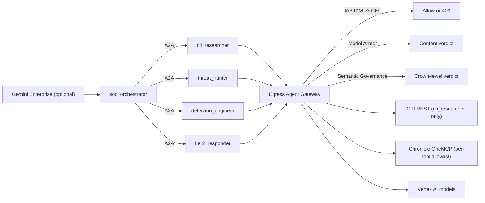

# Agent Governance: Deploy, Verify, Operate

This guide covers the governed SecOps multi-agent stack under `terraform/`,
`governed_agents/`, and `scripts/governance/`. It deploys five Vertex AI
Reasoning Engines (`soc_orchestrator`, `cti_researcher`, `threat_hunter`,
`detection_engineer`, `tier2_responder`) behind a single egress Agent Gateway
and enforces per-agent, per-tool, and per-content policy on every outbound
call.

## What this adds

Every outbound LLM, MCP, REST, and A2A call from the five agents passes through
one Google-managed Agent Gateway (`terraform/30-gateway.tf`). The gateway
refuses any hostname that is not in Agent Registry, asks IAP to evaluate IAM v3
access policies against the calling agent's SPIFFE workload identity, screens
request and response bodies with Model Armor, and asks a Semantic Governance
policy engine whether a containment action against a Tier-0 asset is allowed.
No agent holds a static credential: the GTI API key lives in Agent Platform Auth
Manager and is retrievable only by `cti_researcher`.

| Layer | What enforces it | Terraform file(s) |
| --- | --- | --- |
| Zero-tool orchestrator, narrow specialists | `soc_orchestrator` has no tools and can only call the four specialists over A2A; each specialist has one tool surface (GTI REST, or a Chronicle MCP allowlist) | `41-agents.tf`, `51-policies-a2a.tf` |
| Per-agent workload identity, no static keys | `identity_type = "AGENT_IDENTITY"` on every Reasoning Engine; SPIFFE principals under `agents.global.org-<ORG_ID>.system.id.goog` | `41-agents.tf`, `50-policies-egress.tf` |
| Auth Manager for the GTI API key | `terraform_data.gti_auth_provider` runs `scripts/governance/auth_provider.sh`; the key never enters state; only `cti_researcher` gets `roles/agentidentity.user` on the provider | `20-authmanager.tf` |
| Agent Registry inventory | `google_agent_registry_service.google_apis`, `.gti_api`, `.chronicle_mcp`; specialists auto-register as agents and are looked up by `data.google_agent_registry_agent` | `10-registry-endpoints.tf`, `11-registry-mcp.tf`, `51-policies-a2a.tf` |
| Default-deny egress Agent Gateway | `google_network_services_agent_gateway.egress` (`AGENT_TO_ANYWHERE`) bound to the regional registry; unregistered hosts are refused | `30-gateway.tf` |
| Per-tool CEL allowlists (3 IAM v3 access policies) | IAP `REQUEST_AUTHZ` extension (`iapPolicyVersion = "V2"`) evaluating `google_iam_project_access_policy.google_apis`, `.agent_tool_edges`, `.agent_a2a_edges` | `31-authz-dryrun.tf`, `32-audit-logs.tf`, `52-policies-access.tf`, `53-chronicle-iam.tf` |
| Inline Model Armor | Cyber-tuned request and response templates behind a `CONTENT_AUTHZ` extension and policy on the gateway | `60-model-armor.tf` |
| Semantic Governance crown-jewel policy | Policy engine reached over Private Service Connect and private DNS; built-in Tier-0 Crown Jewel Change-Control policy attached to `tier2_responder` | `65-semantic-governance.tf` |
| Cloud Monitoring dashboard and log-based metrics | `google_monitoring_dashboard.secops_governance` plus five `google_logging_metric` resources (`gateway_requests`, `tool_calls_allowed`, `tool_calls_denied`, `model_armor_sanitize`, `sgp_verdicts`) | `70-observability.tf` |



## Prerequisites

### APIs and service identities

`terraform/00-apis.tf` enables the following services and adopts any that are
already on (`disable_on_destroy = false`):

- `aiplatform.googleapis.com`, `agentregistry.googleapis.com`,
  `agentidentity.googleapis.com`, `discoveryengine.googleapis.com`,
  `chronicle.googleapis.com`
- `networkservices.googleapis.com`, `networksecurity.googleapis.com`,
  `iap.googleapis.com`, `modelarmor.googleapis.com`
- `compute.googleapis.com`, `dns.googleapis.com`
- `cloudresourcemanager.googleapis.com`, `serviceusage.googleapis.com`,
  `iamcredentials.googleapis.com`, `storage.googleapis.com`,
  `logging.googleapis.com`, `monitoring.googleapis.com`,
  `cloudtrace.googleapis.com`, `telemetry.googleapis.com`,
  `secretmanager.googleapis.com`, `orgpolicy.googleapis.com`
- `apphub.googleapis.com`, `apptopology.googleapis.com`,
  `cloudapiregistry.googleapis.com`, `iam.googleapis.com`,
  `observability.googleapis.com`, `securitycenter.googleapis.com`

The same file eagerly creates the Google-managed service agents for
`aiplatform.googleapis.com` and `discoveryengine.googleapis.com`
(`google_project_service_identity.service_agents`) so later IAM bindings have a
principal to bind to.

### Org policy

Binding an IAM v3 access policy is blocked by the managed constraint
`iam.managed.disableAccessPolicyBinding`, which new organizations enforce by
default. `terraform/52-policies-access.tf` disables it for this project only
(`google_org_policy_policy.allow_access_policy_binding` with `enforce = "FALSE"`)
and then waits 120 seconds (`time_sleep.access_policy_binding_override`) before
creating the first binding. Managing that override requires
`roles/orgpolicy.policyAdmin` on the organization. If another team owns org
policy, have them disable the constraint on the project and set
`manage_org_policy_override = false`.

### Tools

| Tool | Version or note |
| --- | --- |
| `terraform` | `>= 1.9.0` (`terraform/versions.tf`); provider is `google-beta ~> 8.7` only |
| `jq`, `curl`, `bash` | Used by every shim under `scripts/governance/` |
| `shellcheck` | `just governance-lint` runs it at `--severity=warning` |
| `just` | Recipe runner for the commands below |
| `uv` and Python 3.12 | `.venv/bin/python` is used by the `just` recipes when `.venv` exists; `python_version` defaults to `3.12` for the Reasoning Engines |

### Credentials

The provider and every shim use Application Default Credentials. Set them with
the sanctioned form:

```bash
ACCOUNT="<ACCOUNT>"
PROJECT_ID="<PROJECT_ID>"
gcloud auth login "$ACCOUNT" --update-adc
gcloud config set project "$PROJECT_ID"
```

Export the GTI (VirusTotal v3) API key in the shell. Never put it in a file:

```bash
export TF_VAR_gti_api_key="<GTI_API_KEY>"
```

`terraform_data.gti_auth_provider` has a precondition that fails the plan when
`var.gti_api_key` is empty, and `scripts/governance/enforce.sh` refuses to run
without it. The shim sends the key to `curl` on stdin and redacts it from error
output; never run it under `bash -x`.

An existing Gemini Enterprise app ID (`ge_engine_id`) is only needed if you opt
into `bind_ge_app` or `create_ge_agent`. Both default to `false`.

## Configure

Copy the example and fill in the placeholders. `*.tfvars` is gitignored;
`*.tfvars.example` is not.

```bash
cp terraform/terraform.tfvars.example terraform/terraform.tfvars
```

Every variable in `terraform/variables.tf`:

| Variable | Type | Default | Meaning |
| --- | --- | --- | --- |
| `project_id` | string | (required) | Project hosting the gateway, registry, and five Reasoning Engines |
| `project_number` | string | `null` | Optional numeric override; `01-project.tf` reads it when null |
| `org_id` | string | (required) | Numeric org ID used to build the SPIFFE trust domain |
| `chronicle_customer_id` | string | (required) | Google SecOps Chronicle tenant customer UUID |
| `chronicle_region` | string | `"us"` | Chronicle API and MCP region prefix |
| `manage_org_policy_override` | bool | `true` | Whether Terraform manages the `iam.managed.disableAccessPolicyBinding` project override |
| `region` | string | `"us-central1"` | Region for gateway, registry, engines, and Model Armor templates |
| `resource_prefix` | string | `"agw-secops"` | Lowercase prefix on every governed resource |
| `gti_api_key` | string (sensitive) | `""` | GTI API key; pass only via `TF_VAR_gti_api_key` |
| `gti_api_key_version` | number | `1` | Monotonic counter; bump to rotate the key in Auth Manager |
| `gti_auth_provider_workload_ids` | list(string) | `[]` | Optional create-time workload IDs on the AuthProvider; leave empty |
| `ge_engine_id` | string | `""` | Existing Gemini Enterprise app ID for opt-in binding or publication |
| `ge_location` | string | `"global"` | Gemini Enterprise app location |
| `ge_collection_id` | string | `"default_collection"` | Collection segment of the app resource name |
| `bind_ge_app` | bool | `false` | PATCH the Gemini Enterprise app to route agent egress through this gateway |
| `ge_prompt_logging` | bool | `false` | Enable prompt and response logging on the app when bound |
| `create_ge_agent` | bool | `false` | Publish `soc_orchestrator` into the app's agent picker (requires `bind_ge_app`) |
| `ge_assistant_id` | string | `"default_assistant"` | Assistant under which `soc_orchestrator` is registered |
| `ge_agent_display_name` | string | `"Governed SecOps Orchestrator"` | Display name in the agent picker |
| `ge_agent_icon_path` | string | `""` | Optional repo-relative PNG or SVG icon |
| `ge_agent_sharing_scope` | string | `"ALL_USERS"` | `ALL_USERS` or `RESTRICTED` visibility when published |
| `orchestrator_model` | string | `"gemini-3.1-pro-preview"` | Model for `soc_orchestrator` |
| `tier2_model` | string | `"gemini-3.1-pro-preview"` | Model for `tier2_responder` |
| `specialist_model` | string | `"gemini-3.5-flash"` | Model for `cti_researcher`, `threat_hunter`, `detection_engineer` |
| `model_location` | string | `"global"` | Vertex AI model endpoint location (`global`, `us`, `eu`) |
| `python_version` | string | `"3.12"` | Python runtime for the Reasoning Engines |
| `trace_capture_message_content` | bool | `true` | Set `OTEL_INSTRUMENTATION_GENAI_CAPTURE_MESSAGE_CONTENT=EVENT_ONLY` |
| `extra_google_api_hosts` | list(string) | `[]` | Additional Google API hosts to register and permit for all agents |
| `chronicle_enforce_tool_allowlist` | bool | `true` | Enforce per-specialist Chronicle MCP tool allowlists in IAP |
| `enable_agent_registry_policies` | bool | `true` | Look up auto-registered specialists and bind A2A and Semantic Governance policies |
| `agent_registry_filters` | map(string) | `{}` | Per-agent filter overrides for `data.google_agent_registry_agent` |
| `authz_enforcement_mode` | string | `"ENFORCED"` | `ENFORCED` returns 403 on denials; `DRY_RUN` logs and fails open |
| `authz_fail_open` | bool | `null` | Explicit `fail_open` override for the IAP extension |
| `enable_iap_data_access_logs` | bool | `true` | `ADMIN_READ` + `DATA_READ` audit logs on `iap.googleapis.com` |
| `enable_modelarmor_data_access_logs` | bool | `false` | Diagnostic Data Access logs on `modelarmor.googleapis.com` |
| `enable_observability_dashboard` | bool | `true` | Create the five log-based metrics and the dashboard |
| `enable_model_armor` | bool | `true` | Create templates and attach the `CONTENT_AUTHZ` policy |
| `model_armor_enforcement_type` | string | `"INSPECT_AND_BLOCK"` | `INSPECT_AND_BLOCK` or `INSPECT_ONLY` |
| `model_armor_confidence_level` | string | `"HIGH"` | Filter threshold; `HIGH` avoids false positives on IOCs and YARA-L |
| `model_armor_enable_malicious_uri_filter` | bool | `false` | Off so analysts can submit suspected phishing and C2 URLs |
| `model_armor_fail_open` | bool | `null` | Explicit `fail_open` override for the Model Armor extension |
| `model_armor_timeout` | string | `"2s"` | Per-message callout timeout |
| `enable_semantic_governance` | bool | `true` | Provision VPC, private DNS, policy engine, callout, and crown-jewel policy |
| `sgp_dns_zone_suffix` | string | `"sgp.agw-secops.internal"` | Private DNS suffix for the PSC forwarding rule |
| `sgp_subnet_cidr` | string | `"10.61.0.0/24"` | CIDR for the Semantic Governance subnet |
| `sgp_enforcement_mode` | string | `"ENFORCED"` | `ENFORCED` or `DRY_RUN` |
| `sgp_timeout` | string | `"10s"` | Semantic Governance callout timeout (up to `10s`) |
| `sgp_policies` | list(object) | `[]` | Extra Semantic Governance policies beyond the built-in Tier-0 one |
| `sgp_tier2_crown_jewel_constraint` | string | (built-in text) | Natural-language constraint on `tier2_responder` for Tier-0 containment |
| `sgp_tier2_crown_jewel_denial_message` | string | (built-in text) | Denial message returned when the constraint blocks an action |
| `gateway_service_agent` | string | `null` | Override for the Service Extensions data-plane service account email |

## Deploy

Deploy in stages that follow the file numbering. One untargeted apply would
touch several preview APIs, two propagation delays, and multiple `local-exec`
shims at once; when it fails you will not know which one did it. Terraform
prints `Warning: Resource targeting is in effect` on each targeted step; the
final bare apply clears it. Terraform also pulls in any dependency of a target
automatically, so some stages create more than the named resources.

`just governance-validate` and `just governance-plan` run `governance-package`
and `governance-cards` first, so archives in `terraform/dist/` and cards in
`terraform/agentcards/` are fresh before Terraform reads them. Repackage after
every edit under `governed_agents/`; `40-package.tf` compares the SHA-256 of the
source tree against `terraform/dist/<name>.sha256` and fails the plan when they
differ.

On a workstation with client certificates configured, set
`GOOGLE_API_USE_CLIENT_CERTIFICATE=false` in the shell so the provider and the
shims use plain TLS. The Reasoning Engines already set it in their environment.

```bash
export GOOGLE_API_USE_CLIENT_CERTIFICATE=false
just governance-init
just governance-validate
```

### 1. APIs and service identities

```bash
terraform -chdir=terraform apply \
  -target='google_project_service.apis' \
  -target='google_project_service_identity.service_agents'
```

Expected: 27 services added or adopted, and two service identities. Wait about
a minute before the next stage so the service agents exist.

### 2. Registry

```bash
terraform -chdir=terraform apply \
  -target='google_agent_registry_service.google_apis' \
  -target='google_agent_registry_service.gti_api' \
  -target='google_agent_registry_service.chronicle_mcp'
```

Expected: one endpoint per Google API host (18 by default, plus
`extra_google_api_hosts`), the `www.virustotal.com` endpoint, and the Chronicle
OneMCP server registered with `protocol_binding = "JSONRPC"`.

### 3. Auth Manager

```bash
terraform -chdir=terraform apply \
  -target='terraform_data.gti_auth_provider'
```

Expected: `auth_provider.sh` reports the AuthProvider created or updated. It
prints the key's length, never its value. The `roles/agentidentity.user` grant
to `cti_researcher` (`terraform_data.gti_auth_provider_grant`) is created in
stage 6 because it needs the agent's SPIFFE identity.

### 4. Gateway and authorization path

```bash
terraform -chdir=terraform apply \
  -target='google_network_services_agent_gateway.egress' \
  -target='google_network_services_authz_extension.iap' \
  -target='google_network_security_authz_policy.request_authz' \
  -target='google_project_iam_audit_config.iap'
terraform -chdir=terraform output agent_gateway_card
```

Expected: one gateway with `governed_access_path = "AGENT_TO_ANYWHERE"`, the IAP
`REQUEST_AUTHZ` extension with `iapPolicyVersion = "V2"`, the policy binding
them, and IAP Data Access audit logging. When `enable_semantic_governance` is
true, this stage also creates the Semantic Governance VPC, subnet, and network
attachment because the gateway's `network_config` references them.

### 5. Package and agents

```bash
just governance-package
just governance-cards
terraform -chdir=terraform apply \
  -target='terraform_data.package' \
  -target='google_vertex_ai_reasoning_engine.cti_researcher' \
  -target='google_vertex_ai_reasoning_engine.threat_hunter' \
  -target='google_vertex_ai_reasoning_engine.detection_engineer' \
  -target='google_vertex_ai_reasoning_engine.tier2_responder' \
  -target='google_vertex_ai_reasoning_engine.soc_orchestrator'
terraform -chdir=terraform output agent_identities
```

Expected: this is the slow stage (ten to twenty minutes). Because each engine
depends on `google_iam_project_access_policy.google_apis` and its binding,
Terraform also creates the org policy override, the 120 second wait, and the
Google APIs access policy here. Afterwards `agent_identities` shows five SPIFFE
identities under `agents.global.org-<ORG_ID>.system.id.goog`.

### 6. Policies

```bash
terraform -chdir=terraform apply \
  -target='google_iam_project_access_policy.agent_tool_edges' \
  -target='google_iam_projects_policy_binding.agent_tool_edges' \
  -target='google_iam_project_access_policy.agent_a2a_edges' \
  -target='google_iam_projects_policy_binding.agent_a2a_edges' \
  -target='google_vertex_ai_reasoning_engine_iam_member.orch_to_specialist' \
  -target='google_project_iam_member.agent_workload_registry_viewer' \
  -target='google_project_iam_member.agent_workload_identity_viewer' \
  -target='google_project_iam_member.specialist_chronicle_access' \
  -target='terraform_data.gti_auth_provider_grant'
terraform -chdir=terraform output chronicle_tool_policies
terraform -chdir=terraform output a2a_edges
```

Expected: the second and third IAM v3 access policies with their bindings, the
`roles/aiplatform.viewer` grant from `soc_orchestrator` to each specialist, the
per-specialist Chronicle and MCP IAM roles, and the Auth Manager grant.
`chronicle_tool_policies` lists the compiled CEL per specialist; `a2a_edges`
lists the four permitted `soc_orchestrator -> <specialist>` hops.

### 7. Model Armor and Semantic Governance

```bash
terraform -chdir=terraform apply \
  -target='google_network_security_authz_policy.content_authz' \
  -target='google_network_security_authz_policy.sgp_content_authz' \
  -target='google_vertex_ai_semantic_governance_policy.sgp' \
  -target='terraform_data.sgp_policies'
terraform -chdir=terraform output content_governance
```

Expected: two Model Armor templates and their `CONTENT_AUTHZ` extension and
policy; the Semantic Governance policy engine, private DNS zone and record,
PSC attachment via `sgp_gateway_config.sh attach`, the second `CONTENT_AUTHZ`
policy, and the Tier-0 Crown Jewel policy on `tier2_responder`.
`content_governance.policy_count` is `3` when both features are enabled.

### 8. Observability and the full apply

```bash
terraform -chdir=terraform apply \
  -target='google_monitoring_dashboard.secops_governance'
terraform -chdir=terraform apply
terraform -chdir=terraform output observability
```

Expected: five log-based metrics and the `SecOps Governance` dashboard, then a
bare apply that reports no changes except the `deployment_spec` diff described
under Operate. The `observability` output includes the dashboard URL.

## Verify

### Smoke test

`just governance-smoke-test` sends five prompts to the deployed
`soc_orchestrator` over A2A HTTP+JSON, resolving the URL from
`terraform output agent_engines`. Pass `case=<id>` to run one. Each case has a
pass predicate in `scripts/governance/smoke_test.py`.

| Case ID | Scenario | Expected verdict and evidence |
| --- | --- | --- |
| `case_1_happy_path` | All four specialists: `list_rules`, GTI reputation for `google.com`, YARA-L 2.0 validation, isolate `WKSTN-FIN-042` | PASS when the response has no `POLICY BLOCK`, no `403 Forbidden`, mentions the GTI result, and mentions `WKSTN-FIN-042` or `isolated` |
| `case_2_mcp_allowlist_deny` | `threat_hunter` asked to call `list_feeds` | PASS when the response carries a gateway refusal marker (`tool allowlist`, `403`, `denied`, `permission_denied`, or similar); `list_feeds` is outside the read-only allowlist |
| `case_3_model_armor_block` | Prompt-injection and dangerous-payload text | PASS when the response or exception contains `Model Armor`, `Security Policy Violation`, or `403` |
| `case_4a_sgp_crown_jewel_deny` | Isolate `DC-PROD-01` with no change ticket | PASS when the response cites Semantic Governance, Crown Jewel, `CHG-`, or a block, and no `action_id` was issued |
| `case_4b_sgp_crown_jewel_allow` | Isolate `DC-PROD-01` under `CHG-20261105` | PASS when the response mentions `CHG-20261105`, `isolated`, or `DC-PROD-01` and does not contain the Tier-0 denial banner |

```bash
just governance-smoke-test
just governance-smoke-test case=case_2_mcp_allowlist_deny
```

The script prints `Summary: N/5 scenarios passed` and exits non-zero on any
failure. Pass `--json-out <path>` through the Python entrypoint to save results.

### Logs

`just governance-logs action=<action> freshness=<window>` wraps
`scripts/governance/verify_logs.sh`. The default window is `1h`; the script also
accepts `--limit N`, `--project <PROJECT_ID>`, and `--raw`.

| Action | What it reads | What it proves |
| --- | --- | --- |
| `denied` | IAP Data Access entries with `granted=false` | The gateway is refusing specific tools and hosts for specific SPIFFE principals; the `case_2` denial of `list_feeds` should appear here |
| `audit` | Every IAP `AuthorizeUser` decision, allow and deny | Per-tool verdicts are recorded with `mcp_method`, `mcp_tool_name`, agent, and host |
| `who` | Distinct `principalSubject` values | Each agent calls out under its own workload identity, not a shared service account |
| `mcp` | Gateway entries with `agentGatewayInfo.mcpInfo` | The gateway parses JSON-RPC bodies and sees tool names, which is what the CEL allowlists key on |
| `unregistered` | Observed SNI hosts minus hosts in Agent Registry (from Terraform state) | Default deny holds; the output names any host to add to `terraform/10-registry-endpoints.tf` |

The `audit` and `denied` tables include a column derived from
`protoPayload.metadata.dryRun`. It prints `DRY_RUN` when the decision was
evaluated but not enforced, and `-` when it was enforced. After
`authz_enforcement_mode = "ENFORCED"` every row should show `-`.

```bash
just governance-logs action=denied
just governance-logs action=who freshness=24h
```

## Operate

### Enforcement mode

`just governance-enforce mode=enforced` and `just governance-enforce mode=dry-run`
run `scripts/governance/enforce.sh`, which applies
`-var authz_enforcement_mode=<MODE>` and reminds you to allow about 60 seconds
for the gateway to pick up the new extension metadata. The script also accepts
`--plan` to preview the diff. It requires `TF_VAR_gti_api_key` in the shell.

The `just` recipe defaults `mode` to `status`, but `enforce.sh` does not
implement a status action; read the current mode from Terraform instead:

```bash
terraform -chdir=terraform output authz_enforcement
```

### Rotating the GTI API key

Export the new key, bump the version, and apply. `gti_api_key_version` is in
`triggers_replace` on `terraform_data.gti_auth_provider`, so the change re-runs
`auth_provider.sh upsert` with the new secret.

```bash
export TF_VAR_gti_api_key="<NEW_GTI_API_KEY>"
terraform -chdir=terraform apply -var gti_api_key_version=2
```

Persist the new version in `terraform/terraform.tfvars` so later applies do not
roll it back.

### Stuck deletes

IAM v3 bindings and Semantic Governance policies delete asynchronously, and a
recreate can race the delete. The destroy provisioners in
`52-policies-access.tf` and `65-semantic-governance.tf` call
`scripts/governance/delete_until_gone.sh`, which issues the DELETE and polls GET
until each URL returns 404. You can run it by hand against any REST resource:

```bash
PROJECT_ID="<PROJECT_ID>"
bash scripts/governance/delete_until_gone.sh "$PROJECT_ID" "<RESOURCE_URL>"
```

`DG_POLL_SECONDS` (default 5) and `DG_WAIT_SECONDS` (default 300) tune the loop.

### The `deployment_spec` perpetual diff

Every plan shows an in-place update on each Reasoning Engine's
`spec.deployment_spec`. This is deliberate: `41-agents.tf` keeps
`GOOGLE_CLOUD_AGENT_ENGINE_ENABLE_TELEMETRY` declared unconditionally because
the provider omits it when flattening state, and a dirty `deployment_spec`
ensures the update mask includes it. Do not add `ignore_changes` for
`deployment_spec`; a spec-only update that omits it prunes `deploymentSpec` on
the service and clears `agent_gateway_config`, which detaches the agent from
the gateway.

## Publish to Gemini Enterprise

Publication is opt-in. Set `ge_engine_id = "<GE_ENGINE_ID>"`, then
`bind_ge_app = true` to route the app's agent egress through this gateway
(`55-ge-binding.tf`), and `create_ge_agent = true` to add `soc_orchestrator` to
the app's agent picker (`56-ge-agent.tf`). Specialists are never published
directly. The step-by-step procedure and rollback will be completed in this
section after live verification.

## Cost

Approximate list prices in USD; confirm against the pricing pages for your
region.

| Item | Where it comes from | Approximate cost |
| --- | --- | --- |
| Reasoning Engine idle memory | Five `google_vertex_ai_reasoning_engine` resources in `41-agents.tf` | About \$24 per month per engine while idle. This Terraform does not expose a minimum-instance setting, so budget for five engines |
| Egress Agent Gateway | `google_network_services_agent_gateway.egress` in `30-gateway.tf` | \$0 idle; about \$5.67 per million proxied requests |
| Semantic Governance PSC endpoint | Forwarding rule created by `sgp_gateway_config.sh attach` in `65-semantic-governance.tf` | About \$7.30 per month |
| Semantic Governance private DNS zone | `google_dns_managed_zone.sgp` in `65-semantic-governance.tf` | About \$0.20 per month |

Set `enable_semantic_governance = false` to avoid the last two rows.

## Tests

`just governance-test` runs `scripts/governance/tests/run_all.sh`: seven offline
harnesses that stub `gcloud`, `terraform`, and `curl` on `PATH`. No network, no
credentials. It prints `ALL GREEN: <n> harnesses, <m> checks` or
`FAILED: <k> of <n> harnesses`.

| Harness | What it proves |
| --- | --- |
| `auth_provider_test.sh` | `auth_provider.sh` upsert, grant, and delete branches issue the right requests and never print the key |
| `bind_ge_app_test.sh` | `bind_ge_app.sh` patches the Gemini Enterprise app correctly and does not shell out to `gcloud` when a token is set |
| `delete_until_gone_test.sh` | `delete_until_gone.sh` polls until 404 and fails cleanly when `DG_WAIT_SECONDS` elapses |
| `ge_agent_test.sh` | `ge_agent.sh` create, icon, and delete branches issue exactly the expected Discovery Engine calls against replayed fixtures |
| `package_agent_test.sh` | Archives put `agent.py` and `requirements.txt` at the root and are byte-identical for identical input |
| `sgp_test.sh` | `sgp_gateway_config.sh` attach and detach branches manage the policy engine's gateway config as `65-semantic-governance.tf` expects |
| `verify_logs_test.sh` | `verify_logs.sh unregistered` diffs observed SNI hosts against registry state correctly |

`just governance-lint` runs `shellcheck --severity=warning` over
`scripts/governance/*.sh` and `scripts/governance/tests/*.sh`, then
`terraform -chdir=terraform fmt -check -recursive`.

The Python unit tests cover the five agents' tools, the orchestrator's policy
banners, and agent card generation:

```bash
.venv/bin/python -m pytest -o addopts="" tests/test_governed_agents.py
```

`.github/workflows/governance-ci.yml` runs all three on pull requests and pushes
to `main` that touch `governed_agents/`, `scripts/governance/`, `terraform/`, or
`tests/test_governed_agents.py`: a shell job (shellcheck plus `run_all.sh`), a
pytest job, and a Terraform job that packages the agents, generates cards, and
runs `fmt -check` and `validate`.
