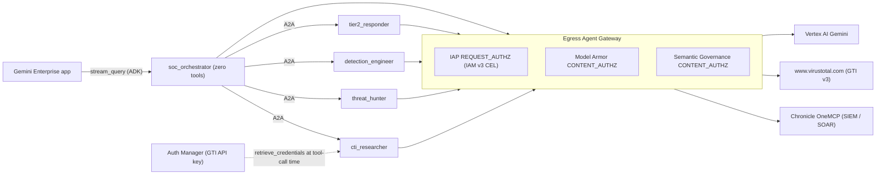
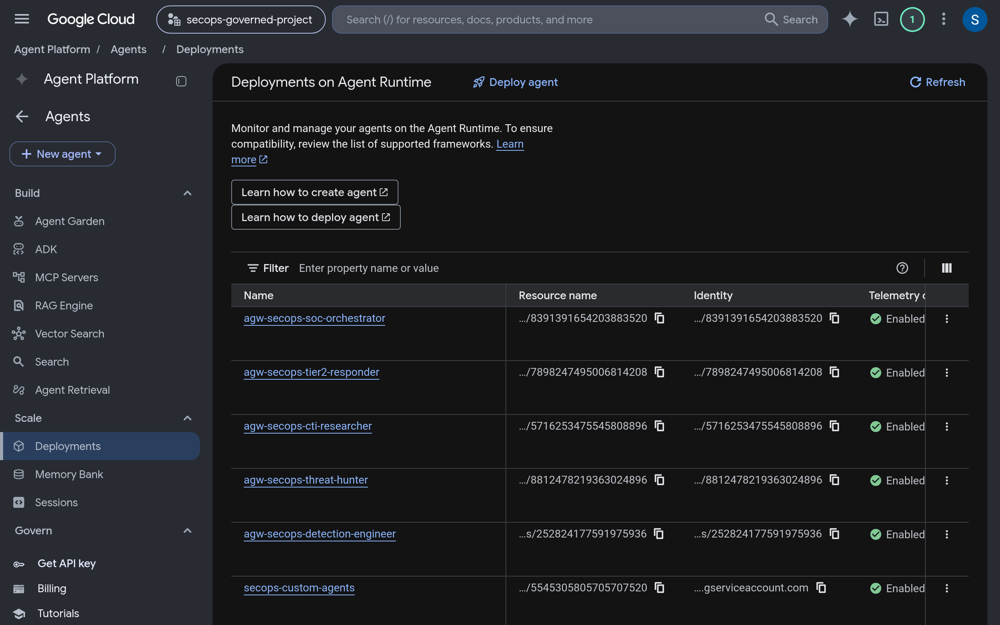
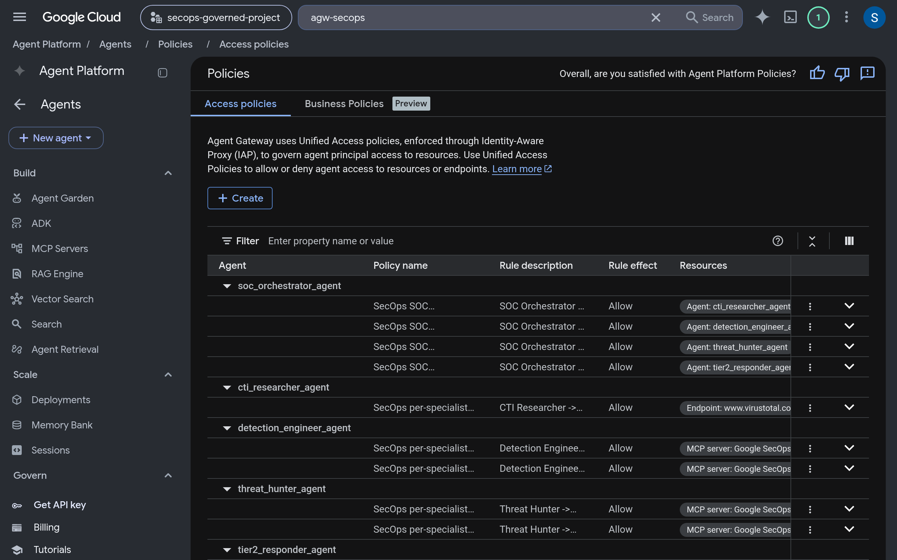
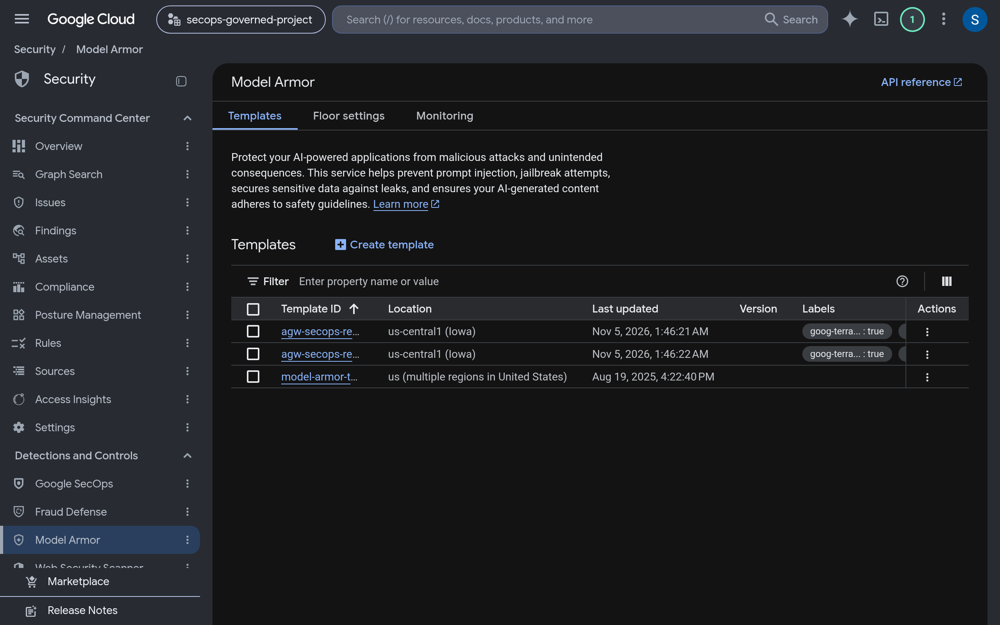
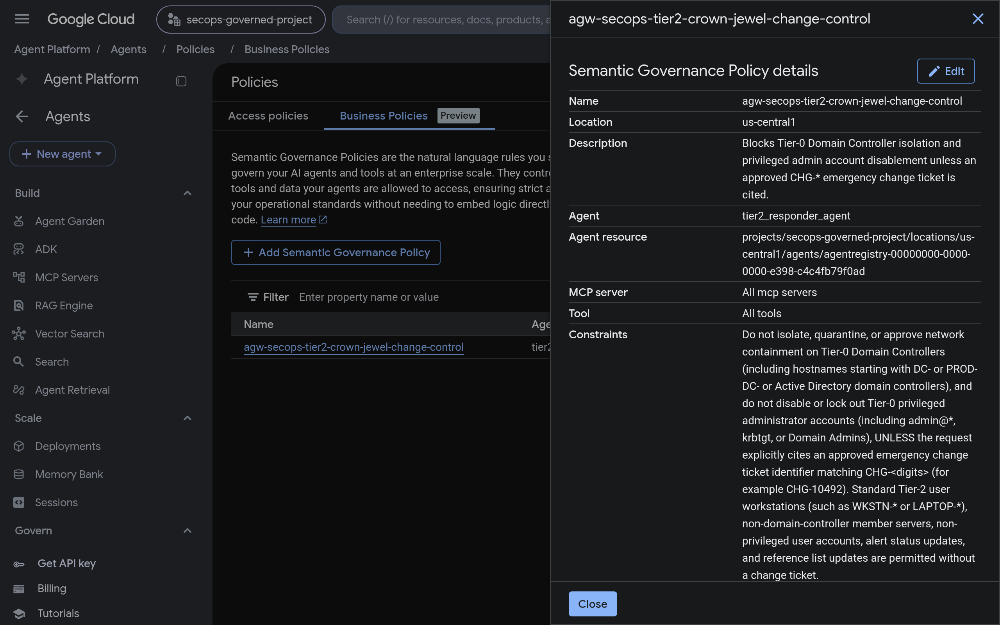

# Agent governance design notes

Why the governed deployment under `terraform/` and `governed_agents/` is shaped the way it is.
[agent_governance.md](agent_governance.md) is the deploy path;
[agent_governance_troubleshooting.md](agent_governance_troubleshooting.md) is what to do when a step fails.

## Architecture

Five Reasoning Engines run under Agent Identity. `soc_orchestrator` has no tools of its own: its
only tools are four `AgentTool` wrappers around `RemoteA2aAgent` peers, so every action it takes is
an A2A call to a specialist. Each specialist owns one narrow capability. All outbound traffic from
all five engines (model calls, A2A, Chronicle MCP, GTI REST, credential retrieval, telemetry) leaves
through one egress Agent Gateway (`30-gateway.tf`, `governed_access_path = "AGENT_TO_ANYWHERE"`)
that refuses any hostname not registered in Agent Registry.



Three controls act on a single tool call and they are not interchangeable. IAP reads the SPIFFE
principal and the registry attributes of the destination and answers *may this identity reach this
resource, including this tool on it*. Model Armor and Semantic Governance read the body. Auth
Manager is not a check: it supplies the GTI key that a `cti_researcher` call needs, and it supplies
it to the agent process, not at the gateway. The A2A hop from `soc_orchestrator` to a specialist
also crosses the gateway, so the orchestrator cannot reach a specialist, and a specialist cannot
reach a peer, unless an IAM v3 rule names that edge.

## Every edge, and the Terraform that creates it

Every row below is an explicit grant. Anything not listed is denied by the gateway's default-deny
posture; there is no wildcard rule anywhere.

| Edge | Who may call | Policy / resource | CEL attribute used |
|---|---|---|---|
| any agent -> Google API infrastructure hosts (regional `aiplatform`, `discoveryengine`, `agentregistry`, `modelarmor`; global `aiplatform`, `agentidentity`, `agentidentitycredentials`, `iamcredentials`, `oauth2`, `logging`, `monitoring`, `cloudtrace`, `telemetry`, and the rest of `google_api_hosts_global`) | `principalSet://.../attribute.container/projects/<PROJECT_NUMBER>` (every agent identity in the project) | `google_iam_project_access_policy.google_apis` in `52-policies-access.tf`; endpoints registered by `google_agent_registry_service.google_apis` in `10-registry-endpoints.tf`; chunked five endpoints per rule | `destination.agent_registry.endpoint.name == '<endpoint>' \|\| ...` |
| `cti_researcher` -> `https://www.virustotal.com` | `cti_researcher` principal only | rule `cti_gti` in `google_iam_project_access_policy.agent_tool_edges`; endpoint `google_agent_registry_service.gti_api` (`HTTP_JSON`) | `destination.agent_registry.endpoint.name == '<gti endpoint>'` |
| `threat_hunter` -> Chronicle MCP, read-only hunt tools (`udm_search`, `search_raw_logs`, `translate_udm_query`, `list_security_alerts`, `get_security_alert`, `fetch_alert_data`, `search_entity`, `summarize_entity`, `get_ioc_match`, `list_rules`, `get_rule`, `list_rule_detections`) | `threat_hunter` principal | rules `threat_hunter_mcp_1`, `threat_hunter_mcp_2` in `agent_tool_edges`; list in `threat_hunter_allowed_tools` (`50-policies-egress.tf`); server `google_agent_registry_service.chronicle_mcp` (`JSONRPC`, `11-registry-mcp.tf`) | `destination.agent_registry.mcp_server.name == '<server>' && (destination.agent_registry.mcp_server.tool.name in [...] \|\| destination.agent_registry.mcp_server.method == 'tools/list')` on chunk 1; `tool.name in [...]` alone on chunk 2 |
| `detection_engineer` -> Chronicle MCP, YARA-L 2.0 validation and coverage tools (`validate_rule`, `list_rules`, `get_rule`, `list_rule_detections`, `list_rule_errors`, `evaluate_rule_coverage`, `generate_synthetic_events`, `udm_search`, `translate_udm_query`, `get_reference_list`, `list_log_types`) | `detection_engineer` principal | rules `detection_engineer_mcp_1`, `detection_engineer_mcp_2`; list `detection_engineer_allowed_tools` | same shape as above |
| `tier2_responder` -> Chronicle MCP, alert and reference-list tools (`list_security_alerts`, `get_security_alert`, `update_security_alert`, `fetch_alert_data`, `search_entity`, `summarize_entity`, `get_ioc_match`, `udm_search`, `get_reference_list`, `create_reference_list`, `update_reference_list`) | `tier2_responder` principal | rules `tier2_responder_mcp_1`, `tier2_responder_mcp_2`; list `tier2_responder_allowed_tools` | same shape as above |
| `soc_orchestrator` -> `cti_researcher` (A2A) | `soc_orchestrator` principal | rule `orch_to_cti_researcher` in `google_iam_project_access_policy.agent_a2a_edges`; agent resolved by `data.google_agent_registry_agent.cti_researcher` (`51-policies-a2a.tf`) | `destination.agent_registry.agent.name == 'projects/<PROJECT_ID>/locations/<REGION>/agents/<agent_id>'` |
| `soc_orchestrator` -> `threat_hunter` (A2A) | `soc_orchestrator` | rule `orch_to_threat_hunter` | `destination.agent_registry.agent.name == ...` |
| `soc_orchestrator` -> `detection_engineer` (A2A) | `soc_orchestrator` | rule `orch_to_detection_engineer` | `destination.agent_registry.agent.name == ...` |
| `soc_orchestrator` -> `tier2_responder` (A2A) | `soc_orchestrator` | rule `orch_to_tier2_responder` | `destination.agent_registry.agent.name == ...` |
| `soc_orchestrator` -> each specialist engine (Vertex AI IAM, needed to invoke the A2A surface) | `soc_orchestrator` | `google_vertex_ai_reasoning_engine_iam_member.orch_to_specialist` (`roles/aiplatform.viewer`, per engine) | not CEL; resource-scoped IAM |
| `cti_researcher` -> GTI key in Auth Manager | `cti_researcher` | `terraform_data.gti_auth_provider_grant` (`roles/agentidentity.user` on one AuthProvider, `20-authmanager.tf`) | not CEL; resource-scoped IAM |
| specialists -> Chronicle tenant (backing roles the MCP server checks) | `threat_hunter`, `detection_engineer`: `roles/mcp.toolUser` + `roles/chronicle.viewer`; `tier2_responder`: `roles/mcp.toolUser` + `roles/chronicle.editor` | `google_project_iam_member.specialist_chronicle_access` (`53-chronicle-iam.tf`) | not CEL; project IAM per principal |
| Gemini Enterprise app -> gateway | Discovery Engine service agent | `google_project_iam_custom_role.ge_agent_gateway` + `terraform_data.ge_binding` -> `scripts/governance/bind_ge_app.sh` (`55-ge-binding.tf`) | shim |
| `cti_researcher` or `soc_orchestrator` -> Chronicle MCP | nothing | no rule, no Chronicle IAM role | denied |
| `threat_hunter` -> `list_feeds`, `create_rule`, `delete_feed`, `create_reference_list`, `execute_manual_action` | nothing | left out of `threat_hunter_allowed_tools` | HTTP 403 from IAP |
| specialist <-> specialist (A2A) | nothing | no rule in `agent_a2a_edges` | denied |

The registry is the governance data model: nothing can be granted that is not first registered as
an endpoint, MCP server, or agent. `10-registry-endpoints.tf` and `11-registry-mcp.tf` are that
inventory; the four specialist agents are auto-registered when their engines deploy and are looked
up by display name in `51-policies-a2a.tf`. The Chronicle MCP server is registered with
`protocol_binding = "JSONRPC"` on purpose: that is what makes the gateway parse the JSON-RPC body
and expose `mcp_server.tool.name` and `mcp_server.method` to CEL. The GTI endpoint is `HTTP_JSON`
because it is a plain REST API with no tool concept.

## Identity

Each engine is deployed with `identity_type = "AGENT_IDENTITY"` (`41-agents.tf`) and receives a
SPIFFE workload identity in the trust domain `agents.global.org-<ORG_ID>.system.id.goog`. Terraform
reads it back from `spec[0].effective_identity` and normalizes it to the IAM principal form in
`50-policies-egress.tf`:

```text
principal://agents.global.org-<ORG_ID>.system.id.goog/resources/aiplatform/projects/<PROJECT_NUMBER>/locations/<REGION>/reasoningEngines/<ENGINE_ID>
```

That string is the `principals` entry on every per-agent IAM v3 rule, the `member` on every
per-agent IAM binding, and the `principalSubject` that appears in IAP Data Access audit logs
(`terraform output agent_principals_long_form`). A precondition on every consumer
(`local.agent_identity_ok`) fails the plan if an engine's identity is not under the trust domain,
so a silently mis-deployed engine cannot end up with no policy.

The project-wide form is used exactly where every agent needs the same thing (Google API
infrastructure endpoints, `roles/agentregistry.viewer`, `roles/agentidentity.viewer`):

```text
principalSet://agents.global.org-<ORG_ID>.system.id.goog/attribute.container/projects/<PROJECT_NUMBER>
```

No service accounts are created and no service account keys exist anywhere in the stack. The
orchestrator authenticates its A2A calls with a bearer token minted from its own workload identity
(`_GoogleBearerAuth` in `governed_agents/soc_orchestrator/agent.py`); `cti_researcher` authenticates
to Auth Manager the same way.



## Three layers, three different questions

### IAP and IAM v3: may this identity call this tool?

`31-authz-dryrun.tf` attaches an IAP `REQUEST_AUTHZ` extension (`iapPolicyVersion = "V2"`) to the
gateway. On every request IAP evaluates the three `google_iam_project_access_policy` resources
bound to the project with the `iap.googleapis.com/resources.egressViaIAP` permission. The
decision is purely structural: principal, destination endpoint, agent, MCP server, tool name,
JSON-RPC method. A denial is an HTTP 403 before the request leaves the gateway, and the specialist
reports it as a `TOOL_ERROR`, which the orchestrator turns into a `[POLICY BLOCK] ... TOOL
ALLOWLIST` banner.

`var.authz_enforcement_mode` defaults to `ENFORCED`. `DRY_RUN` sets `iamEnforcementMode = "DRY_RUN"`
on the extension and derives `fail_open = true`, so denials are logged but not applied; use it only
to validate a new allowlist against real traffic.



### Model Armor: is this content dangerous?

`60-model-armor.tf` creates two templates and a `CONTENT_AUTHZ` policy that routes every
`application/json` and `text/*` body through them. The tuning is deliberate for a SOC workload:

- `pi_and_jailbreak_filter_settings` is enabled on the request template at
  `var.model_armor_confidence_level`, default `HIGH`. Prompt injection smuggled inside an alert
  description or a log line is the attack this layer exists for.
- `rai_settings` (`SEXUALLY_EXPLICIT`, `HATE_SPEECH`, `HARASSMENT`, `DANGEROUS`) runs on both
  templates, also at `HIGH`. At lower confidence, LOLBin command lines, YARA-L 2.0 rule text, and
  exploit descriptions in telemetry trip `DANGEROUS`.
- `malicious_uri_filter_settings` is off (`var.model_armor_enable_malicious_uri_filter = false`).
  Analysts submit phishing and C2 URLs for triage; blocking them defeats the purpose of
  `cti_researcher`.
- `enforcement_type` defaults to `INSPECT_AND_BLOCK` with `fail_open` derived as `false`;
  `INSPECT_ONLY` flips both for a logging-only rollout.

A Model Armor denial surfaces as an exception on the model call. The orchestrator's
`_policy_block_reason` recognizes the Model Armor markers, extracts the reason, and emits the
`[POLICY BLOCK] ... MODEL ARMOR` notice with the control name from `MODEL_ARMOR_CONTROL`.



At `HIGH` confidence, `pi_and_jailbreak` on the request template also blocks capability-enumeration
prompts (for example, `"ask tier 1 to list mcp tools and then list 10 siem rules"` or `"Please list
the MCP tools you have available to use, and then ..."`). Depending on whether the prompt hits the
orchestrator's model turn directly or is forwarded verbatim inside an A2A request to a specialist,
`agw-secops-request` blocks it with HTTP 403 (`Error: Security Policy Violation`), surfacing as the
`[POLICY BLOCK] ... MODEL ARMOR` banner or as `A2A request failed: HTTP Error 403` on the specialist
edge (`SanitizeOperation` log with `filterResults.pi_and_jailbreak` reporting `MATCH_FOUND` and
`rai` reporting `NO_MATCH_FOUND`). Rather than lowering `pi_and_jailbreak` confidence on
`60-model-armor.tf`—which would weaken inline prompt-injection protection—this deployment treats
capability-enumeration refusal as an explicit, demonstrated control
(`case_3b_model_armor_capability_enumeration` in `scripts/governance/smoke_test.py` and
`just governance-logs action=model-armor-blocked`). Legitimate analyst prompts remain task-shaped
(for example, `"list 10 SIEM detection rules"`).

### Semantic Governance: does this action match stated intent and constraints?

`65-semantic-governance.tf` provisions a dedicated VPC, a PSC network attachment, a private Cloud
DNS zone, the `google_vertex_ai_semantic_governance_policy_engine`, and a third `CONTENT_AUTHZ`
policy that routes every non-gRPC `:generateContent` and `:streamGenerateContent` call to the
engine. The engine therefore sees every model turn from all five agents. Its policies are natural
language, attached to a registered agent:

- The built-in policy `<resource_prefix>-tier2-crown-jewel-change-control` is attached to
  `tier2_responder`. Its constraint (`var.sgp_tier2_crown_jewel_constraint`) forbids isolating
  Tier-0 domain controllers or disabling Tier-0 admin accounts unless the request cites a `CHG-*`
  change ticket, and explicitly permits workstation and non-privileged actions. A denial returns
  `var.sgp_tier2_crown_jewel_denial_message`.
- `var.sgp_policies` accepts further policies, optionally scoped to MCP tools on a server.
- `var.sgp_enforcement_mode` defaults to `ENFORCED`; `DRY_RUN` sets `sgpEnforcementMode` on the
  extension. The extension is always `fail_open = false`.



In the `semantic-governance-policy` log stream, each evaluated turn records its evaluation mode in
`jsonPayload.sgpUserIntentMatchingMode`:

- `CONSTRAINTS_AND_INTENT`: used for agents that have one or more explicit
  `google_vertex_ai_semantic_governance_policy` resources attached (in this stack,
  `tier2_responder`). The engine checks both whether the proposed tool call matches the user's
  request and whether it satisfies the attached natural-language constraints.
- `INTENT_ONLY`: used for every governed agent that has no explicit policy attached
  (`soc_orchestrator`, `cti_researcher`, `threat_hunter`, `detection_engineer`). Even without a
  written policy, the engine compares each proposed tool or subagent call against the user's stated
  intent and the agent's registered description and system instructions, and blocks calls that look
  out of role before the tool request ever reaches IAP.

Inspect both modes directly in Cloud Logging (filtering on `sgpUserIntentMatchingMode:*` skips
engine pod-distribution heartbeats):

```bash
PROJECT_ID="<PROJECT_ID>"
gcloud logging read \
  'logName="projects/'"$PROJECT_ID"'/logs/semantic-governance-policy" AND jsonPayload.sgpUserIntentMatchingMode:*' \
  --project="$PROJECT_ID" --freshness=1h --limit=20 \
  --format='table(timestamp, jsonPayload.verdict, jsonPayload.sgpUserIntentMatchingMode, jsonPayload.evaluations[0].toolName, jsonPayload.agentIdentity.basename())'
```

That `INTENT_ONLY` behavior is why `threat_hunter` advertises `list_feeds` neutrally. In
`governed_agents/threat_hunter/agent.py`, `list_feeds` sits in `ADVERTISED_DENIED_TOOLS` so the
MCP toolset exposes it, and the instruction lists it under "inspecting configured Chronicle data
ingestion feeds" rather than under a forbidden mutation group (`create_rule`, `delete_feed`, and so
on). Had the prompt called `delete_feed` on a read-only hunter, `INTENT_ONLY` would deny the
`:generateContent` turn before any MCP HTTP call left the container. Advertising `list_feeds` as an
ordinary read lets `INTENT_ONLY` evaluate `ALLOW` on the model turn so the JSON-RPC `tools/call`
reaches the gateway's IAP `REQUEST_AUTHZ` layer, which deterministically denies it with HTTP 403
because `list_feeds` is excluded from `threat_hunter_allowed_tools`. The orchestrator's
`_GovernedRunner` then emits the `[POLICY BLOCK] ... TOOL ALLOWLIST` banner on both the Gemini
Enterprise and A2A paths.

## Two rules the configuration is built around

### Defaults are the deployment

Every variable default in `variables.tf` is the demo configuration: `region = "us-central1"`,
`resource_prefix = "agw-secops"`, `model_location = "global"`, `authz_enforcement_mode =
"ENFORCED"`, `chronicle_enforce_tool_allowlist = true`, `enable_model_armor = true`,
`model_armor_confidence_level = "HIGH"`, `model_armor_enable_malicious_uri_filter = false`,
`enable_semantic_governance = true`, `sgp_enforcement_mode = "ENFORCED"`,
`enable_observability_dashboard = true`. A `terraform.tfvars` only has to supply what cannot be
defaulted (`project_id`, `org_id`, `chronicle_customer_id`) plus whichever Gemini Enterprise opt-ins
apply. The one exception is the GTI key, which has a default of `""` precisely so it is never
written to a file; a precondition fails the plan when it is empty.

The opt-ins that mutate a resource Terraform did not create (`bind_ge_app`, `create_ge_agent`,
`ge_prompt_logging`) default to `false`, because a shared Gemini Enterprise app must never be
re-pointed by a default.

### Registry-wide IAM is never used

No rule grants `roles/agentregistry.*` write access, no CEL expression matches a registry location
or a prefix, and no access policy applies to "all endpoints" or "all MCP servers". Grants are per
endpoint (`endpoint.name ==`), per agent (`agent.name ==`), or per tool (`tool.name in [...]`), each
bound to one named principal. The one `principalSet://` rule is itself scoped to an explicit
enumeration of infrastructure endpoints, and a precondition on `google_apis` fails the plan if the
GTI endpoint or Chronicle MCP server ever appears in that list. Adding a capability means adding a
row to the table above, not widening an existing one.

## Which parts are shims

Where the google-beta provider has no resource, a `terraform_data` with `local-exec` provisioners
calls the REST API through a bash script under `scripts/governance/`. Each shim is idempotent
(status, create-or-adopt, delete) and owns its own destroy path.

| Shim | Terraform | Provider gap it covers |
|---|---|---|
| `auth_provider.sh` (`upsert`, `grant`, `delete`) | `terraform_data.gti_auth_provider`, `terraform_data.gti_auth_provider_grant` (`20-authmanager.tf`) | No `google_agent_identity_auth_provider` resource. Using a script also keeps the API key out of Terraform state: the key reaches the script only through the `GTI_API_KEY` environment variable and is sent to `curl` on stdin. |
| `bind_ge_app.sh` (`status`, `bind`, `unbind`) | `terraform_data.ge_binding` (`55-ge-binding.tf`) | No provider support for `agentGatewaySetting` on a Discovery Engine engine (UpdateEngine). |
| `ge_agent.sh` (`status`, `create`, `icon`, `delete`) | `terraform_data.ge_agent`, `terraform_data.ge_agent_icon` (`56-ge-agent.tf`) | No resource for the Discovery Engine v1alpha Agents API that publishes `soc_orchestrator` into the agent picker. |
| `ge_observability.sh` (`status`, `enable`, `disable`) | `terraform_data.ge_observability` (`57-ge-observability.tf`) | No resource for the engine `observabilityConfig` that turns on prompt and response logging. |
| `sgp_gateway_config.sh` (`status`, `attach`, `detach`) | `terraform_data.sgp_gateway_config` (`65-semantic-governance.tf`) | `google_vertex_ai_semantic_governance_policy_engine` exists but its `gateway_configs` (the PSC attachment the gateway dials) is not manageable; the resource uses `ignore_changes = [gateway_configs]` and the script owns that field. |
| `delete_until_gone.sh` | destroy provisioners on the three policy bindings (`52-policies-access.tf`) and on `terraform_data.sgp_policies` | IAM v3 policy-binding and Semantic Governance policy deletion is asynchronous; the script polls `GET` until 404 so a recreate does not race a pending delete. |

Everything else (registry services, gateway, authz extensions and policies, access policies and
bindings, Model Armor templates, Reasoning Engines, IAM members, log metrics, dashboard) is a native
provider resource.

## Hard limits

These are the ceilings the configuration is shaped around. Each is enforced by a `precondition` or
by construction, so breaching one fails `terraform plan` rather than producing a half-applied
policy.

| Limit | Where it bites | How the configuration stays under it |
|---|---|---|
| CEL expression at most 1024 characters | every `conditions.expression` in an `iap.googleapis.com` access policy | `google_apis` chunks infrastructure endpoints five per rule; MCP allowlists chunk nine tools per rule; preconditions assert `length(expr) <= 1024` on all three policies |
| `in [...]` list literal at most 10 elements | MCP tool allowlists | `mcp_tools_per_rule = 9`, leaving headroom; `tools/list` is attached to chunk 1 with `\|\|` rather than as a list member |
| At most 10 FGAC rules per access policy | `google_iam_project_access_policy` | Three policies instead of one: `google_apis` (infrastructure, 4 rules), `agent_tool_edges` (1 GTI rule + 2 rules per MCP specialist = 7), `agent_a2a_edges` (4 rules). Preconditions assert `1..10` on each. |
| At most 4 custom authz policies per gateway | `google_network_security_authz_policy` targeting the gateway | The stack uses three: `request_authz` (IAP), `content_authz` (Model Armor), `sgp_content_authz` (Semantic Governance). One slot remains. |
| Registry region pairing for Gemini Enterprise | `terraform_data.ge_binding` | `55-ge-binding.tf` requires the gateway in `us-central1` for a `global` or `us` app and in `europe-west1` for an `eu` app (`local.ge_required_gateway_region`); a precondition fails `bind_ge_app` on a mismatch. |
| Gateway default-deny on unregistered hosts | every outbound request | Model endpoints for `MODEL_LOCATION = global` need `aiplatform.googleapis.com` and `aiplatform.us.rep.googleapis.com` registered alongside the regional host; `10-registry-endpoints.tf` derives distinct `service_id`s (`<region>-...` versus `<region>-g-...`) so they coexist. |

## Credential handling

The only secret in the stack is the GTI (VirusTotal v3) API key.

### Where the key goes

1. It enters as `TF_VAR_gti_api_key` in the shell environment. `var.gti_api_key` is `sensitive`,
   defaults to `""`, and is never placed in `terraform.tfvars`.
2. `terraform_data.gti_auth_provider` passes it to `auth_provider.sh upsert` as the `GTI_API_KEY`
   environment variable. The script posts it to `agentidentity.googleapis.com/v1` on stdin and
   redacts error bodies; it is not a CLI argument, not a temp file, not stdout. Because the resource
   is `terraform_data`, the key is not an attribute and does not land in state.
3. The AuthProvider resource name (not the key) is injected into `cti_researcher` as
   `GTI_AUTH_PROVIDER`.
4. At each tool call, `governed_agents/cti_researcher/gti_tools.py` calls
   `AuthProviderCredentialsServiceClient.retrieve_credentials` on
   `agentidentitycredentials.googleapis.com`, authenticated as the agent's own workload identity,
   receives the key into process memory, and sends one HTTPS request to `www.virustotal.com` with
   it in the `x-apikey` header. The key is not cached across calls and is not logged.

The gateway never injects the credential. It sees the GTI request pass through to a registered
endpoint and evaluates the `cti_gti` rule; the header is opaque to it.

### How the key is scoped

`terraform_data.gti_auth_provider_grant` binds `roles/agentidentity.user` on that one AuthProvider
to `cti_researcher`'s principal and nothing else. All five agents hold
`roles/agentidentity.viewer` at project level (`53-chronicle-iam.tf`), which does not include
credential retrieval. `agentidentitycredentials.googleapis.com` is reachable by every agent as an
infrastructure endpoint; the grant, not the gateway, is what limits who gets a key back.

### Rotating the key

Export the new value as `TF_VAR_gti_api_key`, increment `var.gti_api_key_version`, and apply. The
version is in `triggers_replace`, so the shim re-runs `upsert` on the same provider resource name;
the agent picks up the new key on its next tool call because it holds only the resource name.

### What is and is not protected

Protected: the key is absent from Terraform state, plan output, container environment variables,
agent logs, and the gateway. Only one principal can retrieve it, and that principal can reach only
one external host.

Not protected: anyone who can run `terraform apply` with the variable set has the key in their
shell. Anyone with `roles/agentidentity.user` on the provider, or with permission to grant it, can
retrieve the key. A compromised `cti_researcher` process can exfiltrate indicators it is asked to
look up, but only to `www.virustotal.com`, since no other external endpoint is granted.

## Known provider caveats

- **`deployment_spec` shows a perpetual diff. Do not `ignore_changes` it.** The google-beta
  provider omits `GOOGLE_CLOUD_AGENT_ENGINE_ENABLE_TELEMETRY` when it flattens state, so every plan
  shows that env var as a change. This is left in place on purpose (see the `telemetry_env` comment
  in `41-agents.tf`): if `deployment_spec` were ignored, a later spec-only update would be sent with
  `updateMask=spec`, which prunes `deploymentSpec` server-side and strips `agent_gateway_config`,
  silently taking the engine out from behind the gateway.
- **`MODEL_LOCATION` is passed separately from the deploy region.** Gemini 3.x models
  (`gemini-3.1-pro-preview`, `gemini-3.5-flash`) are served from the `global` endpoint, so each
  agent builds its `Gemini` client with `client_kwargs={"location": MODEL_LOCATION}` while the
  engine itself deploys in `var.region`. This is also why both the regional and the global
  `aiplatform` hosts are registered.
- **`GOOGLE_API_USE_CLIENT_CERTIFICATE=false` on every engine.** This stops the Google client
  libraries from attempting client-certificate (mTLS) negotiation inside the container, where no
  certificate provider exists; without it, failures show up as opaque transport errors rather than
  a clear policy or configuration problem.
- **A2A `agent_card` shows a perpetual diff on the engines.** `51-policies-a2a.tf` deliberately
  orders the registry lookups on a value derived from each engine's `name` instead of `depends_on`,
  so the diff does not defer the data source reads to apply time and break the plan.
- **`iam.managed.disableAccessPolicyBinding`.** Binding an IAM v3 access policy to a project
  requires this managed constraint to be unenforced. `52-policies-access.tf` manages the override
  (`var.manage_org_policy_override = true`) and waits 120 seconds for propagation before creating
  the first binding.
