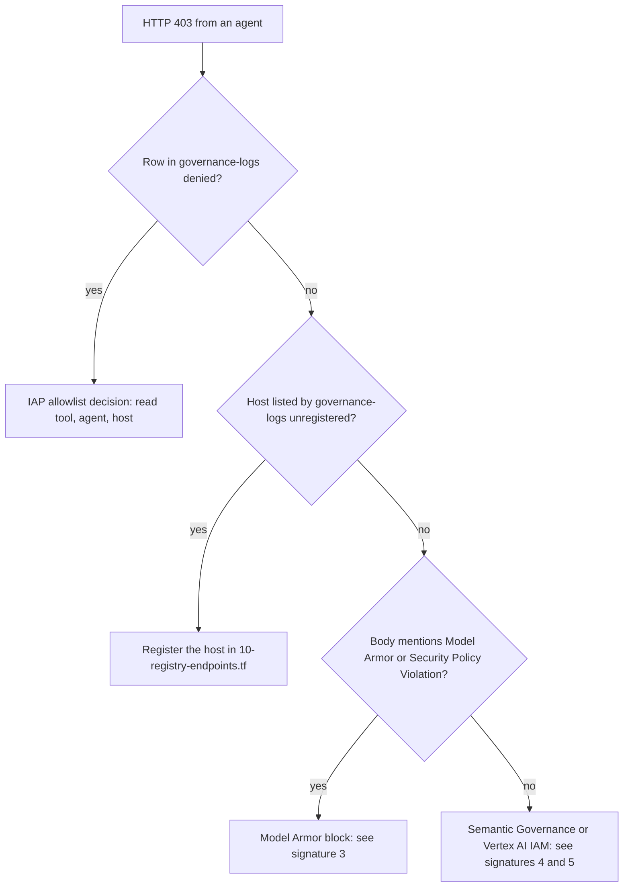

# Agent governance troubleshooting

This page is for when the governed SecOps stack under `terraform/` is broken: an agent returns 403, a Model Armor or Semantic Governance block fires on a legitimate request, an apply fails part way, or a plan never converges. It assumes the stack described in [`terraform/`](../terraform/) is already deployed and that `terraform -chdir=terraform output` works from the repository root.

Three controls act on every outbound request from the five agents (`soc_orchestrator`, `cti_researcher`, `threat_hunter`, `detection_engineer`, `tier2_responder`), and any one of them can be the thing denying you:

| Layer | Reads | Terraform | Verdict surface |
|---|---|---|---|
| IAP `REQUEST_AUTHZ` (IAM v3 CEL allowlists) | headers, SPIFFE identity, MCP tool name | `31-authz-dryrun.tf`, `52-policies-access.tf` | IAP Data Access audit log |
| Model Armor `CONTENT_AUTHZ` | request and response bodies | `60-model-armor.tf` | `modelarmor.googleapis.com/sanitize_operations` |
| Semantic Governance `CONTENT_AUTHZ` | model turns, judged by a model | `65-semantic-governance.tf` | `semantic-governance-policy` log |

## Read the evidence before changing anything

The IAP Data Access audit log is the only surface that records a per-tool verdict together with the SPIFFE identity that made the call. Start there every time.

```bash
just governance-logs action=denied freshness=1h        # IAP denials only; the surface to gate on
just governance-logs action=audit freshness=1h         # every IAP decision, allow and deny
just governance-logs action=who freshness=1h           # distinct SPIFFE principals seen in the audit log
just governance-logs action=mcp freshness=1h           # gateway request log: MCP method, tool, result
just governance-logs action=unregistered freshness=24h # hosts observed at the gateway minus hosts in Agent Registry
```

`governance-logs` wraps [`scripts/governance/verify_logs.sh`](../scripts/governance/verify_logs.sh). The script also accepts `all`, `types`, and `telemetry`, plus `--limit`, `--project`, and `--raw` when you call it directly.

What the columns mean:

`audit` and `denied` share one table:

| Column | Source field | Meaning |
|---|---|---|
| timestamp | `timestamp` | local time of the decision |
| `VERDICT` | `protoPayload.authorizationInfo[0].granted` | `ALLOW` or `DENY` |
| dry run | `protoPayload.metadata.dryRun` | `DRY_RUN` when the IAP extension is in `DRY_RUN` mode (decision recorded, request allowed); `-` when enforced |
| MCP method | `protoPayload.metadata.mcp_attributes.mcp_method` | `tools/call`, `tools/list`, or `-` for non-MCP egress |
| MCP tool | `protoPayload.metadata.mcp_attributes.mcp_tool_name` | the Chronicle MCP tool named in the request, or `-` |
| `AGENT` | `protoPayload.authenticationInfo.principalSubject` (basename) | the calling Reasoning Engine ID |
| host | `protoPayload.requestMetadata.requestAttributes.host` | destination host |

`who` prints `COUNT  PRINCIPAL` from the same audit filter, so an empty `who` with traffic in `mcp` means Data Access logging is off (`enable_iap_data_access_logs` in `variables.tf`), not that nobody called anything.

`mcp` reads the gateway request log (`resource.type="networkservices.googleapis.com/Gateway"`): timestamp, `httpRequest.status`, `jsonPayload.authzPolicyInfo.result`, `mcpInfo.method`, `mcpInfo.parameter`, `httpRequest.requestUrl`. Use it to see traffic, not to prove a denial. `authzPolicyInfo.result` is the AuthzPolicy's verdict, which is `CUSTOM` and delegates to IAP; the per-tool decision is not recorded on this row.

`unregistered` is a set difference, not an error search: every `jsonPayload.tlsSniHostname` seen at the gateway in the window, minus every `interfaces[].url` host on a `google_agent_registry_service` or `google_agent_registry_mcp_server` in Terraform state. Each missing host is printed with the local it belongs in (`local.google_api_hosts_regional`, `local.google_api_hosts_global`, or a dedicated `google_agent_registry_service`) and a `WARNING` when its derived `service_id` would collide with an already registered host.

The rule that saves the most time: **a 403 you cannot attribute to a row in `denied` is not an allowlist decision.** A row names the tool, the verdict, the caller, and the host; read it and stop. No row means a different layer or a missing registration, and editing the CEL allowlist will not change anything.



## Failure signatures

### 1. HTTP 403 with `GatekeeperAuthorizer.AuthorizeUser` on a tool call

**Symptom.** A specialist reports `TOOL_ERROR: <tool> -- MCP tool execution failed: HTTP 403 Forbidden: ...`, and the orchestrator wraps it in the tool-allowlist banner:

```
**[POLICY BLOCK] Blocked by AI security policy -- TOOL ALLOWLIST.**

**REFUSED at the Agent Gateway. The Chronicle MCP tool call never executed.**

> Specialist tool call `list_feeds` was refused by the Agent Gateway (`...`).

**Control:** `chronicle-mcp-tool-allowlist` | **Verdict:** `DENY`
```

**Evidence.** `just governance-logs action=denied freshness=1h` shows a `DENY` row with `tools/call`, the tool name, the specialist's engine ID under `AGENT`, and the Chronicle MCP host. The log entry's `protoPayload.methodName` is `GatekeeperAuthorizer.AuthorizeUser`.

If the specialist's text says only `MCP tool execution failed: Server returned an error response` with no HTTP status, the orchestrator will not raise the banner: that is the MCP SDK's generic wording for any non-2xx reply, and the banner requires a real denial signal (`403`, `forbidden`, `permission denied`, `access denied`, or `denied`), not just that the tool is on the denied list. The specialists' `secops_mcp.py` installs an `httpx` response hook that records non-2xx replies and rewrites the generic text to `HTTP <status> <reason>: <body>`; if you see the generic form, the specialist is running a build from before that hook (redeploy with `just governance-plan` / `apply`).

**Cause.** Either of two things, and the row does not distinguish them:

- The denial is by design. `local.denied_mcp_tools` in [`50-policies-egress.tf`](../terraform/50-policies-egress.tf) (`list_feeds`, `create_rule`, `delete_feed`, `create_reference_list`, `execute_manual_action`, `activate_parser`, `deactivate_parser`) are deliberately advertised to the specialists so that a prompt asking for them reaches the gateway and produces a deterministic denial. Smoke test case 2 depends on this.
- A tool the specialist legitimately needs is missing from its allowlist. The lists are `local.threat_hunter_allowed_tools`, `local.detection_engineer_allowed_tools`, and `local.tier2_responder_allowed_tools` in `50-policies-egress.tf`; [`52-policies-access.tf`](../terraform/52-policies-access.tf) chunks them into CEL rules on `google_iam_project_access_policy.agent_tool_edges` (`destination.agent_registry.mcp_server.tool.name in [...]`, plus `tools/list` on chunk 0). Note that `create_reference_list` is both in the Tier-2 allowlist and in `denied_mcp_tools`; the allowlist is what IAP evaluates, so Tier-2 can call it and the other specialists cannot.

**Fix.** If the tool should be allowed for that specialist, add it to the right `*_allowed_tools` list and apply; chunking is automatic. If the denial is intended, nothing is broken. Allow about 60 seconds after apply for the gateway to pick up the new policy.

```bash
just governance-plan
terraform -chdir=terraform apply
terraform -chdir=terraform output chronicle_tool_policies
```

### 2. HTTP 403 with no row in `denied`

**Symptom.** An agent fails with a bare `403 Forbidden`, often during startup or on the first call to a Google API, and `just governance-logs action=denied` is empty for the window.

**Evidence.**

```bash
just governance-logs action=unregistered freshness=24h
```

prints `UNREGISTERED HOSTS SEEN AT THE GATEWAY` with one line per host and the Terraform local it belongs in. `no gaps: every observed host is registered` means this is not your problem; go to signatures 4 and 5.

**Cause.** The gateway runs in `AGENT_TO_ANYWHERE` default-deny mode. A destination that is not registered in Agent Registry is refused before IAP evaluates any allowlist, so no audit row is written. A host that is registered but absent from the `google_apis` access policy condition fails identically.

**Fix.** Add the host to [`10-registry-endpoints.tf`](../terraform/10-registry-endpoints.tf): regional hosts (`<REGION>-...googleapis.com`) go in `local.google_api_hosts_regional`, global or multi-regional hosts in `local.google_api_hosts_global`, and non-Google hosts get a dedicated `google_agent_registry_service` scoped to one agent in `52-policies-access.tf`. For a quick test, `var.extra_google_api_hosts` appends to the same list.

Watch the `service_id` collision `WARNING` that `unregistered` prints. `service_id` is derived from the hostname with `.googleapis.com` stripped and dots replaced by hyphens; global hosts get a `<REGION>-g-` prefix so that `aiplatform.googleapis.com` and `<REGION>-aiplatform.googleapis.com` can coexist. `extra_google_api_hosts` is concatenated last and the first host per ID wins, so a host whose derived ID is already taken is a silent no-op: clean apply, unchanged endpoint count, 403 persists. Such hosts go in the locals, not in the variable.

If several gaps hide each other (a blocked path never runs, so its downstream hosts never reach the log), switch to dry run for one pass, harvest everything, then re-enforce:

```bash
just governance-enforce mode=dry-run
# exercise the agents, then:
just governance-logs action=unregistered freshness=1h
just governance-enforce mode=enforced
```

### 3. `MODEL_ARMOR_SANITIZATION_VERDICT_BLOCK` on a legitimate SOC prompt

**Symptom.** A real triage request (an IOC list, a YARA-L 2.0 rule body, a LOLBin command line, a suspected phishing URL) comes back with the Model Armor banner instead of an answer:

```
**[POLICY BLOCK] Blocked by AI security policy -- MODEL ARMOR.**

**REFUSED at the Agent Gateway. The model never produced an answer.**

> Security Policy Violation

Model Armor screened this turn at the egress Agent Gateway and returned
**403 PERMISSION_DENIED** before an unscreened response could complete.

**Control:** `agw-secops-ma-content-authz` | **Verdict:** `DENY`
```

The orchestrator emits this from `_POLICY_NOTICE` in [`governed_agents/soc_orchestrator/agent.py`](../governed_agents/soc_orchestrator/agent.py) whenever the exception chain contains one of `_POLICY_MARKERS` (`security policy violation`, `content not allowed`, `prompt injection`, `jailbreak`, `malicious uri`, `sensitive data`). The control name is `MODEL_ARMOR_CONTROL`, set to `<resource_prefix>-ma-content-authz` in `41-agents.tf`.

**Evidence.**

```bash
PROJECT_ID="<PROJECT_ID>"
gcloud logging read \
  'logName="projects/'"$PROJECT_ID"'/logs/modelarmor.googleapis.com%2Fsanitize_operations"' \
  --project="$PROJECT_ID" --freshness=1h --limit=20 \
  --format='table(timestamp, jsonPayload.sanitizationVerdict, jsonPayload.filterResults)'
```

A row with verdict `MODEL_ARMOR_SANITIZATION_VERDICT_BLOCK` and a filter result naming `pi_and_jailbreak`, `rai`, or `malicious_uri` is the block. The IAP `denied` table stays empty, because Model Armor is a separate `CONTENT_AUTHZ` policy.

**Cause.** A false positive on cyber content. [`60-model-armor.tf`](../terraform/60-model-armor.tf) already runs the prompt-injection, jailbreak, and Responsible AI filters at `HIGH` confidence (`var.model_armor_confidence_level`) and leaves the malicious-URI filter off (`var.model_armor_enable_malicious_uri_filter = false`) for exactly this reason. If someone lowered the confidence to `MEDIUM_AND_ABOVE` or enabled the URI filter, legitimate phishing URLs and exploit descriptions start tripping it.

**Fix.** Check the current settings, then restore the defaults:

```bash
terraform -chdir=terraform output content_governance
```

In `terraform.tfvars`:

```hcl
model_armor_confidence_level            = "HIGH"
model_armor_enable_malicious_uri_filter = false
```

If you need to keep inspecting without blocking while you tune, set `model_armor_enforcement_type = "INSPECT_ONLY"`; verdicts are still logged. The opposite case, a hostile prompt that `HIGH` lets through, is an expected consequence of the threshold and not a fault.

### 4. Semantic Governance `DENY` on an in-scope tool

**Symptom.** `tier2_responder` (or any specialist) is blocked by Semantic Governance for an action that no policy forbids, for example isolating a `WKSTN-*` host with no change ticket, which the built-in Tier-0 Crown Jewel policy explicitly permits.

**Evidence.**

```bash
PROJECT_ID="<PROJECT_ID>"
gcloud logging read \
  'logName="projects/'"$PROJECT_ID"'/logs/semantic-governance-policy"' \
  --project="$PROJECT_ID" --freshness=1h --limit=20 --format=json
```

Read the verdict, the policy ID (the built-in one is `<resource_prefix>-tier2-crown-jewel-change-control`), and the engine's reasoning. The same log feeds the `sgp_verdicts` metric in `70-observability.tf`. A denial with no policy ID attached is the signature of this case.

**Cause.** The policy engine evaluates every model turn that crosses the gateway, not only turns from agents that have a `google_vertex_ai_semantic_governance_policy`. An agent with no explicit policy is judged on intent alone: the engine compares what the turn is trying to do against the agent's registered description and skills. When a specialist's prompt or description does not mention the action it is now taking (host isolation, account disablement, reference-list writes), the engine can conclude the action is out of scope and deny it, even though no written constraint applies. In this repository only `tier2_responder` carries a policy (`local.sgp_builtin_policies` in [`65-semantic-governance.tf`](../terraform/65-semantic-governance.tf)); the other three specialists are evaluated on intent only.

**Fix.** One of two edits, in this order:

1. Align the specialist. Make the agent's `DESCRIPTION` and `INSTRUCTION` in `governed_agents/<agent>/agent.py` name the actions it performs, regenerate cards and repackage (`just governance-cards`, `just governance-package`), and apply. The Tier-2 prompt is the model: it says in plain words that it isolates hosts and disables accounts under change control.
2. Add an explicit policy. Append an entry to `var.sgp_policies` with the agent's registry resource name and a `natural_language_constraint` that states what is permitted as well as what is not; the built-in constraint in `var.sgp_tier2_crown_jewel_constraint` ends with the permitted cases for that reason.

While you work, `sgp_enforcement_mode = "DRY_RUN"` keeps logging verdicts without blocking.

### 5. Reasoning Engine returns 404 for a Gemini 3.x model

**Symptom.** Every turn fails inside the engine with a `404 NOT_FOUND` naming the model (`gemini-3.1-pro-preview`, `gemini-3.5-flash`), surfaced by the orchestrator as a `[RUNTIME FAULT]` banner. Nothing appears in `denied`.

**Evidence.** The engine's own logs in Cloud Logging show the `generateContent` call going to `<REGION>-aiplatform.googleapis.com` with `locations/<REGION>` in the path instead of `locations/global`.

**Cause.** Gemini 3.x models are served from the `global` (or `us`) endpoint, not from a single region. Agent Engine sets `GOOGLE_CLOUD_LOCATION` to the deploy region on every container, and that would be the client's default. Each agent therefore reads `MODEL_LOCATION` and passes it explicitly: `Gemini(model=MODEL, client_kwargs={"location": MODEL_LOCATION})`. [`41-agents.tf`](../terraform/41-agents.tf) sets `MODEL_LOCATION` from `var.model_location` (validated to `us`, `eu`, or `global`; default `global`) on all five engines. A 404 means that value is wrong or the env var was dropped.

**Fix.** Confirm `model_location = "global"` (or `"us"`) in `terraform.tfvars`, check the env on the engine, and apply. Do not try to route around it by setting `region` to `global`: the deploy region stays regional, only the model location changes.

```bash
terraform -chdir=terraform output agent_engines
# then inspect spec.deploymentSpec.env on one engine:
just governance-logs action=telemetry
```

Both `aiplatform.googleapis.com` and `aiplatform.us.rep.googleapis.com` are already in `local.google_api_hosts_global`, so the gateway will admit the global endpoint once the agent asks for it.

### 6. `.rep.mtls.googleapis.com` NXDOMAIN or MCP 401 from a workstation

**Symptom.** Running a specialist or the smoke test locally (or deploying from a workstation with a client certificate configured) fails with DNS resolution errors on hosts such as `chronicle.<REGION>.rep.mtls.googleapis.com` or `modelarmor.<REGION>.rep.mtls.googleapis.com`, or the Chronicle MCP server answers `401`.

**Evidence.** The failing hostname contains `.mtls.`. Registered hosts in `10-registry-endpoints.tf` and `11-registry-mcp.tf` do not.

**Cause.** When Google client libraries find a client certificate (for example from a workstation's context-aware access configuration), they switch to mTLS endpoints by rewriting the host. Regional `.rep.googleapis.com` endpoints have no `.rep.mtls.` form, so the lookup fails; where a host does exist, it is not the host registered at the gateway, so the call is refused or unauthenticated. Every engine in `41-agents.tf` sets `GOOGLE_API_USE_CLIENT_CERTIFICATE=false` to prevent this inside Agent Engine; a workstation has no such setting unless you add it.

**Fix.** In the shell you run tools from:

```bash
export GOOGLE_API_USE_CLIENT_CERTIFICATE=false
gcloud config set context_aware/use_client_certificate false
```

Then retry. If the error is from a deployed engine rather than a workstation, the env var has been removed from `41-agents.tf`; restore it.

### 7. Perpetual `deployment_spec` diff on every plan

**Symptom.** `just governance-plan` reports an in-place update on one or more `google_vertex_ai_reasoning_engine` resources every time, with the diff inside `spec.deployment_spec` (typically the `GOOGLE_CLOUD_AGENT_ENGINE_ENABLE_TELEMETRY` env entry), even though nothing changed.

**Evidence.** `terraform plan -detailed-exitcode` exits `2` with only that diff; `just governance-logs action=telemetry` shows every engine with telemetry `on`.

**Cause.** The google-beta provider omits that env var when it flattens the engine's state, so refresh never sees it and plan re-adds it. This is known and deliberately left in place. The comment on `local.telemetry_env` in [`41-agents.tf`](../terraform/41-agents.tf) explains why: keeping `deployment_spec` dirty forces the provider to send the whole spec on update. A spec-only `updateMask=spec` call would prune `deploymentSpec` server-side and clear `agent_gateway_config`, which detaches the engine from the gateway.

**Fix.** Accept the diff. Do not add `lifecycle { ignore_changes = [spec[0].deployment_spec] }`, and do not remove `GOOGLE_CLOUD_AGENT_ENGINE_ENABLE_TELEMETRY` from `local.telemetry_env`. Treat a clean apply plus `telemetry` all `on` as converged. If an engine ever shows telemetry `OFF` or loses its gateway, re-apply with the env var present and it will be reattached.

### 8. First apply fails with `FAILED_PRECONDITION` on `networkservices.agentGateways.get` or a missing `gcp-sa-discoveryengine` service agent

**Symptom.** On a fresh project the first `terraform apply` fails with one of:

- `FAILED_PRECONDITION` mentioning `networkservices.agentGateways.get`, usually from `terraform_data.ge_binding` or when an engine first routes through the gateway;
- an IAM error that the member `serviceAccount:service-<PROJECT_NUMBER>@gcp-sa-discoveryengine.iam.gserviceaccount.com` (or `@gcp-sa-aiplatform`) does not exist.

**Evidence.** `gcloud beta services identity create --service=discoveryengine.googleapis.com --project="$PROJECT_ID"` returns the email on a second run; the first run on a fresh project creates it.

**Cause.** Google-managed service agents do not exist until the service identity is provisioned, and IAM bindings or gateway reads on their behalf fail until then. [`00-apis.tf`](../terraform/00-apis.tf) creates `google_project_service_identity.service_agents` for `aiplatform.googleapis.com` and `discoveryengine.googleapis.com`, and the engines, `55-ge-binding.tf`, and `65-semantic-governance.tf` depend on it, but in a brand-new project the identity can take a few minutes to propagate after creation.

**Fix.** Create the identities first, wait a few minutes, then run the full apply:

```bash
PROJECT_ID="<PROJECT_ID>"
terraform -chdir=terraform apply \
  -target=google_project_service.apis \
  -target=google_project_service_identity.service_agents
gcloud beta services identity create --service=discoveryengine.googleapis.com --project="$PROJECT_ID"
gcloud beta services identity create --service=aiplatform.googleapis.com --project="$PROJECT_ID"
terraform -chdir=terraform apply
```

### 9. `Maximum 10 FGAC conditions are allowed per policy` or `list of size 11 exceeds the limit of 10`

**Symptom.** Plan fails on a precondition such as `agent_tool_edges must have 1..10 FGAC rules, each non-empty and at most 1024 characters.`, or apply fails at IAM with one of the two messages in the title.

**Evidence.** Count the rules you are about to create: `terraform -chdir=terraform console` then `length(local.agent_tool_rules)`, `length(local.google_apis_rule_conditions)`, and `local.mcp_specialist_chunks`.

**Cause.** IAM v3 enforces three ceilings on `iap.googleapis.com` access policies: at most 10 FGAC rules per `google_iam_project_access_policy`, at most 10 items per CEL `in [...]` literal, and at most 1024 characters per expression. [`52-policies-access.tf`](../terraform/52-policies-access.tf) stays under them by splitting tool egress (`agent_tool_edges`) from A2A edges (`agent_a2a_edges`), chunking MCP allowlists at `local.mcp_tools_per_rule = 9` tools per rule (so `tools/list` fits in chunk 0), and chunking Google API endpoints at `local.google_apis_endpoints_per_rule = 5`. You hit the ceiling when an allowlist grows enough to need a third chunk, when `extra_google_api_hosts` pushes the endpoint list past 50, or when someone raised `mcp_tools_per_rule` to 10 or more.

**Fix.** Do not raise the per-rule constants. Either trim the list, or add a fourth `google_iam_project_access_policy` and binding (copy the `agent_tool_edges` block and its `terraform_data.*_policy_binding` destroy helper) and move one specialist's rules into it. Each policy gets its own ten rules.

### 10. Semantic Governance PSC endpoint `state = FAILED` while `pscConnectionStatus = ACCEPTED`

**Symptom.** During apply, [`scripts/governance/sgp_gateway_config.sh`](../scripts/governance/sgp_gateway_config.sh) prints:

```
sgp_gateway_config.sh: WARNING: gateway config '<resource_prefix>' reports state FAILED, but
sgp_gateway_config.sh:          PSC endpoint sgpe-psce-<resource_prefix> exists at <IP> with
sgp_gateway_config.sh:          pscConnectionStatus ACCEPTED. Treating data plane as healthy.
sgp_gateway_config.sh:          Terraform writes the private DNS A record in 65-semantic-governance.tf.
```

and the apply continues.

**Evidence.**

```bash
PROJECT_ID="<PROJECT_ID>"
REGION="<REGION>"
RESOURCE_PREFIX="agw-secops"
gcloud compute forwarding-rules describe "sgpe-psce-$RESOURCE_PREFIX" \
  --region="$REGION" --project="$PROJECT_ID" \
  --format='value(IPAddress,pscConnectionStatus)'
```

**Cause.** The policy engine sometimes marks its own gateway config `FAILED` after a duplicate-insert on the address or forwarding rule it just created, and then stops before writing its DNS record, leaving a working PSC endpoint behind. The shim checks the data plane (`pscConnectionStatus`) instead of trusting the state field, and `65-semantic-governance.tf` reads the forwarding rule's IP with `data.google_compute_forwarding_rule.sgp_endpoint` and writes the A record `<REGION>.<sgp_dns_zone_suffix>` itself with `google_dns_record_set.sgp_endpoint`.

**Fix.** Nothing, when the warning is printed: this state is tolerated and the extension in `65-semantic-governance.tf` resolves the host through the Terraform-managed record. The shim dies instead of warning when the endpoint is missing or not `ACCEPTED`; that is a real failure. Look at the Vertex AI service agent's own calls for the cause:

```bash
PROJECT_ID="<PROJECT_ID>"
PROJECT_NUMBER="<PROJECT_NUMBER>"
gcloud logging read \
  'protoPayload.authenticationInfo.principalEmail="service-'"$PROJECT_NUMBER"'@gcp-sa-aiplatform.iam.gserviceaccount.com"' \
  --project="$PROJECT_ID" --freshness=1h \
  --format='value(timestamp,protoPayload.methodName,protoPayload.status.code,protoPayload.resourceName)'
```

Status code 7 (`PERMISSION_DENIED`) means the `roles/compute.networkAdmin` or `roles/dns.admin` grants in `65-semantic-governance.tf` have not landed; code 8 (`RESOURCE_EXHAUSTED`) means `var.sgp_subnet_cidr` has no free address.

### 11. Gemini Enterprise bind refused

**Symptom A.** `terraform_data.ge_binding` fails with:

```
bind_ge_app.sh: <GE_ENGINE_ID> is already bound to a different gateway (projects/.../agentGateways/...). Run 'bind_ge_app.sh unbind' first or set GE_FORCE_REBIND=1.
```

**Symptom B.** It fails with:

```
bind_ge_app.sh: no Gemini Enterprise app at projects/<PROJECT_NUMBER>/locations/<ge_location>/collections/default_collection/engines/<GE_ENGINE_ID>: ...
```

**Evidence.** Both strings come from [`scripts/governance/bind_ge_app.sh`](../scripts/governance/bind_ge_app.sh). `terraform -chdir=terraform output ge_binding` prints the engine path and the gateway Terraform intends to bind.

**Cause A.** The app's `agentGatewaySetting.defaultEgressAgentGateway` already points at another gateway (an earlier stack with a different `resource_prefix`, or a gateway in another project). The shim refuses to overwrite it silently because the setting is shared by every agent on that app.

**Cause B.** The app does not exist at that location. `ge_location` must match where the app was created (`global`, `us`, or `eu`); the shim derives the API host from it (`discoveryengine.googleapis.com` for `global`, `<ge_location>-discoveryengine.googleapis.com` otherwise). A wrong `ge_engine_id` produces the same 404. Note also the precondition in `55-ge-binding.tf`: an app in `global` or `us` requires the gateway in `us-central1`, and `eu` requires `europe-west1`.

**Fix A.** Either unbind first, with the same variables Terraform passes to the shim, or re-run with `GE_FORCE_REBIND=1` if you are certain the old gateway is retired:

```bash
export GE_PROJECT_ID="<PROJECT_ID>"
export GE_PROJECT_NUMBER="<PROJECT_NUMBER>"
export GE_LOCATION="global"
export GE_ENGINE_ID="<GE_ENGINE_ID>"
bash scripts/governance/bind_ge_app.sh status
bash scripts/governance/bind_ge_app.sh unbind
terraform -chdir=terraform apply
# or, without unbinding:
GE_FORCE_REBIND=1 terraform -chdir=terraform apply
```

**Fix B.** Correct `ge_location` and `ge_engine_id` in `terraform.tfvars`, confirm with `bind_ge_app.sh status`, then apply.

### 12. Smoke test case fails with `500 Internal Server Error` after about 60 to 80 seconds

**Symptom.** `just governance-smoke-test` prints `Status: FAIL (6x.xxs) -- unexpected exception (...500 Internal Server Error...)` for one case while the others pass, most often right after an apply that touched an engine.

**Evidence.** The elapsed time is the tell. A real policy block returns in well under a second with a 403 and a banner; a 500 at 60 to 80 seconds is a timeout somewhere between the gateway and a restarting engine. `just governance-logs action=denied` has no matching row, and `just governance-logs action=telemetry` shows the engines healthy a minute later.

**Cause.** Transient. Any apply that changes an engine redeploys it, and the first turns after a redeploy can time out while the container warms and re-registers its identity. Specialist calls that fan out from the orchestrator multiply the exposure.

**Fix.** Wait a minute and rerun only the failed case. [`scripts/governance/smoke_test.py`](../scripts/governance/smoke_test.py) matches `--case` against either the full case ID or the short token after `case_`, so both forms work:

```bash
just governance-smoke-test case=4a
just governance-smoke-test case=case_4a_sgp_crown_jewel_deny
```

The short tokens are `1`, `2`, `3`, `4a`, and `4b`. If the same case fails three times in a row with the same 500, it is not transient; read the engine's logs in Cloud Logging for the traceback.

### 13. `TF_VAR_gti_api_key is empty` precondition on plan

**Symptom.** Plan stops with `var.gti_api_key is empty. Export TF_VAR_gti_api_key in the shell environment before running Terraform.` (from `20-authmanager.tf`), or `enforce.sh` refuses to start with `TF_VAR_gti_api_key is unset and no *.tfvars in terraform/ defines gti_api_key.`

**Evidence.** `printenv TF_VAR_gti_api_key` prints nothing in the shell you are running `just` from.

**Cause.** The GTI (VirusTotal v3) API key is `sensitive` and intentionally has no default and no committed file. It is passed to Agent Platform Auth Manager by `terraform_data.gti_auth_provider` at apply time and is never read by the agents directly; `cti_researcher` retrieves it through Auth Manager under its own identity.

**Fix.** Export it in the shell for the duration of the session. Do not put it in `terraform.tfvars`, `.env`, or any file the repository could track; the hygiene gate in `scripts/check_public_repo_hygiene.py` exists to catch exactly that.

```bash
read -r -s -p "GTI API key: " TF_VAR_gti_api_key; echo
export TF_VAR_gti_api_key
just governance-plan
```

To rotate the key later, change the value in the environment and bump `gti_api_key_version` in `terraform.tfvars`.

### 14. Specialist edge returns `A2A request failed: HTTP 403` with `Error: Security Policy Violation`

**Symptom.** The orchestrator reports that a specialist "encountered an error":
`A2A request failed: HTTP Error 403 ... reasoningEngines/<ENGINE_ID>/a2a/message:send`.
From the Gemini Enterprise console the same turn shows the orchestrator's
policy-notice banner, and the Reasoning Engine log carries
`google.genai.errors.ClientError: 403 Forbidden ... "Error: Security Policy Violation"`.

**Evidence.** `just governance-logs action=denied freshness=10m` is empty and the
A2A host shows `ALLOW` in `audit`, so this is not the allowlist. The
`semantic-governance-policy` log shows `verdict: ALLOW`. The attribution is in
the Model Armor log:

```bash
PROJECT_ID="<PROJECT_ID>"
gcloud logging read 'resource.type="modelarmor.googleapis.com/SanitizeOperation"' \
  --project="$PROJECT_ID" --freshness=10m --format=json \
  | jq '.[] | {t: .timestamp, template: .resource.labels.template_id, pi: .jsonPayload.sanitizationResult.filterResults.pi_and_jailbreak}'
# ... "matchState": "MATCH_FOUND", "confidenceLevel": "HIGH" on the request template
```

**Cause.** Prompts shaped like "ask the <specialist> to list the MCP tools it
can use, and then ..." match the prompt-injection and jailbreak filter at
`HIGH` confidence (capability enumeration directed at an agent reads as an
injection attempt). The orchestrator forwards the user text verbatim inside the
A2A request to the specialist, and that outbound request is what the request
template inspects, so the block lands on the specialist edge rather than on
the first model call. The message text is the generic inline-extension string;
only the Model Armor log names the filter.

**Fix.** Phrase specialist work as a task ("list 10 SIEM detection rules",
"validate this YARA-L 2.0 rule") rather than as instructions to the agent about
itself. If capability enumeration must be allowed, lower the request template's
`pi_and_jailbreak` confidence or switch `model_armor_enforcement_type` to
`INSPECT_ONLY` in `60-model-armor.tf`; both weaken the prompt-injection
demonstration, so prefer the rephrasing.

## Rollback levers

Each lever turns off one control without touching the others. Apply after each change and allow about 60 seconds for the gateway to pick up new metadata.

| Control | Lever | Effect |
|---|---|---|
| IAP tool and A2A allowlists | `just governance-enforce mode=dry-run` (check the current mode first with `just governance-enforce mode=status`) | Sets `authz_enforcement_mode = "DRY_RUN"` on the IAP extension: every decision is still written to the audit log with `DRY_RUN` in the dry-run column, but denials are not returned to the caller. `just governance-enforce mode=enforced` restores enforcement. This runs `terraform apply -var authz_enforcement_mode=...` and does not persist; the next plain apply reverts to the tfvars value. |
| Model Armor | `enable_model_armor = false` in `terraform.tfvars` | Removes the Model Armor templates, extension, and `CONTENT_AUTHZ` policy from the gateway. For a softer step, `model_armor_enforcement_type = "INSPECT_ONLY"` keeps logging verdicts without blocking. |
| Semantic Governance | `sgp_enforcement_mode = "DRY_RUN"`, or `enable_semantic_governance = false` | `DRY_RUN` keeps the policy engine evaluating and logging to `semantic-governance-policy` but does not block. `false` tears down the VPC, PSC attachment, DNS zone, policy engine, extension, and the built-in Tier-0 policy; expect a long destroy. |
| Gemini Enterprise | `bind_ge_app = false` and `create_ge_agent = false`, then apply | Runs `ge_agent.sh delete` to remove the orchestrator from the app's agent picker and `bind_ge_app.sh unbind` to clear the app's egress gateway. `create_ge_agent` requires `bind_ge_app`, so both must be set together. |

Check the resulting state with:

```bash
terraform -chdir=terraform output authz_enforcement
terraform -chdir=terraform output content_governance
terraform -chdir=terraform output ge_binding
```

None of these levers changes Agent Registry or the engines themselves. If the problem is an unregistered host (signature 2) or a model endpoint (signature 5), dry run will show you the gap but will not close it.
