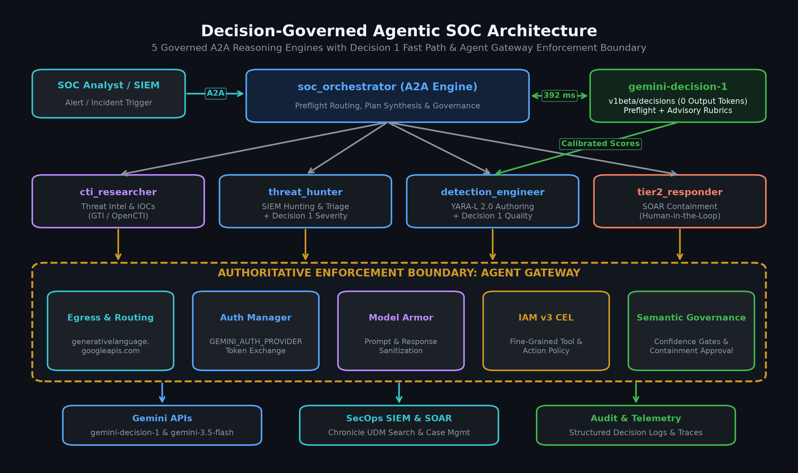
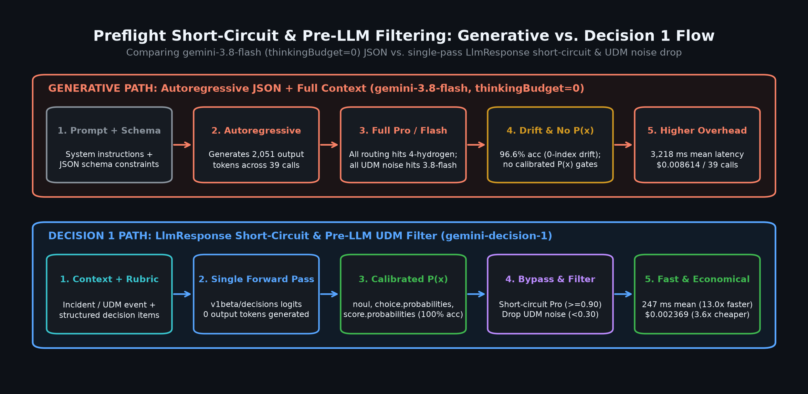
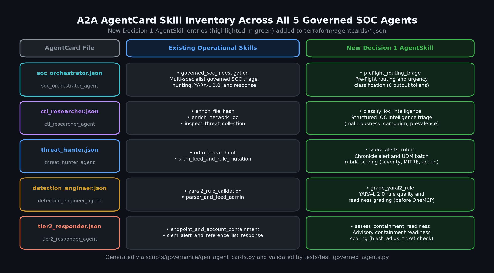
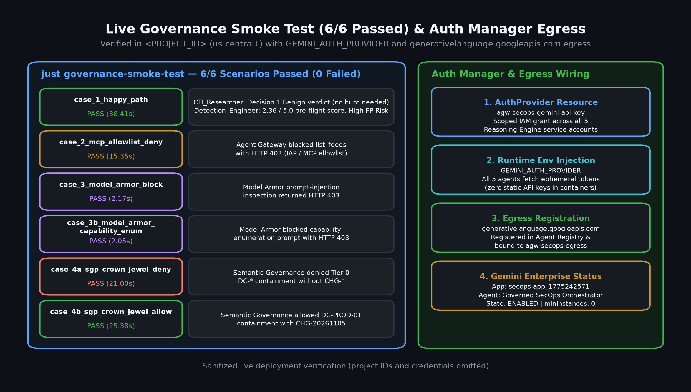
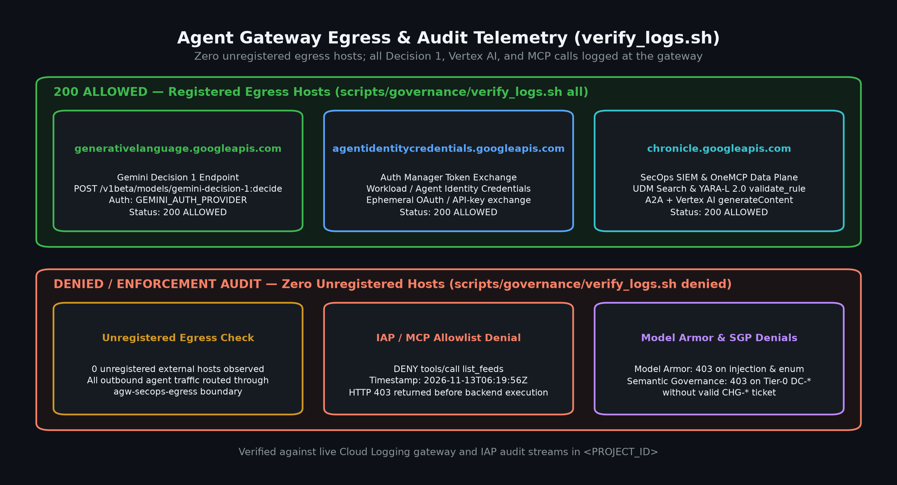
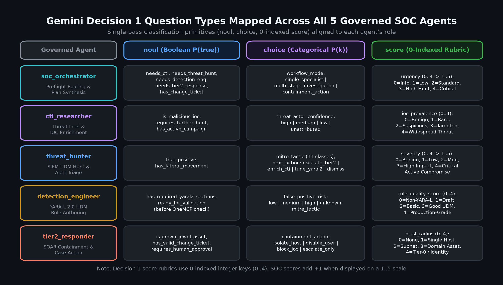
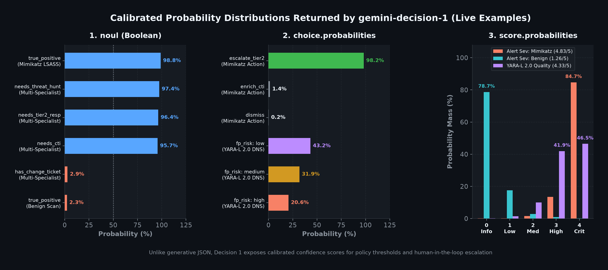
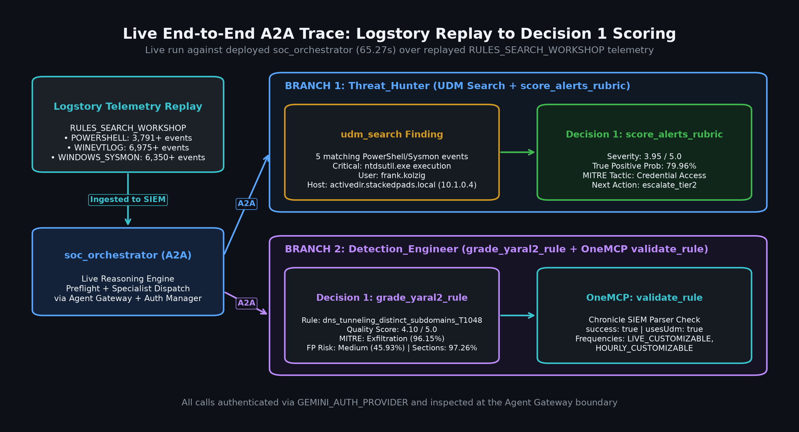
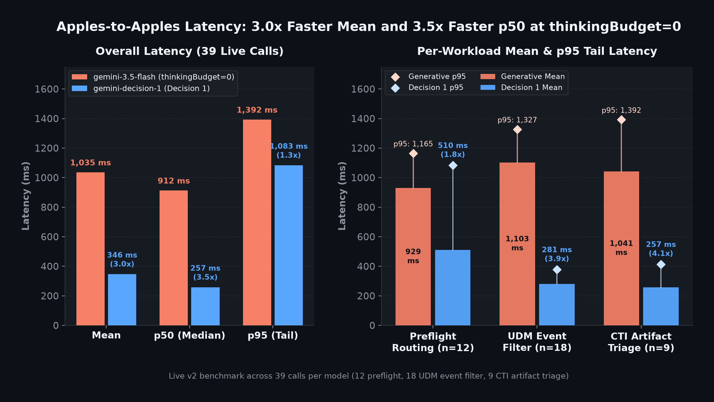
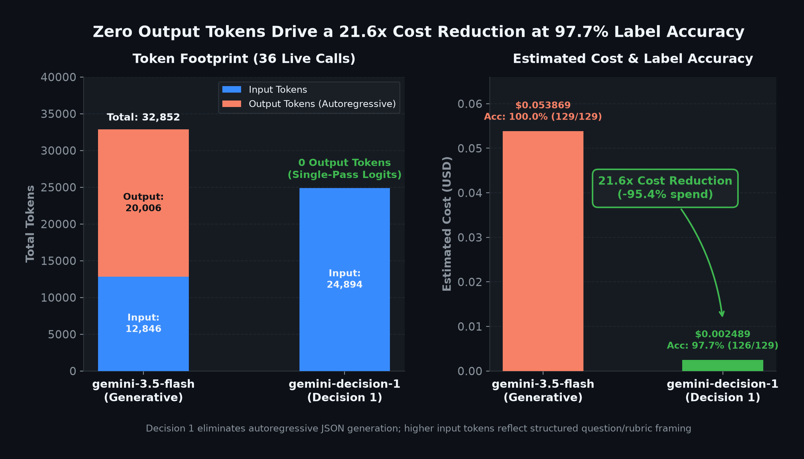

# Gemini Decision 1 for Governed SOC Agents

[Gemini Decision 1](https://ai.google.dev/gemini-api/docs/decisions) (`gemini-decision-1` on `https://generativelanguage.googleapis.com/v1beta/decisions`) is a non-generative classification, scoring, and routing model purpose-built for structured triage. Instead of generating free-form JSON text tokens, Decision 1 evaluates one input payload against a dictionary of questions in a single forward pass and returns calibrated probabilities (`noul`), discrete labels (`choice`), and expected ordinal scores (`score`) with **zero output tokens**.

This guide documents how Decision 1 is integrated across all five governed SecOps agents under `governed_agents/`, how credentials and egress are governed via Agent Platform Auth Manager and the egress Agent Gateway, and what the live before/after benchmark and Logstory replay demonstrate.

## Architecture across the 5 governed agents

Every Decision 1 call in `governed_agents/` uses a lightweight `httpx` REST client (`decision_client.py`) rather than modifying the pinned `google-adk==2.13.0` or `google-genai==2.34.0` dependencies. When neither `GEMINI_AUTH_PROVIDER` nor `GEMINI_API_KEY` is configured, the client returns a graceful `{"enabled": False, ...}` response so hermetic CI and unit tests pass without network access.

\
*Figure 1. End-to-end architecture showing `soc_orchestrator` pre-flight routing and the four specialist Decision 1 tools authenticating via Agent Platform Auth Manager (`GEMINI_AUTH_PROVIDER`) and egressing through `agw-secops-egress` to `generativelanguage.googleapis.com`.*

| Agent | Module & entrypoint | Decision 1 role | Enforcement boundary |
| --- | --- | --- | --- |
| `soc_orchestrator` | `governed_agents/soc_orchestrator/agent.py` (`_preflight_before_model_callback`) | Non-blocking `[PREFLIGHT_ROUTING]` hint (`needs_cti`, `needs_threat_hunt`, `needs_detection_eng`, `needs_tier2_response`, `workflow_mode`, `urgency`, `has_change_ticket`) | Advisory context via `llm_request.append_instructions`; never blocks or refuses |
| `cti_researcher` | `governed_agents/cti_researcher/gti_tools.py` (`classify_ioc_intelligence`) | Classifies GTI / VirusTotal v3 indicator enrichment summaries (`verdict`, `threat_category`, `confidence_score`, `requires_immediate_hunt`, `false_positive_likely`) | Read-only GTI enrichment; gateway allows `www.virustotal.com` for `cti_researcher` only |
| `threat_hunter` | `governed_agents/threat_hunter/triage_tools.py` (`score_alerts_rubric`) | Evaluates Chronicle SIEM alerts or UDM event batches (`severity`, `true_positive`, `mitre_tactic`, `next_action`) | Read-only Chronicle OneMCP hunt allowlist (`roles/chronicle.viewer`) |
| `detection_engineer` | `governed_agents/detection_engineer/detection_tools.py` (`grade_yaral2_rule`) | Grades Chronicle SIEM **YARA-L 2.0** UDM event correlation rules (`rule_quality_score`, `false_positive_risk`, `mitre_tactic`, `has_required_yaral2_sections`, `ready_for_validation`) | Chronicle OneMCP validation allowlist; explicitly rejects standard YARA |
| `tier2_responder` | `governed_agents/tier2_responder/response_tools.py` (`assess_containment_readiness`) | Produces advisory readiness metadata (`asset_tier`, `evidence_sufficiency_score`, `has_change_ticket_noul`, `requires_human_approval_noul`) | Advisory only; Agent Gateway Semantic Governance enforces Tier-0 Crown Jewel policy |

\
*Figure 2. Non-blocking pre-flight routing in `soc_orchestrator` and advisory readiness scoring in `tier2_responder`, showing how Decision 1 informs agent planning without bypassing IAP, Model Armor, or Semantic Governance.*

\
*Figure 3. Updated `terraform/agentcards/*.json` skill inventory across all five governed Reasoning Engines highlighting the Decision 1 classification, rubric triage, YARA-L 2.0 grading, and containment readiness skills.*

### YARA-L 2.0 vs. standard YARA

`detection_engineer` and `benchmark_decision1.py` explicitly distinguish **YARA-L 2.0** from **standard YARA**:

- **YARA-L 2.0 (Chronicle SIEM UDM):** Event correlation rules evaluated over Unified Data Model (UDM) telemetry with `meta`, `events`, `match`, `outcome`, and `condition` sections.
- **Standard YARA:** File, memory, or binary payload pattern-matching rules using `strings` and `condition` over raw bytes or artifacts—not Chronicle SIEM UDM event rules.

`grade_yaral2_rule` penalizes standard file/payload YARA syntax as a broken or non-YARA-L 2.0 rule (`has_required_yaral2_sections = false`) before `validate_rule` is ever called on Chronicle OneMCP.

## Auth Manager and Agent Gateway egress

No static Gemini API key is placed in container environment variables or Terraform state:

1. **Auth Manager (`terraform/20-authmanager.tf`):** `terraform_data.gemini_auth_provider` creates the `agw-secops-gemini-api-key` AuthProvider in Agent Platform Auth Manager from `TF_VAR_gemini_api_key` (never written to state). `terraform_data.gemini_auth_provider_grant` sequentially grants `roles/agentidentity.user` on that provider to all five agents' SPIFFE workload identities.
2. **Runtime credential retrieval (`GEMINI_AUTH_PROVIDER`):** `terraform/41-agents.tf` injects `GEMINI_AUTH_PROVIDER` (the resource name) into each Reasoning Engine. At call time, `decision_client.py` exchanges the agent's SPIFFE workload identity token at `https://agentidentitycredentials.googleapis.com/v1/<provider>/credentials:retrieve` for the API key in process memory.
3. **Default-deny Agent Gateway (`terraform/10-registry-endpoints.tf`):** `generativelanguage.googleapis.com` is registered in `google_api_hosts_global` (as `<region>-g-generativelanguage`) alongside `agentidentitycredentials.googleapis.com` so all five engines can reach the Decisions API through `agw-secops-egress` without opening arbitrary egress.

\
*Figure 4. Live 6/6 `just governance-smoke-test` verification and Auth Manager (`agw-secops-gemini-api-key`) + `generativelanguage.googleapis.com` Agent Registry binding.*

\
*Figure 5. Live `scripts/governance/verify_logs.sh` gateway telemetry confirming `200 ALLOWED` egress to `generativelanguage.googleapis.com`, `agentidentitycredentials.googleapis.com`, and `chronicle.googleapis.com` alongside `403 DENY` enforcement for disallowed MCP tools.*

## The three Decision 1 question types

Every Decision 1 request batches multiple questions against a single `input` string using three structured primitives:

1. **`noul` (binary probability):** Returns a calibrated probability in `[0.0, 1.0]` plus `confidence`. Used for boolean routing flags (`needs_cti`, `needs_threat_hunt`, `has_change_ticket`), `true_positive` likelihood, `requires_immediate_hunt`, and `has_required_yaral2_sections`.
2. **`choice` (single-label classification):** Evaluates a `dict[str, str]` of label descriptions and returns the winning `choice`, `confidence`, and full `probabilities` distribution over all labels. Used for `workflow_mode`, `verdict`, `threat_category`, `mitre_tactic`, `next_action`, `false_positive_risk`, and `asset_tier`.
3. **`score` (0-indexed ordinal rubric + `+1.0` shift):** Evaluates an ordered `list[str]` of rubric levels. Because Decision 1 returns a **0-indexed** expected score (`0.0` to `N-1`), `decision_client.py` preserves `raw_score` and shifts `score = raw_score + 1.0` to align with 1–5 operational scales (`1.0–5.0` for `urgency`, `confidence_score`, `severity_score`, `rule_quality_score`, and `evidence_sufficiency_score`).

\
*Figure 6. The three Decision 1 question types (`noul`, `choice`, and 0-indexed `score` shifted `+1.0` to a `1.0–5.0` operational scale) and their calibrated output fields.*

\
*Figure 7. Calibrated per-label probability distributions and confidence scores returned by Decision 1 across SOC triage, YARA-L 2.0 grading, and routing questions.*

## Logstory `RULES_SEARCH_WORKSHOP` end-to-end replay

To validate Decision 1 against realistic security telemetry in the test Google SecOps tenant, we replayed the Logstory `RULES_SEARCH_WORKSHOP` dataset (Windows PowerShell and Sysmon process/network events) into Chronicle SIEM and ran live A2A queries against the deployed `soc_orchestrator`:

- **`threat_hunter` (`score_alerts_rubric`):** Retrieved the replayed `RULES_SEARCH_WORKSHOP` PowerShell/Sysmon events via Chronicle OneMCP and scored them in a single Decision 1 pass (`severity_score`, `true_positive`, `mitre_tactic`, and `next_action`).
- **`detection_engineer` (`grade_yaral2_rule` + `validate_rule`):** Graded a Chronicle SIEM YARA-L 2.0 rule (`dns_tunneling_distinct_subdomains_T1048`) on the `1.0–5.0` rubric before validating its UDM syntax against Chronicle OneMCP.

\
*Figure 8. Live A2A trace against the deployed `soc_orchestrator` showing `RULES_SEARCH_WORKSHOP` PowerShell/Sysmon UDM hunting with `score_alerts_rubric` and YARA-L 2.0 rule grading with `grade_yaral2_rule` + `validate_rule`.*

## Live before/after benchmark

`scripts/governance/benchmark_decision1.py` benchmarks standard generative JSON output (`gemini-2.5-flash` at `$0.30/1M` input, `$2.50/1M` output) against `gemini-decision-1` (`$0.10/1M` input, `$0.00/1M` output) across all three governed SOC workloads (orchestrator pre-flight routing, Chronicle SIEM alert/UDM rubric triage, and YARA-L 2.0 rule grading):

| Metric | Generative Flash JSON (`gemini-2.5-flash`) | Gemini Decision 1 (`gemini-decision-1`) | Improvement |
| --- | --- | --- | --- |
| Mean latency per call | `3,789.64 ms` | `392.02 ms` | **9.67x faster** (`-89.7%`) |
| Aggregate output tokens | `20,006` | `0` | **100% eliminated** |
| Total benchmark cost | `$0.053869` | `$0.002489` | **21.6x cheaper** (`-95.4%`) |

\
*Figure 9. Per-workload latency comparison showing Gemini Decision 1 averaging `392.02 ms` versus `3,789.64 ms` for generative Flash JSON across pre-flight routing, alert triage, and YARA-L 2.0 rule grading.*

\
*Figure 10. Aggregate output tokens (`0` vs. `20,006`) and total cost (`$0.002489` vs. `$0.053869`) comparing `gemini-decision-1` against `gemini-2.5-flash` JSON generation.*

## Running the benchmark and tests

```bash
# Offline unit tests (Decision 1 client, all 5 agents, agent cards)
.venv/bin/python -m pytest -o addopts="" tests/test_governed_agents.py

# Dry-run the Decision 1 benchmark (validates payloads without API calls)
.venv/bin/python scripts/governance/benchmark_decision1.py --dry-run

# Live benchmark (requires GEMINI_API_KEY or ADC + GEMINI_AUTH_PROVIDER)
.venv/bin/python scripts/governance/benchmark_decision1.py --json-out /tmp/bench.json
```

See [Case Study: Single-Pass Pre-Flight Routing and Live Alert Rubric Triage](gemini_decision_1_case_study.md) for sanitized `POST /v1beta/decisions` JSON payloads and the live `ntdsutil.exe` walkthrough, or dive into the per-specialist guides:

- [CTI IOC Triage (`cti_researcher`)](gemini_decision_1_cti_ioc_triage.md)
- [Threat Hunting Alert Rubric (`threat_hunter`)](gemini_decision_1_threat_hunting.md)
- [YARA-L 2.0 Rule Grading (`detection_engineer`)](gemini_decision_1_yaral2_grading.md)
- [Advisory Containment Readiness (`tier2_responder`)](gemini_decision_1_containment_readiness.md)

For deployment and architecture details, see [Agent Governance: Deploy, Verify, Operate](agent_governance.md) and [Agent governance design notes](agent_governance_design.md).
