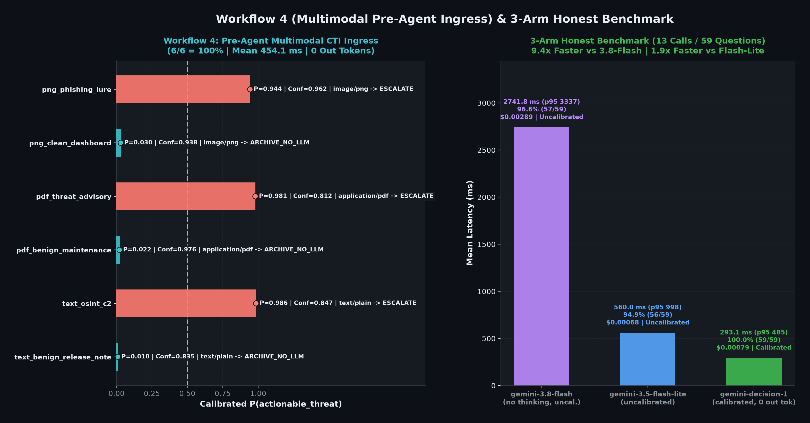

# Gemini Decision 1 Honest 3-Arm Benchmark

`scripts/governance/benchmark_decision1.py` compares `gemini-decision-1` against two generative baselines with `thinkingBudget=0`: `gemini-3.8-flash` and `gemini-3.5-flash-lite`. Across 13 live calls and 59 scored questions (`/tmp/decision1_v2_results/benchmark_v4_honest.json`), `gemini-decision-1` achieves 100.0% accuracy (59/59) with 293.12 ms mean latency, 484.72 ms p95 latency, 0 output tokens, and calibrated `[0.01, 0.99]` posterior probabilities.

\
*Figure 1. Three-arm live comparison (`gemini-decision-1` vs. `gemini-3.5-flash-lite` vs. `gemini-3.8-flash`, `thinkingBudget=0`) across 13 calls and 59 questions, alongside Workflow 4 multimodal CTI ingress results.*

## Three-arm comparison (`thinkingBudget=0`)

| Metric | `gemini-3.8-flash` (`thinkingBudget=0`) | `gemini-3.5-flash-lite` (`thinkingBudget=0`) | `gemini-decision-1` |
| --- | --- | --- | --- |
| Calls / questions | 13 / 59 | 13 / 59 | 13 / 59 |
| Input tokens | 3,874 | 3,874 | 7,898 |
| Output tokens | 691 | 724 | 0 |
| Mean latency | 2,741.77 ms | 559.96 ms | 293.12 ms |
| p50 latency | 2,684.41 ms | 508.14 ms | 271.56 ms |
| p95 latency | 3,337.09 ms | 997.78 ms | 484.72 ms |
| Estimated cost (USD) | $0.002890 | $0.000677 | $0.000790 |
| Accuracy | 96.6% (57/59) | 94.9% (56/59) | 100.0% (59/59) |
| Calibrated probabilities | `False` | `False` | `True` |

## Why Decision 1 wins even when Flash-Lite matches raw token cost

On raw token billing for this 13-call slice, `gemini-3.5-flash-lite` ($0.000677) is slightly cheaper than `gemini-decision-1` ($0.000790) because Decision 1 encodes per-question criteria into 7,898 input tokens while Flash-Lite uses 3,874 input tokens plus 724 output tokens.

Decision 1 still wins for inline ADK governance callbacks for three reasons:

1. **Tail latency:** `gemini-decision-1` cuts p95 latency to 484.72 ms, compared to 997.78 ms for `gemini-3.5-flash-lite` (2.06x slower) and 3,337.09 ms for `gemini-3.8-flash` (6.88x slower). Callback guards sit on the critical path of every tool and model turn, so p95 latency determines user-visible responsiveness.
2. **Zero-indexing and schema accuracy:** Both generative models mis-scored 0-indexed `severity` rubrics on benign UDM noise (`udm_noise_defender_cdn` and `udm_noise_qualys_scan` for `gemini-3.8-flash`, plus `udm_noise_osconfig_dns` for `gemini-3.5-flash-lite`), returning `0.0` instead of `1.0` to `2.5`. `gemini-decision-1` scored 59/59 (100.0%) with zero mismatches.
3. **Calibrated `[0.01, 0.99]` posteriors:** `gemini-decision-1` returns native calibrated probabilities (`noul`, `choice`, `score`) required by downstream thresholds such as `P(injection) >= 0.65` in Workflow 1 and `E[Loss|close]` vs. `E[Loss|isolate]` in Workflow 3. Generative models return uncalibrated JSON text (`calibrated_probabilities: False`).

## Reproduction

```bash
.venv/bin/python scripts/governance/benchmark_decision1.py \
  --gen-model gemini-3.8-flash \
  --lite-model gemini-3.5-flash-lite \
  --iterations 1 \
  --json-out /tmp/decision1_v2_results/benchmark_v4_honest.json
```
