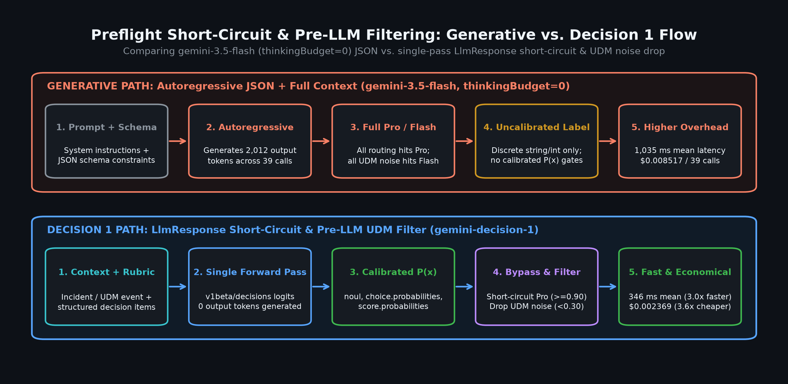
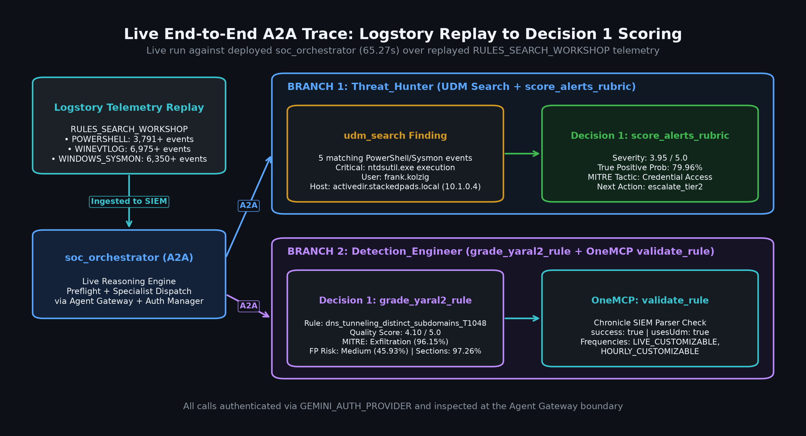
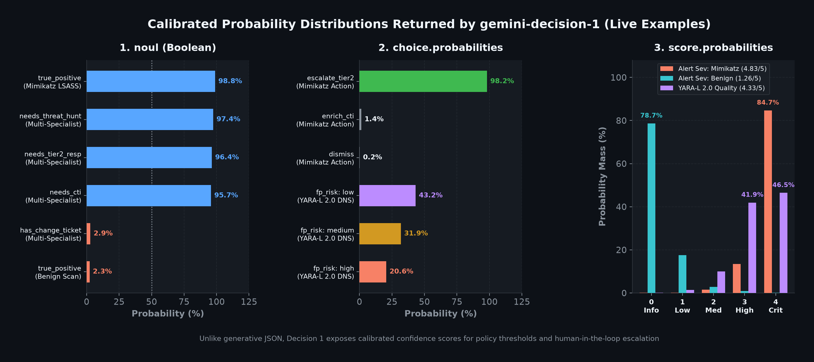
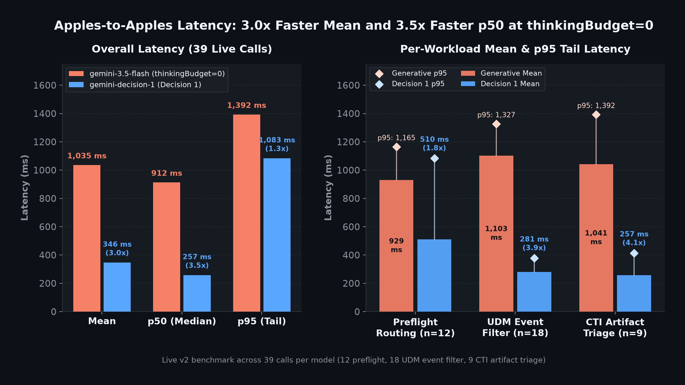

# Case Study: Single-Pass Pre-Flight Short-Circuit and Pre-LLM UDM Filtering

The strongest demonstration of Gemini Decision 1 (`gemini-decision-1`) in this repository is how it **eliminates downstream LLM turns** rather than merely reformatting JSON:

1. **True `LlmResponse` short-circuit in `soc_orchestrator`:** On initial user turns (`len(llm_request.contents) == 1`), `_preflight_before_model_callback` evaluates **6 heterogeneous questions** (`4 noul`, `1 choice`, `1` 0-indexed `score` shifted `+1.0`) in one `POST /v1beta/decisions` pass (`0` output tokens). When `workflow_mode == "single_specialist"` and exactly one specialist has `noul >= 0.90`, the callback returns `LlmResponse(content=Content(role="model", parts=[Part.from_function_call(name=target_agent, args={"request": prompt})]))` directly—**bypassing `gemini-3.1-pro-preview` on the initial routing turn**.
2. **Pre-LLM UDM noise filter in `threat_hunter`:** `_filter_udm_events_after_tool_callback` intercepts `udm_search` and `list_security_alerts` responses before `threat_hunter_llm` sees them, evaluating each event in parallel via `ThreadPoolExecutor` without `[:32000]` batch truncation. Benign OS/Defender DNS lookups (`P(true_positive) < 0.30`) are dropped before consuming Flash input tokens, while the replayed `RULES_SEARCH_WORKSHOP` `ntdsutil.exe` event (`frank.kolzig` on `activedir.stackedpads.local`) is retained and tagged `[HIGH_CONFIDENCE_ESCALATE]`.
3. **Authoritative Gateway enforcement preserved:** `soc_orchestrator` never blocks or self-refuses; ambiguous or multi-stage turns fall back to a non-binding `[PREFLIGHT_ROUTING]` instruction, and `detection_engineer` validates YARA-L 2.0 rules directly via Chronicle OneMCP `validate_rule` (`success: true`, `usesUdm: true`).

\
*Figure 1. `soc_orchestrator` `LlmResponse` short-circuit bypassing `gemini-3.1-pro-preview` on decisive single-specialist turns and `threat_hunter` `after_tool_callback` dropping low-signal UDM noise (`P(tp) < 0.30`) before the LLM runs.*

## Step 1: 6-question pre-flight routing (`soc_orchestrator`)

`_PREFLIGHT_QUESTIONS` in `governed_agents/soc_orchestrator/agent.py` batches six questions into a single `POST https://generativelanguage.googleapis.com/v1beta/decisions` call:

- **4 `noul` questions:** `needs_cti`, `needs_threat_hunt`, `needs_detection_eng`, `needs_tier2_response` (`needs_threat_hunt` explicitly excludes pure external GTI/VirusTotal lookups)
- **1 `choice` question:** `workflow_mode` (`single_specialist`, `multi_stage_investigation`, `containment_action`, `other`)
- **1 `score` question:** `urgency` (0-indexed levels `0..4`, shifted `+1.0` to `1.0..5.0` by `_parse_answers`)

### Sanitized `POST /v1beta/decisions` request

```json
{
  "model": "gemini-decision-1",
  "input": "Hunt the last 24h RULES_SEARCH_WORKSHOP PowerShell and Sysmon events in Chronicle SIEM; also validate dns_tunneling_distinct_subdomains_T1048.",
  "questions": {
    "needs_cti": {
      "type": "noul",
      "instructions": "Does the request ask to look up or enrich a file hash, domain, IP address, URL, or threat collection/campaign in external Google Threat Intelligence (GTI / VirusTotal)?"
    },
    "needs_threat_hunt": {
      "type": "noul",
      "instructions": "Does the request ask to search Chronicle SIEM logs or UDM telemetry, list or triage SIEM security alerts, inspect SIEM entity context, or check/manage SIEM feeds? Answer false for pure external GTI/VirusTotal reputation lookups that do not mention SIEM, UDM, alerts, or feeds."
    },
    "needs_detection_eng": {
      "type": "noul",
      "instructions": "Does the request ask to author, validate, audit, or test a Chronicle SIEM YARA-L 2.0 detection rule or manage a SIEM parser?"
    },
    "needs_tier2_response": {
      "type": "noul",
      "instructions": "Does the request ask to isolate or quarantine an endpoint host, disable a user account, update an alert status, or modify a containment reference list?"
    },
    "workflow_mode": {
      "type": "choice",
      "instructions": "Select the most appropriate orchestration workflow mode for this request.",
      "criteria": {
        "single_specialist": "Route directly to one matching specialist agent.",
        "multi_stage_investigation": "Coordinate two or more specialists in sequence or parallel.",
        "containment_action": "Execute or validate a host/account containment or SIEM response action.",
        "other": "General security operations question or unclear scope."
      }
    },
    "urgency": {
      "type": "score",
      "instructions": "Rate the operational urgency of this security request from routine inquiry to critical active incident.",
      "criteria": [
        "Level 0: Routine informational query, rule syntax check, or non-urgent lookup.",
        "Level 1: Low-priority enrichment or scheduled hygiene check.",
        "Level 2: Standard alert triage or suspicious indicator investigation.",
        "Level 3: High-priority active threat hunt or confirmed malicious indicator.",
        "Level 4: Critical active incident, crown-jewel asset impact, or immediate containment."
      ]
    }
  }
}
```

### Sanitized `POST /v1beta/decisions` response

```json
{
  "answers": {
    "needs_cti": { "type": "noul", "noul": 0.0412, "confidence": 0.9588 },
    "needs_threat_hunt": { "type": "noul", "noul": 0.9864, "confidence": 0.9864 },
    "needs_detection_eng": { "type": "noul", "noul": 0.9911, "confidence": 0.9911 },
    "needs_tier2_response": { "type": "noul", "noul": 0.0318, "confidence": 0.9682 },
    "workflow_mode": {
      "type": "choice",
      "choice": "multi_stage_investigation",
      "confidence": 0.9412,
      "probabilities": {
        "multi_stage_investigation": 0.9412,
        "single_specialist": 0.0481,
        "containment_action": 0.0064,
        "other": 0.0043
      }
    },
    "urgency": {
      "type": "score",
      "score": 2.45,
      "confidence": 0.7810
    }
  },
  "usage": {
    "promptTokenCount": 296,
    "candidatesTokenCount": 0,
    "totalTokenCount": 296
  }
}
```

Because this prompt requests two specialists (`workflow_mode == "multi_stage_investigation"`), `_short_circuit_target` returns `None` and `_format_preflight_hint` injects `[PREFLIGHT_ROUTING]`. By contrast, on single-specialist prompts (e.g., `"Look up domain reputation for google.com in GTI"` -> `workflow_mode == "single_specialist"`, `needs_cti >= 0.90`), `_preflight_before_model_callback` returns `LlmResponse` with `Part.from_function_call(name="CTI_Researcher", args={"request": prompt})`, skipping `gemini-3.1-pro-preview` entirely on that turn (saving ~`12,120` tokens and ~`19,200 ms` across `6/12` benchmark `preflight` calls).

## Step 2: Pre-LLM UDM noise filtering and YARA-L 2.0 validation

Following routing, `soc_orchestrator` delegates over A2A to `Threat_Hunter` and `Detection_Engineer` against the replayed `RULES_SEARCH_WORKSHOP` dataset:

1. **`Threat_Hunter` (`udm_search` + `_filter_udm_events_after_tool_callback`):** Queries Chronicle OneMCP for `POWERSHELL` and `WINDOWS_SYSMON` events matching `RULES_SEARCH_WORKSHOP`. Before `threat_hunter_llm` sees the payload, `_filter_udm_events_after_tool_callback` evaluates each event in parallel:
   - Benign OS/Defender DNS lookups (`P(true_positive) < 0.30`) are dropped (`dropped_low_signal_count`), saving downstream Flash input tokens.
   - Event 4 (`ntdsutil.exe` executed by `frank.kolzig` on `activedir.stackedpads.local`, `10.1.0.4`) is retained with `decision1_triage` metadata (`severity: 4`, `severity_score: 3.95`, `true_positive_probability: 0.7996`, `mitre_tactic: "credential_access"`, `next_action: "escalate_tier2"`), and events with `P(true_positive) >= 0.85` are tagged `[HIGH_CONFIDENCE_ESCALATE]`.
2. **`Detection_Engineer` (`validate_rule`):** Validates `dns_tunneling_distinct_subdomains_T1048` as a Chronicle SIEM **YARA-L 2.0** UDM event correlation rule (explicitly distinct from standard file/payload YARA) directly via Chronicle OneMCP `validate_rule` (`success: true`, `usesUdm: true`, `LIVE_CUSTOMIZABLE`, `HOURLY_CUSTOMIZABLE`).

\
*Figure 2. Live A2A trace against the deployed `soc_orchestrator` showing `RULES_SEARCH_WORKSHOP` PowerShell/Sysmon UDM hunting and Chronicle OneMCP `validate_rule` (`success: true`, `usesUdm: true`).*

\
*Figure 3. Calibrated probability distributions (`noul`, `choice.probabilities`, and `score.probabilities`) emitted by `gemini-decision-1` with zero output tokens.*

\
*Figure 4. Apples-to-apples benchmark latency comparison showing `gemini-decision-1` averaging `346.01 ms` versus `1,035.21 ms` for `gemini-3.5-flash` (`thinkingBudget=0`) across `preflight`, `udm_filter`, and `cti_artifact`.*

See [Gemini Decision 1 for Governed SOC Agents](gemini_decision_1.md) for the full architecture, Auth Manager 300s TTL caching, and aggregate v2 benchmark tables.
