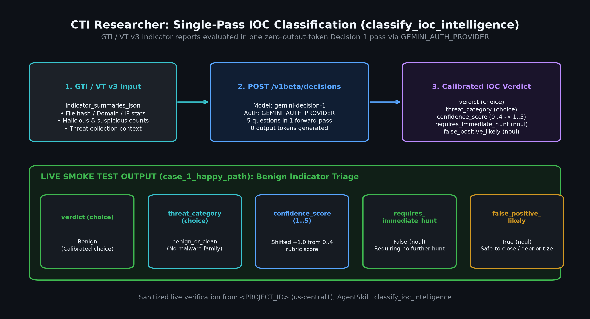
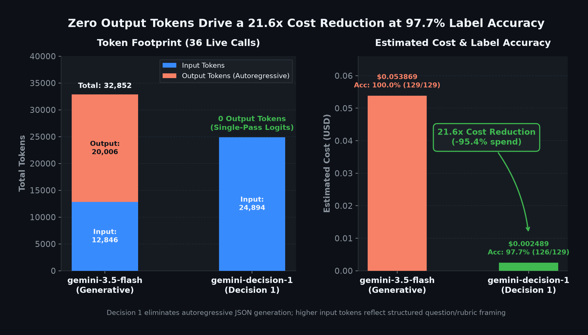
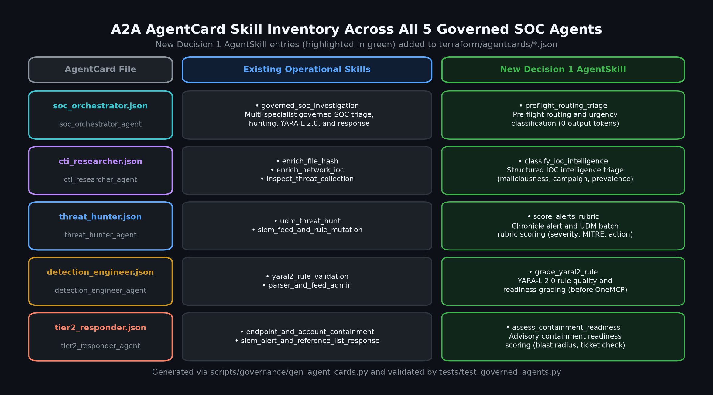

# CTI IOC Intelligence Triage with Gemini Decision 1

In `governed_agents/cti_researcher/`, the Cyber Threat Intelligence (CTI) Researcher specialist combines external Google Threat Intelligence (VirusTotal v3) indicator lookups with `classify_ioc_intelligence(indicator_summaries_json)` to evaluate indicator enrichment reports in **one zero-output-token forward pass** using Gemini Decision 1 (`gemini-decision-1` on `https://generativelanguage.googleapis.com/v1beta/decisions`).

By architectural design (`terraform/50-policies-egress.tf`), `cti_researcher` is laterally isolated to external threat intelligence: its SPIFFE workload identity is permitted egress only to `https://www.virustotal.com`, `generativelanguage.googleapis.com`, `agentidentitycredentials.googleapis.com`, and Vertex AI, with zero access to internal Chronicle SIEM/SOAR MCP endpoints or containment tools.

## Single-pass IOC classification (`classify_ioc_intelligence`)

After enriching a file hash, domain, IP address, or threat collection with `lookup_file_hash_reputation`, `lookup_domain_reputation`, `lookup_ip_reputation`, or `get_threat_collection`, the agent passes the summarized JSON payload to `classify_ioc_intelligence(indicator_summaries_json)` in `governed_agents/cti_researcher/gti_tools.py`.

If `indicator_summaries_json` is empty, the tool returns `{"enabled": False, "error": "indicator_summaries_json must not be empty."}` without making an API call. Otherwise, it batches **five structured questions** into a single `evaluate_decisions(...)` request:

| Question key | Type | Output / Range | Purpose in CTI triage |
| --- | --- | --- | --- |
| `verdict` | `choice` | `malicious`, `suspicious`, `benign`, `unknown` | Overall threat classification plus calibrated `verdict_confidence`. |
| `threat_category` | `choice` | `malware_delivery`, `command_and_control`, `phishing_credential_theft`, `scanning_exploitation`, `benign_infrastructure`, `other_or_unknown` | Primary threat category plus calibrated `threat_category_confidence`. |
| `confidence_score` | `score` | `1.0–5.0` (0-indexed `0..4` shifted `+1.0`) | Operational confidence rating based on multi-engine consensus and threat context. |
| `requires_immediate_hunt` | `noul` | Probability in `[0.0, 1.0]` (`>= 0.5` -> `true`) | Indicates whether internal SIEM/UDM threat hunting is warranted; preserves `requires_immediate_hunt_probability`. |
| `false_positive_likely` | `noul` | Probability in `[0.0, 1.0]` (`>= 0.5` -> `true`) | Flags likely false positives (dual-use admin tools, shared CDNs, isolated vendor heuristics); preserves `false_positive_likely_probability`. |

Because `score_question` defines a 0-indexed list of five rubric levels (`0` = very low confidence through `4` = very high confidence), `classify_ioc_intelligence` shifts the returned expected score by `+1.0` (`round(float(raw_score) + 1.0, 2)`) to align with the 1–5 operational confidence scale expected by `soc_orchestrator` and analysts.

\
*Figure 1. Single-pass `classify_ioc_intelligence` flow in `governed_agents/cti_researcher/gti_tools.py`, evaluating GTI/VirusTotal v3 summaries across `verdict`, `threat_category`, `confidence_score` (shifted `+1.0` to `1–5`), `requires_immediate_hunt`, and `false_positive_likely` with zero output tokens.*

\
*Figure 2. Aggregate output tokens (`0` vs. `20,006`) and total cost (`$0.002489` vs. `$0.053869`) comparing `gemini-decision-1` against `gemini-2.5-flash` JSON generation across governed SOC workloads.*

## Auth Manager and `AgentSkill` registration

### Runtime credential retrieval (`AuthProviderCredentialsServiceClient`)

No static API keys are stored in Terraform state or container environment variables. Instead, `terraform/20-authmanager.tf` provisions two separate Agent Platform Auth Manager providers and `terraform/41-agents.tf` injects only their resource names into `cti_researcher`:

1. **`GTI_AUTH_PROVIDER` (`<prefix>-gti-api-key`):** Holds the VirusTotal v3 API key and grants `roles/agentidentity.user` exclusively to `cti_researcher`.
2. **`GEMINI_AUTH_PROVIDER` (`<prefix>-gemini-api-key`):** Holds the Gemini Decisions API key and grants `roles/agentidentity.user` to all five governed Reasoning Engines.

At tool-call time, `governed_agents/cti_researcher/decision_client.py` resolves the Gemini credential in `_get_gemini_api_key()`:

- When `GEMINI_AUTH_PROVIDER` is set, it initializes a thread-safe `AuthProviderCredentialsServiceClient(transport="rest")` (guarded by `_creds_lock`) and calls `retrieve_credentials(RetrieveCredentialsRequest(auth_provider=provider_name, user_id="cti_researcher"))` against `agentidentitycredentials.googleapis.com` using the agent's SPIFFE workload identity.
- If `GEMINI_AUTH_PROVIDER` is unset, it falls back to `GEMINI_API_KEY`; if neither is configured, `evaluate_decisions` returns `{"enabled": False, ...}` so hermetic unit tests run without network access.

### A2A `AgentSkill` registration

In `governed_agents/cti_researcher/agent.py`, `classify_ioc_intelligence` is attached to `cti_llm.tools` and advertised on the A2A `AgentCard` (`create_agent_card`, materialized in `terraform/agentcards/cti_researcher.json`) alongside the three GTI lookup skills (`enrich_file_hash`, `enrich_network_ioc`, `inspect_threat_collection`):

```python
AgentSkill(
    id="classify_ioc_intelligence",
    name="Structured IOC intelligence triage",
    description=(
        "Evaluates GTI indicator enrichment summaries in a single "
        "zero-output-token pass to classify verdict, threat category, "
        "1-5 confidence score, immediate hunt urgency, and false-positive "
        "likelihood."
    ),
    tags=["cti", "triage", "classification", "decision", "gti"],
    examples=["Classify the GTI enrichment summary for this hash and domain"],
)
```

\
*Figure 3. Skill matrix across `terraform/agentcards/*.json` highlighting the `classify_ioc_intelligence` `AgentSkill` on `cti_researcher_agent` alongside the Decision 1 skills on the other governed specialists.*

## Sanitized `POST /v1beta/decisions` payload and `case_1_happy_path`

During the live `just governance-smoke-test` run (`scripts/governance/smoke_test.py`), `case_1_happy_path` instructs `soc_orchestrator` to ask `CTI_Researcher` to look up the GTI domain reputation for `google.com`. `CTI_Researcher` invokes `lookup_domain_reputation("google.com")` followed by `classify_ioc_intelligence`.

### Sanitized `POST /v1beta/decisions` request

```json
{
  "model": "gemini-decision-1",
  "input": "GTI / VirusTotal v3 indicator enrichment summaries:\n{\"indicator\": \"google.com\", \"indicator_type\": \"domain\", \"found\": true, \"reputation\": 1200, \"malicious_detections\": 0, \"suspicious_detections\": 0, \"harmless_detections\": 85, \"undetected_engines\": 9, \"popular_threat_label\": null, \"tags\": [\"top-1000\"], \"as_owner\": \"GOOGLE\"}",
  "questions": {
    "verdict": {
      "type": "choice",
      "instructions": "Classify the overall threat verdict for the summarized GTI/IOC indicator data.",
      "criteria": {
        "malicious": "Confirmed malicious indicator with strong multi-engine detections, malware family attribution, or active C2/exploit infrastructure.",
        "suspicious": "Partially flagged or anomalous indicator with moderate detections, newly observed domain, or ambiguous threat context.",
        "benign": "Clean or well-known legitimate infrastructure with zero or negligible detections and trusted ownership.",
        "unknown": "Insufficient intelligence, indicator not found in GTI, or conflicting data that prevents classification."
      }
    },
    "threat_category": {
      "type": "choice",
      "instructions": "Select the primary threat category represented by the indicator intelligence.",
      "criteria": {
        "malware_delivery": "Payload hosting, dropper, downloader, or malicious executable distribution.",
        "command_and_control": "Command-and-control server, beaconing domain/IP, or covert exfiltration channel.",
        "phishing_credential_theft": "Phishing lure, credential harvesting infrastructure, or brand impersonation.",
        "scanning_exploitation": "Vulnerability scanner, brute-force source, or active exploit delivery.",
        "benign_infrastructure": "Legitimate CDN, cloud provider, DNS resolver, or trusted enterprise service.",
        "other_or_unknown": "Threat category does not match the above options or insufficient data is present."
      }
    },
    "confidence_score": {
      "type": "score",
      "instructions": "Rate classification confidence from lowest (level 0) to highest (level 4) based on detection consensus and threat context.",
      "criteria": [
        "Very low confidence: indicator not found, conflicting signals, or minimal context.",
        "Low confidence: isolated weak detection with no threat family attribution.",
        "Moderate confidence: multiple suspicious signals or moderate detections without clear attribution.",
        "High confidence: strong multi-engine consensus, consistent tags, or known threat label.",
        "Very high confidence: overwhelming malicious consensus, explicit malware or campaign attribution, and corroborating metadata."
      ]
    },
    "requires_immediate_hunt": {
      "type": "noul",
      "instructions": "True if the indicator intelligence warrants immediate internal SIEM/UDM threat hunting across endpoints, network logs, or DNS telemetry; false otherwise."
    },
    "false_positive_likely": {
      "type": "noul",
      "instructions": "True if detections are likely a false positive such as a dual-use admin tool, shared CDN/cloud IP, or isolated vendor heuristic; false otherwise."
    }
  }
}
```

### Sanitized `POST /v1beta/decisions` response

```json
{
  "answers": {
    "verdict": {
      "type": "choice",
      "choice": "benign",
      "confidence": 0.9962,
      "probabilities": {
        "benign": 0.9962,
        "unknown": 0.0021,
        "suspicious": 0.0012,
        "malicious": 0.0005
      }
    },
    "threat_category": {
      "type": "choice",
      "choice": "benign_infrastructure",
      "confidence": 0.9941,
      "probabilities": {
        "benign_infrastructure": 0.9941,
        "other_or_unknown": 0.0042,
        "phishing_credential_theft": 0.0008,
        "malware_delivery": 0.0004,
        "command_and_control": 0.0003,
        "scanning_exploitation": 0.0002
      }
    },
    "confidence_score": {
      "type": "score",
      "score": 3.88,
      "confidence": 0.8920
    },
    "requires_immediate_hunt": {
      "type": "noul",
      "noul": 0.0038,
      "confidence": 0.9962
    },
    "false_positive_likely": {
      "type": "noul",
      "noul": 0.0145,
      "confidence": 0.9855
    }
  },
  "usage": {
    "promptTokenCount": 298,
    "candidatesTokenCount": 0,
    "totalTokenCount": 298
  }
}
```

### Live `case_1_happy_path` result

In the live `case_1_happy_path` smoke test, `classify_ioc_intelligence` shifts `confidence_score` (`3.88` + `1.0` = `4.88 / 5.0`) and returns a **`Benign`** verdict (`benign_infrastructure`) with `requires_immediate_hunt: false`, confirming that no further internal SIEM hunt action is required—all with `candidatesTokenCount: 0`.

See [Gemini Decision 1 for Governed SOC Agents](gemini_decision_1.md) for the full 5-agent architecture, Auth Manager configuration, and aggregate benchmark tables.
