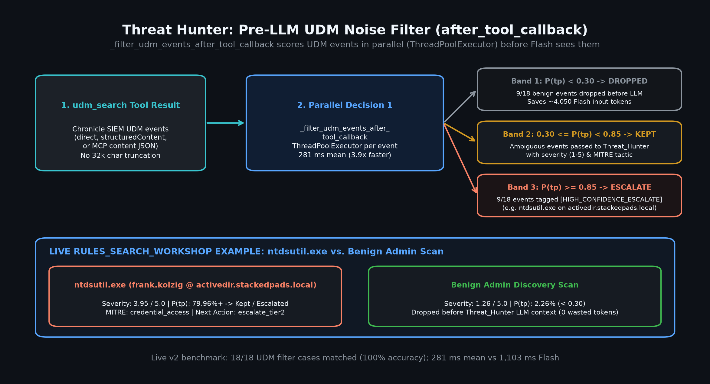
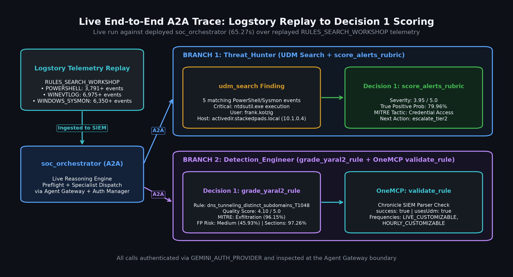
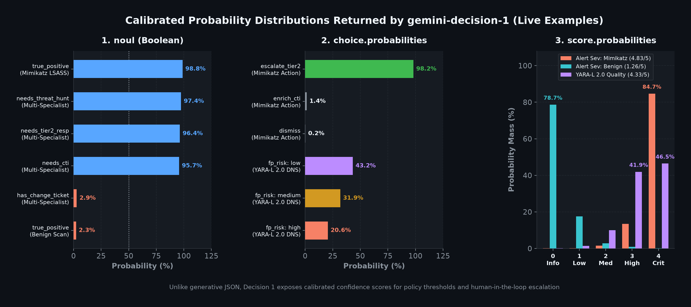

# Threat Hunter Pre-LLM UDM Noise Filter (`after_tool_callback`)

`threat_hunter` pairs read-only Google SecOps (Chronicle SIEM) Universal Data Model (UDM) hunting with `_filter_udm_events_after_tool_callback` in `governed_agents/threat_hunter/triage_tools.py`. Instead of passing every noisy SIEM event or alert into `threat_hunter_llm` (or truncating batches at `32,000` characters), the ADK `after_tool_callback` intercepts `udm_search` and `list_security_alerts` responses and evaluates each event **in parallel** via `gemini-decision-1` (`ThreadPoolExecutor`, `max_workers=8`) before the LLM sees the payload.

## How the `after_tool_callback` threshold filter works

`_extract_event_list` locates the event or alert list across direct dictionaries, `structuredContent`, and MCP JSON `content` wrappers (`events`, `alerts`, `results`, `udmEvents`, `securityAlerts`). `_evaluate_single_event` then sends `_EVENT_TRIAGE_QUESTIONS` for each item to `evaluate_decisions` (`governed_agents/threat_hunter/decision_client.py`, which caches Auth Manager tokens for 300 seconds and reuses a module-level `httpx.Client`):

| Question ID | Decision 1 Type | Output Mapping & Semantics | Rubric Options / Scale |
| :--- | :--- | :--- | :--- |
| `severity` | `score` | 0-indexed expected score (`0.0..4.0`) shifted `+1.0` to `severity_score` (`1.0..5.0`) and integer `severity` (`1..5`) | `1`: Informational/benign, `2`: Low anomaly, `3`: Medium suspicious, `4`: High likely threat, `5`: Critical active compromise |
| `true_positive` | `noul` | Calibrated probability (`0.0..1.0`) driving the pre-LLM drop/keep/escalate decision | True-positive security threat vs. benign administrative activity or false positive |
| `mitre_tactic` | `choice` | Categorical `choice` attached to `decision1_triage` | `initial_access`, `execution`, `persistence`, `privilege_escalation`, `defense_evasion`, `credential_access`, `discovery`, `lateral_movement`, `collection_exfiltration`, `command_and_control`, `other_or_benign` |
| `next_action` | `choice` | Categorical `choice` attached to `decision1_triage` | `dismiss`, `enrich_cti`, `escalate_tier2`, `tune_yaral2` |

Based on `P(true_positive)`:

- **`P(true_positive) < 0.30` (`_DROP_THRESHOLD`):** Dropped before `threat_hunter_llm` runs and counted in `dropped_low_signal_count`, saving downstream Flash input tokens (`9/18` events dropped in the v2 benchmark, saving ~`4,050` tokens).
- **`0.30 <= P(true_positive) < 0.85`:** Kept with `decision1_triage` metadata (`true_positive_probability`, `severity`, `severity_score`, `mitre_tactic`, `next_action`).
- **`P(true_positive) >= 0.85` (`_ESCALATE_THRESHOLD`):** Kept with `decision1_triage` metadata and tagged `[HIGH_CONFIDENCE_ESCALATE]` (`escalation_tag`).

When neither `GEMINI_AUTH_PROVIDER` nor `GEMINI_API_KEY` is configured, `_filter_udm_events_after_tool_callback` returns `None` so the raw tool response passes through unchanged and hermetic unit tests pass without network access.

\
*Figure 1. Parallel `after_tool_callback` UDM noise filter (`_DROP_THRESHOLD = 0.30`, `_ESCALATE_THRESHOLD = 0.85`) comparing the replayed `ntdsutil.exe` event on `activedir.stackedpads.local` (`3.95 / 5.0` shifted severity, `79.96%` TP, `credential_access`, `escalate_tier2`) against a benign admin discovery scan dropped before the LLM runs.*

## YARA-L 2.0 vs. standard YARA and Gateway boundaries

In both `governed_agents/threat_hunter/agent.py` and the `tune_yaral2` rubric option, `threat_hunter` explicitly distinguishes **Chronicle SIEM YARA-L 2.0** detection rules from **standard YARA** rules:

- **Chronicle SIEM YARA-L 2.0:** Event-correlation rules written against UDM telemetry (`meta`, `events`, and `condition` sections) and inspected via `list_rules`, `get_rule`, and `list_rule_detections`.
- **Standard YARA:** File and binary payload pattern-matching rules (`strings` and `condition` sections) used on artifacts rather than SIEM UDM event streams.

`threat_hunter` is strictly read-only on Chronicle OneMCP (`udm_search`, `search_raw_logs`, `translate_udm_query`, `list_security_alerts`, `get_security_alert`, `fetch_alert_data`, `search_entity`, `summarize_entity`, `get_ioc_match`, `list_rules`, `get_rule`, `list_rule_detections`). Mutating tools (`create_rule`, `delete_feed`, `create_reference_list`, `execute_manual_action`) and feed inspection (`list_feeds`) remain in `ADVERTISED_DENIED_TOOLS` so Agent Gateway IAM v3 CEL policies enforce live HTTP 403 denials at the boundary rather than relying on LLM self-refusal.

## Live Logstory `RULES_SEARCH_WORKSHOP` replay

To validate the UDM filter against realistic Windows enterprise telemetry, we replayed the Logstory `RULES_SEARCH_WORKSHOP` dataset into the test Google SecOps tenant:

- **Ingested telemetry volumes:** `POWERSHELL` (`3,791+` events), `WINEVTLOG` (`6,975+` events), and `WINDOWS_SYSMON` (`6,350+` events).
- **Live A2A hunt (`ntdsutil.exe`):** Querying Chronicle OneMCP via `udm_search` surfaced routine OS/Defender DNS lookups alongside a credential-dumping event where user `frank.kolzig` executed `ntdsutil.exe` on `activedir.stackedpads.local` (`10.1.0.4`).
- **Triage metadata:** The `ntdsutil.exe` event is retained with `severity_score: 3.95 / 5.0` (`severity: 4`, High Severity), `79.96%` true-positive probability, `mitre_tactic: "credential_access"`, and `next_action: "escalate_tier2"`.

\
*Figure 2. Live A2A trace against the deployed `soc_orchestrator` showing `threat_hunter` retrieving replayed `RULES_SEARCH_WORKSHOP` events and retaining the `ntdsutil.exe` activity (`3.95 / 5.0`, `79.96%` TP, `Credential Access`, `escalate_tier2`).*

\
*Figure 3. Calibrated probability distributions (`noul`, `choice.probabilities`, and `score` levels) produced by `gemini-decision-1` without generating output tokens.*

## Sanitized `POST /v1beta/decisions` request and response

### Sanitized request (`_evaluate_single_event`)

```json
{
  "model": "gemini-decision-1",
  "input": "Evaluate the following Chronicle SIEM UDM event or security alert:\n\n{\n  \"dataset\": \"RULES_SEARCH_WORKSHOP\",\n  \"event_id\": \"sysmon-ntdsutil-004\",\n  \"log_type\": \"WINDOWS_SYSMON\",\n  \"principal\": {\n    \"hostname\": \"activedir.stackedpads.local\",\n    \"ip\": \"10.1.0.4\",\n    \"user\": {\n      \"userid\": \"frank.kolzig\"\n    }\n  },\n  \"target\": {\n    \"process\": {\n      \"command_line\": \"ntdsutil.exe \\\"ac i ntds\\\" \\\"ifm\\\" \\\"create full c:\\\\temp\\\\ntds_dump\\\" q q\",\n      \"file\": {\n        \"full_path\": \"C:\\\\Windows\\\\System32\\\\ntdsutil.exe\"\n      }\n    }\n  }\n}",
  "questions": {
    "severity": {
      "type": "score",
      "instructions": "Score the overall security severity of this Chronicle SIEM alert or UDM event.",
      "criteria": [
        "Informational or benign activity with no security impact.",
        "Low severity anomaly or policy notice requiring routine review.",
        "Medium severity suspicious activity warranting analyst investigation.",
        "High severity likely threat activity with potential host or account impact.",
        "Critical severity active compromise, lateral movement, or data exfiltration."
      ]
    },
    "true_positive": {
      "type": "noul",
      "instructions": "Determine whether this alert or UDM event represents a true positive security threat rather than benign administrative activity or a false positive."
    },
    "mitre_tactic": {
      "type": "choice",
      "instructions": "Select the primary MITRE ATT&CK tactic represented by this alert or UDM event.",
      "criteria": {
        "initial_access": "Phishing, exploit public-facing application, or external remote service entry.",
        "execution": "Command and scripting interpreter, PowerShell, WMI, or malicious binary execution.",
        "persistence": "Scheduled tasks, registry run keys, new accounts, or startup modifications.",
        "privilege_escalation": "Token manipulation, sudo abuse, UAC bypass, or elevation to admin or SYSTEM.",
        "defense_evasion": "Log clearing, process hollowing, disabling security tools, or obfuscation.",
        "credential_access": "LSASS dumping, brute force, Kerberoasting, or credential harvesting.",
        "discovery": "Network scanning, account or domain enumeration, or host reconnaissance.",
        "lateral_movement": "SMB, WinRM, RDP, or SSH pivoting or remote service execution across hosts.",
        "collection_exfiltration": "Staging archives, unusual outbound transfers, or DNS or HTTP exfiltration.",
        "command_and_control": "Beaconing, C2 callbacks, or anomalous external encrypted channels.",
        "other_or_benign": "Other tactic not listed above, or benign or inconclusive activity."
      }
    },
    "next_action": {
      "type": "choice",
      "instructions": "Select the recommended next SOC triage action for this alert or UDM event.",
      "criteria": {
        "dismiss": "Benign or clear false positive; close or deprioritize without further escalation.",
        "enrich_cti": "Suspicious indicators present; enrich IPs, domains, or hashes via CTI before escalating.",
        "escalate_tier2": "High-confidence threat or active compromise; escalate to Tier 2 for containment.",
        "tune_yaral2": "Noisy or overly broad Chronicle SIEM YARA-L 2.0 detection rule (distinct from standard file/payload YARA); send to Detection Engineering for tuning."
      }
    }
  }
}
```

### Sanitized response (`_evaluate_single_event`)

```json
{
  "answers": {
    "severity": {
      "type": "score",
      "score": 2.95,
      "confidence": 0.8412
    },
    "true_positive": {
      "type": "noul",
      "noul": 0.7996,
      "confidence": 0.7996
    },
    "mitre_tactic": {
      "type": "choice",
      "choice": "credential_access",
      "confidence": 0.9145,
      "probabilities": {
        "credential_access": 0.9145,
        "execution": 0.0482,
        "privilege_escalation": 0.0211,
        "discovery": 0.0094,
        "other_or_benign": 0.0068
      }
    },
    "next_action": {
      "type": "choice",
      "choice": "escalate_tier2",
      "confidence": 0.8834,
      "probabilities": {
        "escalate_tier2": 0.8834,
        "enrich_cti": 0.0891,
        "tune_yaral2": 0.0182,
        "dismiss": 0.0093
      }
    }
  },
  "usage": {
    "promptTokenCount": 412,
    "candidatesTokenCount": 0,
    "totalTokenCount": 412
  }
}
```

`_evaluate_single_event` shifts `answers.severity.score` (`2.95`) by `+1.0` to `3.95` (`severity: 4`), keeps the event because `0.7996 >= 0.30`, and attaches `decision1_triage` before passing the filtered list to `threat_hunter_llm`.

See [Gemini Decision 1 for Governed SOC Agents](gemini_decision_1.md) for the full architecture and [Case Study: Single-Pass Pre-Flight Short-Circuit and Pre-LLM UDM Filtering](gemini_decision_1_case_study.md) for the end-to-end `soc_orchestrator` walkthrough.
