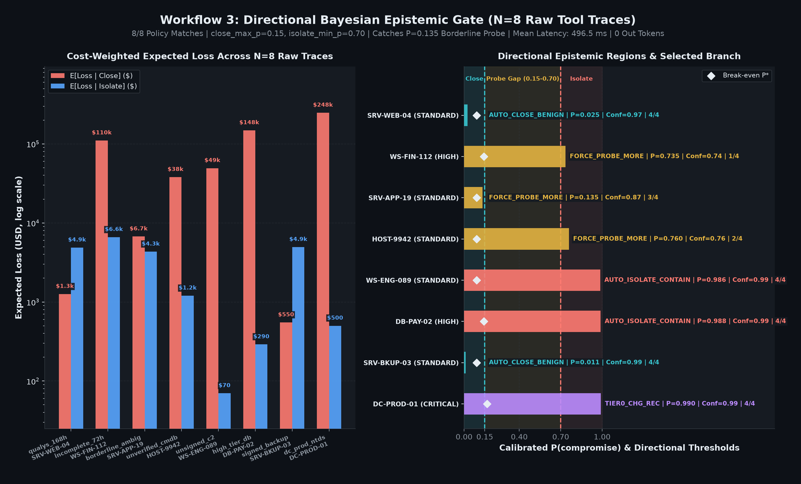
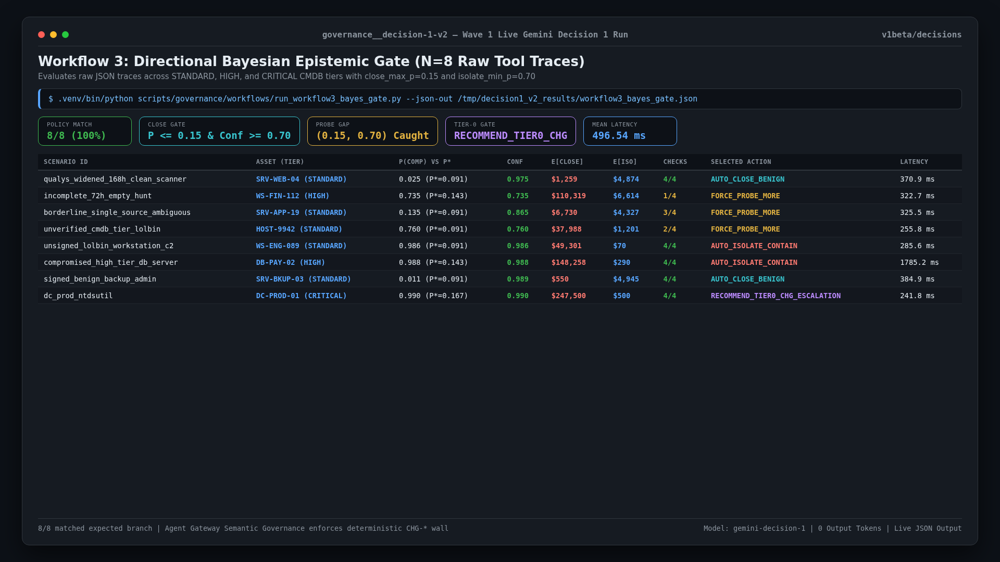

# Workflow 3: Cost-Weighted Bayes Containment Gate

`governed_agents/shared_decision_guards/bayes_containment_gate.py` combines calibrated `noul` probabilities from Gemini Decision 1 with asymmetric CMDB asset-criticality loss matrices in pure Python to select one of four containment outcomes: `AUTO_CLOSE_BENIGN`, `FORCE_PROBE_MORE`, `AUTO_ISOLATE_CONTAIN`, or `RECOMMEND_TIER0_CHG_ESCALATION`.

Across 8 live raw JSON tool-trace scenarios (`/tmp/decision1_v2_results/workflow3_bayes_gate.json`), the gate matches 8/8 expected actions with 0 output tokens, including catching borderline intermediate posteriors (`P = 0.1346` on `SRV-APP-19`) and unverified CMDB tiers (`HOST-9942`).

\
*Figure 1. Expected financial loss (`E[Loss|close]` vs. `E[Loss|isolate]`) across the 8 live raw JSON tool-trace scenarios, showing `AUTO_CLOSE_BENIGN`, `FORCE_PROBE_MORE`, `AUTO_ISOLATE_CONTAIN`, and `RECOMMEND_TIER0_CHG_ESCALATION` on `DC-PROD-01`.*

## Expected financial loss across CMDB tiers

Fixed probability cutoffs treat a developer workstation and a Tier-0 domain controller identically. `compute_expected_losses` instead compares the expected cost of closing a true compromise (`expected_loss_close = P(compromise) * L_FN`) against the expected cost of isolating a healthy host (`expected_loss_isolate = (1 - P(compromise)) * L_FP`). Containment becomes Bayes-optimal when `P(compromise)` exceeds `bayes_threshold = L_FP / (L_FP + L_FN)`.

`ASSET_TIER_LOSSES` defines four CMDB `AssetTier` profiles (with `normalize_asset_tier` mapping `TIER-0`, `TIER0`, and `T0` to `CRITICAL`):

| Asset tier | False positive loss (`L_FP`) | False negative loss (`L_FN`) | Bayes threshold (`P*`) |
| --- | --- | --- | --- |
| `LOW` | $500 | $10,000 | 0.0476 |
| `STANDARD` | $5,000 | $50,000 | 0.0909 |
| `HIGH` | $25,000 | $150,000 | 0.1429 |
| `CRITICAL` (Tier-0) | $50,000 | $250,000 | 0.1667 |

## Four epistemic checks and `[COMPUTED_WINDOW_HOURS]`

Before comparing financial losses, `evaluate_bayes_containment_gate` evaluates `_BAYES_GATE_QUESTIONS` in a single `gemini-decision-1` call (5 `noul` questions, 0 output tokens). For raw UDM tool traces, `compute_udm_window_bucket` deterministically computes `[COMPUTED_WINDOW_HOURS]` from RFC3339 `start_time` and `end_time` arguments in Python so the model does not do timestamp arithmetic:

1. `compromise_detected`: Whether the target host or account is genuinely compromised.
2. `corroborated_two_sources`: Whether the finding is corroborated by at least two independent telemetry or intelligence sources.
3. `widened_72h_to_168h_on_empty_hunt`: Whether the investigation confirmed positive hits or widened an empty 72-hour hunt window to 168 hours.
4. `checked_lolbin_signer`: Whether any involved LOLBin or executable had its digital signature, file path, and parent-child process chain verified.
5. `verified_asset_tier`: Whether the target asset's hostname and CMDB criticality tier were explicitly verified.

Each epistemic check passes when its `noul` probability is `>= DEFAULT_EPISTEMIC_THRESHOLD` (0.50).

## Directional thresholds and the `65-semantic-governance.tf` boundary

Because `noul` returns symmetric confidence (`confidence = max(p, 1 - p)`), a borderline posterior such as `P = 0.135` has `confidence = 0.865` even though it exceeds `STANDARD` Bayes threshold `P* = 0.0909`. `decide_containment_action` resolves this with directional thresholds (`DEFAULT_CLOSE_MAX_P = 0.15`, `DEFAULT_ISOLATE_MIN_P = 0.70`, `DEFAULT_POSITIVE_ACTION_CONFIDENCE = 0.70`):

1. **`FORCE_PROBE_MORE`:** Triggered if any epistemic check fails, if `p_compromise` falls in the uncertain intermediate zone `(0.15, 0.70)`, or if `expected_loss_close > expected_loss_isolate` while `p_compromise < 0.70` (such as `P = 0.1346` on `SRV-APP-19`). `make_bayes_epistemic_before_model_callback` injects `[EPISTEMIC_INVESTIGATION_ADVISORY]` into `llm_request` so the model runs the missing tool probes before synthesizing its verdict.
2. **`RECOMMEND_TIER0_CHG_ESCALATION`:** Triggered when `p_compromise >= 0.70`, `expected_loss_close > expected_loss_isolate`, and `asset_tier == AssetTier.CRITICAL`. Sets `requires_chg_ticket = True` and injects `[TIER0_CHG_ADVISORY]`, leaving `terraform/65-semantic-governance.tf` at the Agent Gateway as the sole deterministic enforcement wall for `CHG-*` emergency change tickets.
3. **`AUTO_ISOLATE_CONTAIN`:** Triggered when `p_compromise >= 0.70`, `expected_loss_close > expected_loss_isolate`, and all epistemic checks pass on `LOW`, `STANDARD`, or `HIGH` assets.
4. **`AUTO_CLOSE_BENIGN`:** Triggered when `p_compromise <= 0.15`, `1 - p_compromise >= 0.70`, `expected_loss_close <= expected_loss_isolate`, and all epistemic checks pass.

\
*Figure 2. Live run of `scripts/governance/workflows/run_workflow3_bayes_gate.py` showing 8/8 deterministic branch matches over raw JSON tool traces.*

## Live scenario results (N=8)

| Scenario ID | Asset (`Tier`) | `P(compromise)` / Conf | `E[Loss\|close]` | `E[Loss\|isolate]` | Action | Latency (ms) |
| --- | --- | --- | --- | --- | --- | --- |
| `qualys_widened_168h_clean_scanner` | `SRV-WEB-04` (`STANDARD`) | 0.0252 / 0.9748 | $1,259.16 | $4,874.08 | `AUTO_CLOSE_BENIGN` | 370.87 |
| `incomplete_72h_empty_hunt` | `WS-FIN-112` (`HIGH`) | 0.7355 / 0.7355 | $110,318.57 | $6,613.57 | `FORCE_PROBE_MORE` | 322.74 |
| `borderline_single_source_ambiguous` | `SRV-APP-19` (`STANDARD`) | 0.1346 / 0.8654 | $6,730.41 | $4,326.96 | `FORCE_PROBE_MORE` | 325.47 |
| `unverified_cmdb_tier_lolbin` | `HOST-9942` (`STANDARD`) | 0.7598 / 0.7598 | $37,987.97 | $1,201.20 | `FORCE_PROBE_MORE` | 255.80 |
| `unsigned_lolbin_workstation_c2` | `WS-ENG-089` (`STANDARD`) | 0.9860 / 0.9860 | $49,301.06 | $69.89 | `AUTO_ISOLATE_CONTAIN` | 285.63 |
| `compromised_high_tier_db_server` | `DB-PAY-02` (`HIGH`) | 0.9884 / 0.9884 | $148,257.77 | $290.37 | `AUTO_ISOLATE_CONTAIN` | 1,785.15 |
| `signed_benign_backup_admin` | `SRV-BKUP-03` (`STANDARD`) | 0.0110 / 0.9890 | $550.04 | $4,945.00 | `AUTO_CLOSE_BENIGN` | 384.85 |
| `dc_prod_ntdsutil` | `DC-PROD-01` (`CRITICAL`) | 0.9900 / 0.9900 | $247,500.00 | $500.00 | `RECOMMEND_TIER0_CHG_ESCALATION` | 241.80 |

## Reproduction

```bash
.venv/bin/python -m pytest -o addopts="" tests/test_workflow3_bayes_gate.py
.venv/bin/python scripts/governance/workflows/run_workflow3_bayes_gate.py
```
