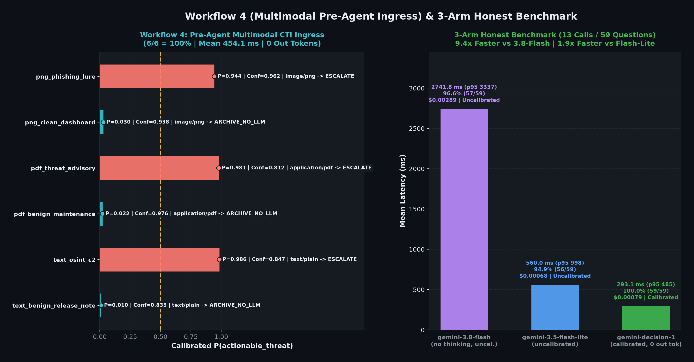

# Workflow 4: Pre-Agent Multimodal CTI Ingress

`governed_agents/shared_decision_guards/multimodal_cti_ingress.py` implements `triage_multimodal_security_artifact`, a pre-agent ingress gate backed by `gemini-decision-1` (`POST /v1beta/decisions`). It evaluates raw bytes, local file paths, HTTPS/Files-API URIs, or base64/text payloads (`image/png`, `application/pdf`, `text/plain`) alongside optional header or CMDB JSON context in one zero-output-token call before waking `cti_researcher` or any downstream generative LLM.

Across 6 live multimodal cases (`/tmp/decision1_v2_results/workflow4_multimodal_ingress.json`), the gate achieves 100% accuracy (6/6) with 454.15 ms mean latency, 6,818 total input tokens, and 0 output tokens.

\
*Figure 1. Live Workflow 4 pre-agent multimodal CTI ingress results across `image/png`, `application/pdf`, and `text/plain` artifacts (6/6 accuracy, 0 output tokens, native calibrated confidence) alongside the 3-arm honest benchmark.*

## Why multimodal artifacts belong at pre-agent ingress

In ADK and MCP architectures, passing raw PDFs or PNG screenshots through an LLM tool `FunctionCall` forces the generative model to serialize or base64-encode binary payloads inside JSON arguments, inflating token cost and risking truncation before inspection.

`triage_multimodal_security_artifact` places `gemini-decision-1` at the ingress boundary before the agent loop starts:

- **`_build_artifact_input`:** Normalizes `image/*` into `type: "image"`, `application/pdf` into `type: "document"`, `audio/*` into `type: "audio"`, `video/*` into `type: "video"`, and `text/plain` into `type: "text"` parts via `decision_client.py`.
- **`_INGRESS_QUESTIONS`:** Evaluates `is_actionable_threat` (`noul`), `threat_category` (`choice`), `severity` (`score` shifted `+1.0` to a `1.0` to `5.0` scale), and `requires_immediate_hunt` (`noul`) in one forward pass.
- **`_compute_native_confidence`:** Computes confidence directly from Decision 1's native calibrated `answer["confidence"]` on `is_actionable_threat` and `threat_category` rather than a synthetic verbal rubric.
- **Routing:** Actionable artifacts route to `escalate_threat_hunter`; benign artifacts route to `archive_no_llm` without waking a generative model.

## Live scenario results

| Case ID | Modality | Actionable (`P`) | Threat category | Severity | Confidence | Route | Latency (ms) | Input tokens |
| --- | --- | --- | --- | --- | --- | --- | --- | --- |
| `png_phishing_lure` | `image/png` | `true` (0.9441) | `phishing_credential_theft` | 3.84 | 0.9615 | `escalate_threat_hunter` | 588.67 | 1,622 |
| `png_clean_dashboard` | `image/png` | `false` (0.0302) | `benign_infrastructure` | 1.20 | 0.9381 | `archive_no_llm` | 326.35 | 1,633 |
| `pdf_threat_advisory` | `application/pdf` | `true` (0.9805) | `command_and_control` | 4.18 | 0.8118 | `escalate_threat_hunter` | 600.36 | 1,220 |
| `pdf_benign_maintenance` | `application/pdf` | `false` (0.0219) | `benign_infrastructure` | 1.08 | 0.9759 | `archive_no_llm` | 606.87 | 1,182 |
| `text_osint_c2` | `text/plain` | `true` (0.9857) | `command_and_control` | 4.45 | 0.8470 | `escalate_threat_hunter` | 354.25 | 591 |
| `text_benign_release_note` | `text/plain` | `false` (0.0100) | `benign_infrastructure` | 1.06 | 0.8345 | `archive_no_llm` | 248.41 | 570 |

## Reproduction

```bash
.venv/bin/python -m pytest -o addopts="" tests/test_multimodal_cti_ingress.py
.venv/bin/python scripts/governance/workflows/run_workflow4_multimodal_ingress.py
```
