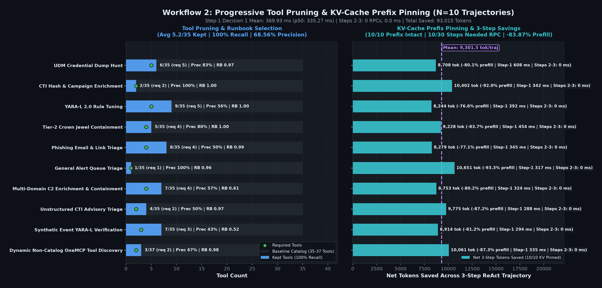
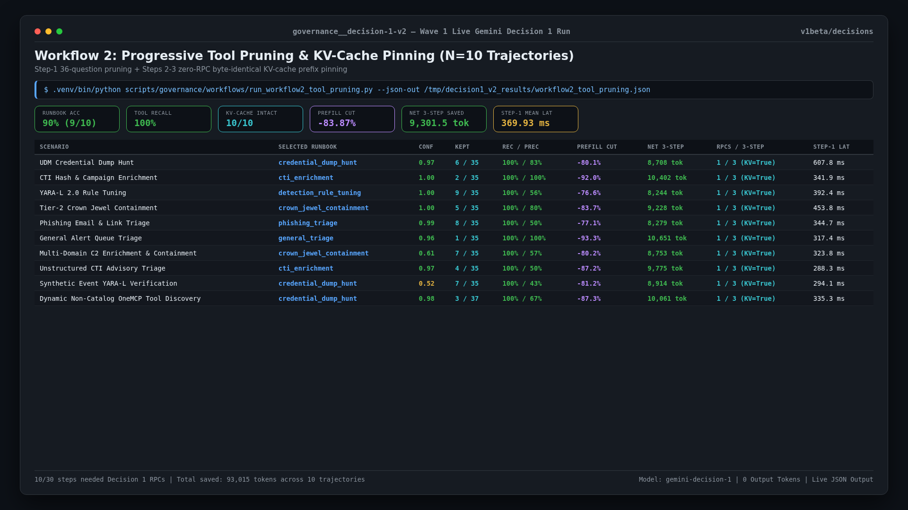

# Workflow 2: Progressive Tool and Runbook Pruning

`governed_agents/shared_decision_guards/progressive_tool_pruner.py` implements an ADK `before_model_callback` (`progressive_tool_pruner_callback` and `make_progressive_tool_pruner_callback`) that evaluates 36 structured questions in a single Gemini Decision 1 pass (0 output tokens) on Step 1 and pins the pruned tool set and runbook across subsequent tool-continuation steps.

Across 10 live 3-step SOC trajectories over a 35-tool catalog and 6 operational runbooks, the pruner achieves 90.00% runbook accuracy (9/10), 100.00% tool recall (0 missing required tools), 68.56% mean tool precision, and an 83.87% mean prefill reduction (16,027.2 bytes saved per step, ~4,006.5 estimated tokens saved per step). With Turn-1 KV-cache prefix pinning (`prune_with_session_pinning_async`), Steps 2 and 3 execute in 0.0 ms with 0 Decision 1 RPCs and 10/10 byte-identical prefix hashes (`compute_prefix_hash`), yielding 9,301.5 net tokens saved per 3-step trajectory (93,015 tokens total across 10 trajectories).

\
*Figure 1. Baseline vs. pruned `LlmRequest` prefill bytes and 3-step trajectory savings with Turn-1 KV-cache prefix pinning (`10/10` intact prefix hashes, `10` total RPCs across `30` steps).*

## Single-pass 36-question scoring and live catalog extraction

`build_pruning_questions` constructs one Decision 1 request containing:

1. **1 `choice` question (`select_runbook`):** Matches the prompt against `RUNBOOK_CRITERIA` for the 6 playbooks in `SOC_RUNBOOKS` (`credential_dump_hunt`, `phishing_triage`, `cti_enrichment`, `crown_jewel_containment`, `detection_rule_tuning` for Chronicle SIEM **YARA-L 2.0** UDM rules rather than standard file/payload YARA, and `general_triage`).
2. **35+ `noul` questions (`tool_needed_<tool_name>`):** Evaluates each tool in `SOC_TOOL_CATALOG` or any dynamically registered `FunctionDeclaration.description` extracted at runtime by `_extract_request_tool_descriptions`.

Because `gemini-decision-1` scores all 36 questions in one forward pass over the shared input prompt, Step-1 evaluation finishes with 0 output tokens (362.38 ms mean, 319.83 ms p50, 458.46 ms p95 in the Wave 1 verification run).

## Turn-1 KV-cache prefix pinning and canary preservation

Re-pruning tools on every step of a multi-step tool loop invalidates the downstream LLM's KV cache whenever the system prompt or tool declaration list changes. `prune_with_session_pinning_async` prevents cache thrashing:

- **Step 1:** Runs Decision 1, stores `tool_pruner_pinned_plan` (`kept_tools`, `selected_runbook`, `runbook_confidence`) and `tool_pruner_pinned_prompt` in session state, and mutates `LlmRequest`.
- **Steps 2 and 3 (`_is_tool_continuation_step`):** Reapplies `_apply_pinned_plan` in 0.0 ms with 0 Decision 1 RPCs, preserving a byte-identical `compute_prefix_hash` across all 10 trajectories (10/10 intact).
- **Minimum catalog guard (`DEFAULT_MIN_TOOLS_TO_PRUNE = 12`):** Skips Decision 1 overhead when an agent already has fewer than 12 declared tools.
- **Canary preservation (`preserve_canary_tools`):** Retains designated `ADVERTISED_DENIED_TOOLS` alongside `safety_floor_tools` so Agent Gateway allowlist tests and security canaries are never pruned away.

\
*Figure 2. Live run of `scripts/governance/workflows/run_workflow2_tool_pruning.py` showing 10/10 KV-cache prefix pinning, 100.00% tool recall, 83.87% prefill reduction, and 9,301.5 net tokens saved per 3-step trajectory.*

## Live 10-trajectory results

| Scenario ID | Selected runbook (match) | Kept tools | Recall / precision | 3-step net tokens saved |
| --- | --- | --- | --- | --- |
| `udm_credential_dump_hunt` | `credential_dump_hunt` (`true`) | 6 / 35 | 1.00 / 0.83 | 8,708 |
| `cti_hash_lookup` | `cti_enrichment` (`true`) | 2 / 35 | 1.00 / 1.00 | 10,402 |
| `yaral_rule_tuning` | `detection_rule_tuning` (`true`) | 9 / 35 | 1.00 / 0.56 | 8,244 |
| `tier2_containment` | `crown_jewel_containment` (`true`) | 5 / 35 | 1.00 / 0.80 | 9,228 |
| `phishing_triage` | `phishing_triage` (`true`) | 8 / 35 | 1.00 / 0.50 | 8,279 |
| `general_alert_queue_triage` | `general_triage` (`true`) | 1 / 35 | 1.00 / 1.00 | 10,651 |
| `multi_domain_c2_containment` | `crown_jewel_containment` (`true`) | 7 / 35 | 1.00 / 0.57 | 8,753 |
| `unstructured_cti_advisory` | `cti_enrichment` (`true`) | 4 / 35 | 1.00 / 0.50 | 9,775 |
| `synthetic_rule_coverage_check` | `credential_dump_hunt` (`false`) | 7 / 35 | 1.00 / 0.43 | 8,914 |
| `dynamic_onemcp_timeline_export` | `credential_dump_hunt` (`true`) | 3 / 37 | 1.00 / 0.67 | 10,061 |

## Reproduction

```bash
.venv/bin/python -m pytest -o addopts="" tests/test_workflow2_tool_pruning.py
.venv/bin/python scripts/governance/workflows/run_workflow2_tool_pruning.py
```
