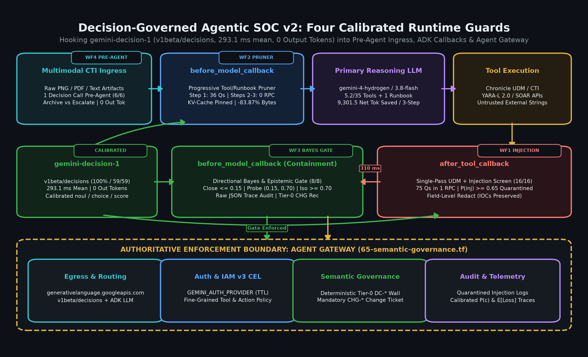

# Gemini Decision 1 v2 Lifecycle Workflows

Gemini Decision 1 (`gemini-decision-1` on `https://generativelanguage.googleapis.com/v1beta/decisions`) evaluates structured questions in a single forward pass and returns calibrated probabilities (`noul`), discrete labels (`choice`), and ordinal scores (`score`) with zero output tokens.

In v2, Decision 1 moves out of LLM-callable tool wrappers and into Google Agent Development Kit (ADK) lifecycle callbacks and pre-agent ingress gates under `governed_agents/shared_decision_guards/`. Across four live workflows (40 scenarios total) and an honest 3-arm benchmark (59 scored questions), the v2 stack achieves 100% classification accuracy on injection screening (16/16), Bayes containment (8/8), and multimodal CTI ingress (6/6), cuts prompt prefill by 83.87% across 3-step trajectories with 10/10 KV-cache prefix pinning, and outperforms `gemini-3.5-flash-lite` and `gemini-3.8-flash` on accuracy and tail latency.

\
*Figure 1. ADK lifecycle callback pipeline showing Workflow 2 (`before_model_callback` progressive tool and runbook pruning with KV-cache pinning), Workflow 1 (`after_tool_callback` LOLBin-safe prompt-injection screening and IOC-preserving redaction), Workflow 3 (`before_model_callback` directional Bayesian epistemic gate), and Workflow 4 (pre-agent multimodal CTI ingress).*

## Why v2 moves Decision 1 into ADK lifecycle callbacks

When a triage check or safety gate is exposed as a standard LLM tool, the generative model decides whether to call it, what arguments to pass, and how to interpret the result. Untrusted telemetry returned by an earlier tool call can steer the model to skip the check or fabricate a benign disposition.

Moving Decision 1 into ADK lifecycle callbacks and pre-agent ingress removes that discretion:

1. **`before_model_callback` (`progressive_tool_pruner_callback` / `prune_with_session_pinning_async`):** Runs before the generative model sees the request. Scores 35 tools and 6 runbooks in one Decision 1 pass on Step 1, strips irrelevant declarations and instructions from `LlmRequest`, and pins the plan for Steps 2 and 3 so KV-cache prefixes stay byte-identical with 0 extra RPCs.
2. **`after_tool_callback` (`screen_tool_output_after_tool_callback` and `triage_tools.py`):** Runs immediately after untrusted MCP or enrichment tools return and before the payload enters the model context. Evaluates UDM triage and indirect prompt injection in one 75-question pass (`triage_tools.py`), checks `inj_prob >= 0.65` before `tp_prob < 0.30`, and redacts only free-text leaves via `redact_free_text_fields` so structured IOCs stay visible.
3. **`before_model_callback` (`make_bayes_epistemic_before_model_callback`):** Runs over raw JSON tool traces before the LLM synthesizes its post-tool verdict. Audits 4 epistemic checks and computes asymmetric expected financial loss across CMDB tiers, using directional `close_max_p = 0.15` and `isolate_min_p = 0.70` thresholds so intermediate `(0.15, 0.70)` posteriors route to `FORCE_PROBE_MORE`.
4. **Pre-agent ingress (`triage_multimodal_security_artifact`):** Screens raw `image/png`, `application/pdf`, and `text/plain` CTI artifacts before waking `cti_researcher`, eliminating base64 binary serialization inside LLM JSON `FunctionCall` arguments.

## Shared client, container packaging, and `soc_orchestrator` guard

All four workflows share `governed_agents/shared_decision_guards/decision_client.py` (re-exported by `soc_orchestrator/decision_client.py`, `threat_hunter/decision_client.py`, and `cti_researcher/decision_client.py`). The canonical client supports synchronous (`evaluate_decisions`) and asynchronous (`aevaluate_decisions`) calls, multimodal `input` parts (`text`, `image`, `document`, `audio`, `video`), HTTP 400 input-safety block detection (`safety_blocked: True`), and 300-second in-memory Agent Platform Auth Manager token caching (`GEMINI_AUTH_PROVIDER`).

To prevent `ModuleNotFoundError` inside Vertex AI Reasoning Engine containers, `scripts/governance/package_agent.sh` and `terraform/40-package.tf` bundle `shared_decision_guards/` into every `terraform/dist/<agent>.tar.gz` archive and compute identical deterministic SHA-256 hashes over the sorted file list. In `soc_orchestrator`, `_preflight_before_model_callback` guards on `len(contents) != 1` so short-circuit routing only fires on initial user turns.

## How the four workflows compose

| Workflow | Hook / boundary | Module | Decision 1 questions | Live accuracy | Mean latency |
| --- | --- | --- | --- | --- | --- |
| Workflow 1: Indirect Prompt-Injection Guard | `after_tool_callback` | `governed_agents/shared_decision_guards/prompt_injection_guard.py` + `governed_agents/threat_hunter/triage_tools.py` | Single-pass 75-question UDM + injection batch (up to 15 items per RPC) | 100% (16/16) | 309.86 ms |
| Workflow 2: Progressive Tool & Runbook Pruning | `before_model_callback` | `governed_agents/shared_decision_guards/progressive_tool_pruner.py` | 1 `choice` (`select_runbook`) + 35 `noul` (`tool_needed_*`) on Step 1; 0 RPCs on Steps 2 and 3 | 90.00% runbook (9/10), 100% tool recall | 362.38 ms Step 1 (0.0 ms Steps 2 and 3) |
| Workflow 3: Cost-Weighted Bayes Containment Gate | `before_model_callback` / `after_model_callback` | `governed_agents/shared_decision_guards/bayes_containment_gate.py` | 5 `noul` (`compromise_detected` + 4 epistemic checks) | 100% (8/8) | 181.4 to 1,785.15 ms |
| Workflow 4: Pre-Agent Multimodal CTI Ingress | Pre-agent ingress | `governed_agents/shared_decision_guards/multimodal_cti_ingress.py` | 4 questions (`is_actionable_threat`, `threat_category`, `severity`, `requires_immediate_hunt`) | 100% (6/6) | 454.15 ms |

## Honest 3-arm benchmark summary

Across 13 live calls and 59 scored questions (`/tmp/decision1_v2_results/benchmark_v4_honest.json`), `gemini-decision-1` delivers 100.0% accuracy (59/59) with 293.12 ms mean latency, 484.72 ms p95 latency, 0 output tokens, and calibrated `[0.01, 0.99]` posteriors, compared to `gemini-3.5-flash-lite` (559.96 ms mean, 997.78 ms p95, 94.9% accuracy, $0.000677) and `gemini-3.8-flash` (2,741.77 ms mean, 3,337.09 ms p95, 96.6% accuracy, $0.002890). See [Gemini Decision 1 Honest 3-Arm Benchmark](gemini_decision_1_benchmarks.md) for the full breakdown.

### Chronicle SIEM YARA-L 2.0 vs. standard YARA

Throughout the v2 runbooks, tool catalogs, and injection criteria, the stack separates **YARA-L 2.0** from **standard YARA**:

- **YARA-L 2.0 (Chronicle SIEM UDM):** Event correlation rules evaluated over Unified Data Model (UDM) telemetry with `meta`, `events`, `match`, `outcome`, and `condition` sections, validated with `validate_rule` and `evaluate_rule_coverage`.
- **Standard YARA:** File, memory, or binary payload pattern-matching rules using `strings` and `condition` over raw bytes or artifacts, not Chronicle SIEM UDM events.

## Reproducing the tests and live workflows

Run the hermetic unit tests and packaging checks offline without network access:

```bash
.venv/bin/python -m pytest -o addopts="" \
  tests/test_governed_agents.py \
  tests/test_unified_decision_client_and_packaging.py \
  tests/test_workflow1_injection_guard.py \
  tests/test_workflow2_tool_pruning.py \
  tests/test_workflow3_bayes_gate.py \
  tests/test_multimodal_cti_ingress.py

bash scripts/governance/tests/run_all.sh
```

Run the live workflows against `gemini-decision-1` (requires `GEMINI_API_KEY` or `GEMINI_AUTH_PROVIDER`):

```bash
.venv/bin/python scripts/governance/workflows/run_workflow1_injection_guard.py
.venv/bin/python scripts/governance/workflows/run_workflow2_tool_pruning.py
.venv/bin/python scripts/governance/workflows/run_workflow3_bayes_gate.py
.venv/bin/python scripts/governance/workflows/run_workflow4_multimodal_ingress.py
```

## Deep-dive guides

- [Workflow 1: Indirect Prompt-Injection Guard](gemini_decision_1_v2_injection_guard.md)
- [Workflow 2: Progressive Tool and Runbook Pruning](gemini_decision_1_v2_tool_pruning.md)
- [Workflow 3: Cost-Weighted Bayes Containment Gate](gemini_decision_1_v2_bayes_gate.md)
- [Workflow 4: Pre-Agent Multimodal CTI Ingress](gemini_decision_1_v2_multimodal_ingress.md)
- [Gemini Decision 1 Honest 3-Arm Benchmark](gemini_decision_1_benchmarks.md)
