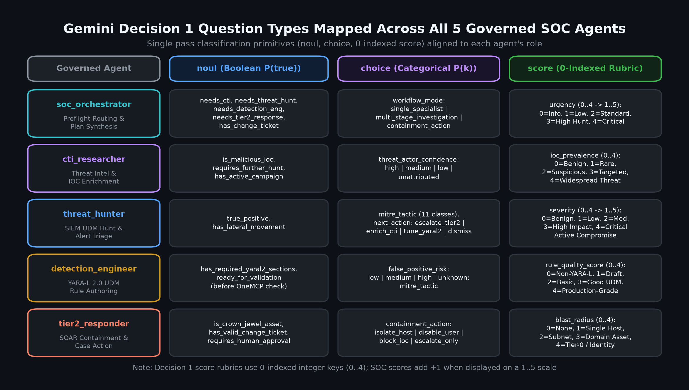
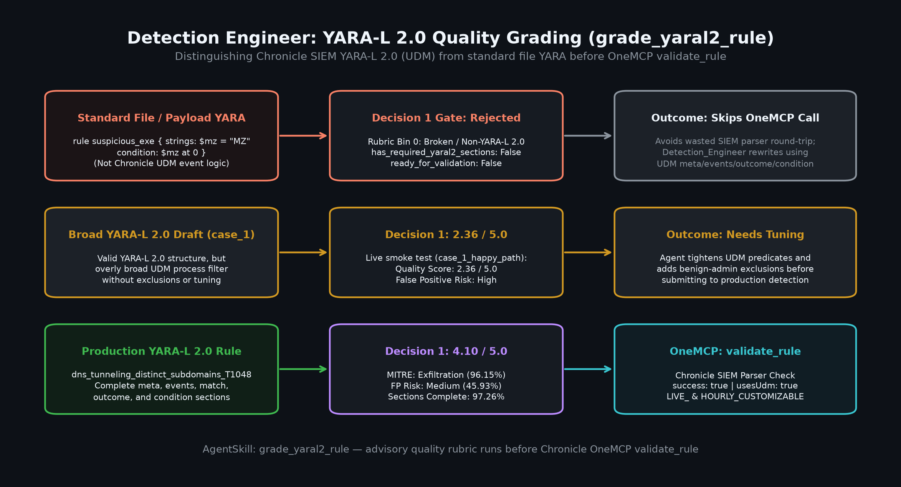
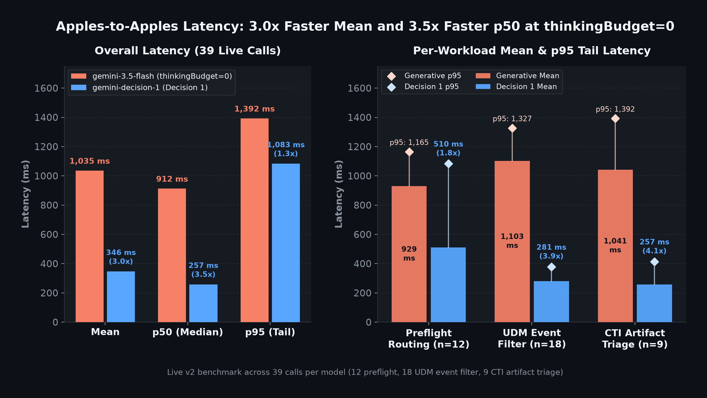

# YARA-L 2.0 Pre-Flight Rule Grading (`detection_engineer`)

In `governed_agents/detection_engineer/`, Gemini Decision 1 (`gemini-decision-1`) powers a single-pass, zero-output-token pre-flight rubric via `grade_yaral2_rule(rule_text, coverage_context)` before `detection_engineer` submits a rule to Chronicle OneMCP `validate_rule` or `evaluate_rule_coverage`.

## Single-pass pre-flight rubric (`grade_yaral2_rule`)

Defined in `governed_agents/detection_engineer/detection_tools.py` and registered on `detection_engineer_llm` in `governed_agents/detection_engineer/agent.py`, `grade_yaral2_rule` evaluates a candidate rule and optional `coverage_context` in one `POST /v1beta/decisions` forward pass (`0` output tokens):

| Question key | Decision 1 type | Output mapping | Purpose |
| --- | --- | --- | --- |
| `rule_quality_score` | `score` (0–4) | Shifted `+1.0` to `1.0–5.0` (`round(float(raw_score) + 1.0, 4)`) | Grades rule engineering quality from broken/non-YARA-L 2.0 (level 0) to production-grade UDM detection (level 4). |
| `false_positive_risk` | `choice` | `low`, `medium`, `high`, `unknown` | Estimates enterprise SOC false-positive volume from UDM predicate specificity and exclusions. |
| `mitre_tactic` | `choice` | 14 MITRE ATT&CK Enterprise tactics + `other_or_unknown` | Maps the rule's detection objective to a primary ATT&CK tactic. |
| `has_required_yaral2_sections` | `noul` | `bool(float(noul) >= 0.5)` + `has_required_yaral2_sections_noul` | Verifies Chronicle SIEM YARA-L 2.0 structure (`meta`, `events`, `condition` with UDM predicates) rather than standard YARA. |
| `ready_for_validation` | `noul` | `bool(float(noul) >= 0.5)` + `ready_for_validation_noul` | Assesses whether the rule is complete and coherent enough for Chronicle OneMCP `validate_rule` and `evaluate_rule_coverage`. |

If `rule_text.strip()` is empty, `grade_yaral2_rule` returns `{"enabled": False, "rule_language": "YARA-L 2.0 (Chronicle SIEM UDM)", "error": "rule_text must be a non-empty YARA-L 2.0 rule."}` without issuing a network request. When neither `GEMINI_AUTH_PROVIDER` nor `GEMINI_API_KEY` is configured, it returns `{"enabled": False, ...}` so offline unit tests remain hermetic.

\
*Figure 1. The three Decision 1 question types (`noul`, `choice`, and 0-indexed `score` shifted `+1.0` to a `1.0–5.0` scale) combined in `grade_yaral2_rule` with zero output tokens.*

## Chronicle SIEM YARA-L 2.0 vs. standard YARA

`detection_engineer` enforces strict terminology and structural separation between two distinct languages:

| Dimension | Chronicle SIEM **YARA-L 2.0** | Standard **YARA** |
| --- | --- | --- |
| Target domain | Security telemetry event correlation over Unified Data Model (UDM) records in Chronicle SIEM | Static file, memory, or binary payload pattern matching |
| Required sections | `rule <name>` with `meta`, `events`, and `condition` (plus optional `match` and `outcome`) | `rule <name>` with `strings` (hex/text/regex) and `condition` (plus optional `meta` or `pe` module checks) |
| Predicate model | UDM field filters such as `$e.metadata.log_type`, `$e.metadata.event_type`, and `$e.network.dns.questions.name` | Byte offsets, string matches (`$mz at 0`), and file-header signatures |

### Negative-control rejection behavior

Both `grade_yaral2_rule` (via `input_payload` and `has_required_yaral2_sections`) and `scripts/governance/benchmark_decision1.py` (`yaral2_negative_control_standard_yara`) explicitly test rejection of standard file/payload YARA rules:

```yara
rule Suspicious_PE_String {
  strings:
    $mz = "MZ"
    $cmd = "vssadmin delete shadows"
  condition:
    $mz at 0 and $cmd
}
```

Because this payload uses `strings` and binary offset logic (`$mz at 0`) instead of `events` and UDM predicates, Decision 1 assigns level 0 (`Broken or non-YARA-L 2.0 rule`) and returns `has_required_yaral2_sections = false` and `ready_for_validation = false`. This catches language confusion in one sub-second pass before invoking Chronicle OneMCP `validate_rule`.

\
*Figure 2. `grade_yaral2_rule` evaluation comparing a minimal draft (`case_1_happy_path`), a production-grade UDM rule (`dns_tunneling_distinct_subdomains_T1048`), and negative-control rejection of a standard file/payload YARA rule.*

## Live verification results

Live runs against the deployed governed SOC environment demonstrate how `grade_yaral2_rule` differentiates minimal drafts from production-ready UDM correlation rules:

### 1. Live `case_1_happy_path` smoke test

In `scripts/governance/smoke_test.py` (`case_1_happy_path`), `detection_engineer` evaluates a minimal two-line rule (`rule smoke_proc_check { meta: author = "soc" events: $e.metadata.event_type = "PROCESS_LAUNCH" condition: $e }`) that lacks log-source scoping, process command-line filters, or exclusions:

- **Rule quality score:** `2.36 / 5.0`
- **False positive risk:** `high` (`High False Positive Risk`)

The rubric accurately flags that although the draft is syntactically valid YARA-L 2.0, matching every `PROCESS_LAUNCH` event without scoping will generate excessive SOC alert volume.

### 2. Live `dns_tunneling_distinct_subdomains_T1048` evaluation

During the live Logstory `RULES_SEARCH_WORKSHOP` A2A replay, `detection_engineer` grades a multi-section UDM correlation rule (`GCP_DNS` log-type filter, hexadecimal subdomain regex, `match` window `$vm over 10m`, and `outcome` `count_distinct` threshold):

- **Rule quality score:** `4.10 / 5.0` (Production-grade)
- **MITRE ATT&CK tactic:** `exfiltration` (`96.15%` confidence)
- **False positive risk:** `medium` (`45.93%` confidence)
- **YARA-L 2.0 section completeness (`has_required_yaral2_sections`):** `true` (`97.26%` confidence)
- **Chronicle OneMCP `validate_rule`:** `success: true`, `usesUdm: true` (`LIVE_CUSTOMIZABLE` and `HOURLY_CUSTOMIZABLE`)

## Latency advantage in pre-flight grading

Across the live benchmark in `scripts/governance/benchmark_decision1.py` (comparing `gemini-decision-1` against `gemini-2.5-flash` JSON generation across pre-flight routing, alert rubric triage, and YARA-L 2.0 rule grading), Decision 1 reduces mean per-call latency from `3,789.64 ms` to `392.02 ms` (**9.67x faster**) while eliminating output token generation (`0` vs. `20,006` aggregate output tokens).

\
*Figure 3. Per-workload latency comparison showing `gemini-decision-1` averaging `392.02 ms` versus `3,789.64 ms` for `gemini-2.5-flash` JSON generation across pre-flight routing, alert triage, and YARA-L 2.0 grading.*

## Governance and tool allowlist

In `governed_agents/detection_engineer/agent.py`, `grade_yaral2_rule` runs as a local Python tool alongside Chronicle OneMCP tools (`validate_rule`, `evaluate_rule_coverage`, `generate_synthetic_events`, `udm_search`, `list_rules`, `get_rule`, `list_rule_detections`, `list_rule_errors`, `translate_udm_query`, `get_reference_list`, and `list_log_types`). Destructive ingestion administration tools (`delete_feed`, `activate_parser`, `deactivate_parser`) remain advertised on the agent so Agent Gateway IAM v3 tool-allowlist policies evaluate and log denials at the gateway boundary.

See [Gemini Decision 1 for Governed SOC Agents](gemini_decision_1.md) for the full 5-agent architecture, Auth Manager configuration, and benchmark details, and [Case Study: Single-Pass Pre-Flight Routing and Live Alert Rubric Triage](gemini_decision_1_case_study.md) for the end-to-end `RULES_SEARCH_WORKSHOP` A2A trace.
