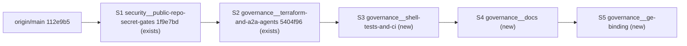

# Agent Governance Stack Implementation Plan (2026-11-06)

> For agentic workers: this is the sanitized public copy of the overnight run plan. Steps use checkbox syntax for tracking.
> work strictly top-down through S1..S5. Each stack has a GATE. Do not start stack N+1 until every GATE line of stack N is green and logged in the Run Log. Nothing is pushed to GitHub tonight. If a GATE cannot be made green after two honest attempts, stop, write the Morning Report, and end.

**Goal:** Finish porting the governance best practices of `the private reference governance repository` into `this repository` as a verified, locally-stacked set of branches: hygiene gate (S1), governance IaC + agents (S2), shell test harnesses + CI (S3), documentation (S4), live Gemini Enterprise binding and publication (S5).

**Architecture:** Five branches, each stacked on the previous, each in its own worktree under `agentic_soc_agentspace__worktrees/`. S1 and S2 already exist as commits and only need re-verification. S3..S5 are new. Terraform local state is the single live source of truth and moves with the newest stack that runs `apply`.

**Tech Stack:** Python 3.12 (`uv` venv), `just`, bash + shellcheck 0.10, Terraform 1.16.5 with `google-beta ~> 8.7`, ADK 2.13.0 / `a2a-sdk` 1.3.0, GitHub Actions, `gh` CLI (read-only tonight).

**Spec / references:**
- Upstream reference clone: `<REFERENCE_REPO_ROOT>` (HEAD `b7c5a6e`, no drift since port)

## Global Constraints

- PUBLIC repository. Every commit must pass `scripts/check_public_repo_hygiene.py --git-range origin/main..HEAD` with 0 findings. Never write internal sandbox or corporate domain names, internal shortlinks, tenant IDs, project numbers, engine IDs, or customer IDs into tracked files (the gate's rule list in `scripts/check_public_repo_hygiene.py` is authoritative). Use placeholders (`<PROJECT_ID>`, `<GE_ENGINE_ID>`).
- No emojis anywhere (code, docs, commit messages). `tests/test_governed_agents.py::test_zero_emojis_across_governance_files` enforces this for governance files.
- `git add <explicit paths>` only. Never `git add .`/`-A`. Never stage `.env`, `.envrc`, `*.tfvars`, `*.tfstate*`, `.gcloud/`.
- Branch names use `__` as delimiter, never `/`.
- Pin every `pip install` in CI (`pkg==x.y.z`). Pin GitHub Actions to major tags already used in the repo (`actions/checkout@v5`, `actions/setup-python@v6`, `actions/cache@v5`).
- Shell examples in docs: define variables first, then reference them (`PROJECT_ID="..."` then `$PROJECT_ID`).
- Do NOT push, do NOT open PRs, do NOT merge. Local stack only.
- Do NOT destroy or scale down any resource in `<PROJECT_ID>` or `<REFERENCE_SANDBOX_PROJECT>`.
- Run pytest as `.venv/bin/python -m pytest -o addopts="" -p no:cacheprovider <files>` (repo `addopts` requires `pytest-cov`, which is not in the venv).
- Commit messages: imperative, `<type>(<scope>): <summary>` matching repo history (`security:`, `test(governance):`, `docs(governance):`, `feat(governance):`, `ci(governance):`).

## Stack Layout



| Stack | Worktree path (under `<WORKTREES_ROOT>/`) | Branch | Base |
|---|---|---|---|
| S1 | `security__public-repo-secret-gates` | `security__public-repo-secret-gates` | `main` |
| S2 | `governance__terraform-and-a2a-agents` | `governance__terraform-and-a2a-agents` | S1 |
| S3 | `governance__shell-tests-and-ci` | `governance__shell-tests-and-ci` | S2 |
| S4 | `governance__docs` | `governance__docs` | S3 |
| S5 | `governance__ge-binding` | `governance__ge-binding` | S4 |

Stacking rule: if you amend or add commits to a lower stack after a higher one exists, rebase every higher stack with `git rebase --onto <lower-new-head> <lower-old-head> <higher-branch>` and re-run that stack's GATE. Avoid this by finishing each stack before creating the next.


---

## Pre-flight (15 min)

- [ ] `cd $S2 && git status --short` is empty; `git -C $WT/main fetch origin` and confirm `git log --oneline HEAD..origin/main | wc -l` is `0` in S2 (still rebased on current main). If main moved, rebase S1 then S2 onto `origin/main` and re-run both GATES.
- [ ] `direnv exec $S2 gcloud auth application-default print-access-token >/dev/null && echo ADC_OK` (if this fails, stop: credentials must be refreshed by the user with `gcloud auth login <ACCOUNT> --update-adc` from inside the direnv directory).
- [ ] `direnv exec $S2 terraform -chdir=terraform plan -input=false -lock-timeout=60s -detailed-exitcode -out=/tmp/preflight.tfplan; echo exit=$?` Expected: exit `0` or `2`. If `2`, `terraform show /tmp/preflight.tfplan | grep -E "^\s*[-~+] " | sort | uniq -c` must show no `-` (destroy) lines. Record in Run Log. Delete `/tmp/preflight.tfplan`.
- [ ] Snapshot the Gemini Enterprise app (`bash scripts/governance/bind_ge_app.sh status`) and the current agent list (`just gem-ent-list-agents`) into your evidence directory before any binding change.

---

## S1: `security__public-repo-secret-gates` (re-verify only, 10 min)

**Files:** none to change. Commit `1f9e7bd` already contains `scripts/check_public_repo_hygiene.py`, `tests/test_check_public_repo_hygiene.py`, `.gitignore`, `.pre-commit-config.yaml`, `.github/workflows/public-repo-hygiene.yml`, `justfile`, `pyproject.toml`.

- [ ] `cd $WT/security__public-repo-secret-gates && ln -sfn ../governance__terraform-and-a2a-agents/.venv .venv`
- [ ] GATE S1-a: `.venv/bin/python -m pytest -o addopts="" -p no:cacheprovider tests/test_check_public_repo_hygiene.py` -> `5 passed`
- [ ] GATE S1-b: `python3 scripts/check_public_repo_hygiene.py --all-tracked; echo exit=$?` -> `exit=0`
- [ ] GATE S1-c: `python3 scripts/check_public_repo_hygiene.py --git-range origin/main..HEAD; echo exit=$?` -> `exit=0`
- [ ] GATE S1-d: `.venv/bin/python -m pre_commit run --files $(git diff --name-only origin/main..HEAD) 2>&1 | tail -20` -> every hook `Passed` or `Skipped`. If `pre_commit` is not installed in the venv: `uv pip install --python .venv/bin/python pre-commit==4.2.0`.
- [ ] GATE S1-e: `git log --oneline origin/main..HEAD | wc -l` -> `1`; `git status --short` -> empty.
- [ ] Log S1 PASS.

---

## S2: `governance__terraform-and-a2a-agents` (re-verify, 30 min incl. live smoke test)

**Files:** none to change unless a GATE fails. Commit `5404f96`.

- [ ] `cd $S2`
- [ ] GATE S2-a: `.venv/bin/python -m pytest -o addopts="" -p no:cacheprovider tests/test_governed_agents.py tests/test_check_public_repo_hygiene.py` -> `11 passed`
- [ ] GATE S2-b: `.venv/bin/ruff check governed_agents scripts/governance tests/test_governed_agents.py` -> `All checks passed!`
- [ ] GATE S2-c: `python3 scripts/check_public_repo_hygiene.py --git-range origin/main..HEAD; echo exit=$?` -> `exit=0`
- [ ] GATE S2-d: `direnv exec . just governance-validate 2>&1 | tail -3` -> `Success! The configuration is valid.` (this also regenerates `terraform/dist/*.tar.gz` and `terraform/agentcards/*.json`; afterwards `git status --short` must still be empty, proving card generation is deterministic. If `terraform/agentcards/*.json` changed, that is a real finding: inspect, and if the generator is right, commit the regenerated cards with `fix(governance): regenerate agent cards` and note it.)
- [ ] GATE S2-e (live): `direnv exec . just governance-smoke-test 2>&1 | tee $EVID/S2/smoke.txt | tail -8` -> final summary `5 passed, 0 failed` (per-case timeout 300 s; total may take 10 to 15 min). If a single case fails on a timeout, rerun only that case once with `just governance-smoke-test case=<id>`.
- [ ] GATE S2-f (live): `direnv exec . bash scripts/governance/verify_logs.sh unregistered --freshness 2h 2>&1 | tee $EVID/S2/unregistered.txt | tail -5` -> zero unregistered egress hosts (no `FATAL`).
- [ ] GATE S2-g: `git status --short` empty; `git log --oneline origin/main..HEAD | wc -l` -> `2`.
- [ ] Log S2 PASS.

---

## S3: `governance__shell-tests-and-ci` (new, 3 to 4 h)

Port the eight offline harnesses from the reference repo's `scripts/tests/` to `scripts/governance/tests/`, adapted to the five SecOps agents and to the divergent SecOps scripts; add shellcheck, a runner, a `just` recipe, Terraform formatting, and a GitHub Actions workflow.

**Files:**
- Create: `scripts/governance/tests/run_all.sh`
- Create: `scripts/governance/tests/package_agent_test.sh` (port of upstream `scripts/tests/package_agent_test.sh`, 206 lines)
- Create: `scripts/governance/tests/verify_logs_test.sh` (upstream 231 lines; our `verify_logs.sh` has 406 changed lines vs upstream, read ours first)
- Create: `scripts/governance/tests/auth_provider_test.sh` (upstream 494 lines; ours has 394 changed lines, GTI API key instead of Maps)
- Create: `scripts/governance/tests/bind_ge_app_test.sh` (upstream 224 lines)
- Create: `scripts/governance/tests/ge_agent_test.sh` (upstream 329 lines)
- Create: `scripts/governance/tests/delete_until_gone_test.sh` (upstream 154 lines)
- Create: `scripts/governance/tests/sgp_test.sh` (upstream 277 lines, tests `sgp_gateway_config.sh`)
- Modify: `tests/test_governed_agents.py` (fold in any assertions from upstream `scripts/tests/orchestrator_notice_test.py` not already covered by `test_soc_orchestrator_policy_block_banners`; upstream `prompt_probe.py` is a live probe, not ported, say so in `run_all.sh` header)
- Modify: `scripts/governance/*.sh` (only to clear shellcheck SC1010/SC2155 findings; no behavior change)
- Modify: `terraform/52-policies-access.tf` (`terraform fmt` only)
- Modify: `.pre-commit-config.yaml` (add shellcheck hook)
- Modify: `justfile` (add `governance-test`, `governance-lint`)
- Create: `.github/workflows/governance-ci.yml`

**Interfaces:**
- Produces: `bash scripts/governance/tests/run_all.sh` exits 0 and prints `ALL GREEN: <n> harnesses, <m> checks` on success; `just governance-test` wraps it; `just governance-lint` runs shellcheck + `terraform fmt -check`. S4 docs reference these three commands by exact name.

### Task 3.1: Create worktree

- [ ] `cd $WT/main && git worktree add ../governance__shell-tests-and-ci -b governance__shell-tests-and-ci governance__terraform-and-a2a-agents`
- [ ] `cd $WT/governance__shell-tests-and-ci && ln -s ../governance__terraform-and-a2a-agents/.venv .venv && git status --short` -> empty. Set `S3=$PWD`.

### Task 3.2: Harness skeleton and runner (do this first so every later harness is runnable)

- [ ] Create `scripts/governance/tests/run_all.sh`:
  ```bash
  #!/usr/bin/env bash
  #
  # Run every offline governance harness. No network, no credentials: each
  # harness stubs gcloud/terraform/curl on PATH. Ported from the reference
  # agent-governance repository's scripts/tests/, adapted to the five SecOps
  # agents. prompt_probe.py (live A2A probe) is intentionally not ported; use
  # scripts/governance/smoke_test.py for live verification.
  #
  #     bash scripts/governance/tests/run_all.sh
  set -euo pipefail
  HERE=$(cd "$(dirname "${BASH_SOURCE[0]}")" && pwd)
  readonly HERE
  harnesses=0; failures=0; checks=0
  for t in "$HERE"/*_test.sh; do
    harnesses=$((harnesses + 1))
    printf '== %s\n' "$(basename "$t")"
    if out=$(bash "$t" 2>&1); then
      printf '%s\n' "$out"
    else
      printf '%s\n' "$out"; failures=$((failures + 1))
    fi
    checks=$((checks + $(printf '%s\n' "$out" | grep -c '^  ok ' || true)))
  done
  if (( failures > 0 )); then
    printf 'FAILED: %d of %d harnesses\n' "$failures" "$harnesses"; exit 1
  fi
  printf 'ALL GREEN: %d harnesses, %d checks\n' "$harnesses" "$checks"
  ```
- [ ] Run it: `bash scripts/governance/tests/run_all.sh` -> `ALL GREEN: 0 harnesses, 0 checks` (glob expands to literal when empty under `set -u`? It does not with nullglob unset: it will try to run a file named `*_test.sh` and fail. Add `shopt -s nullglob` after `set -euo pipefail`. Re-run; expect `ALL GREEN: 0 harnesses, 0 checks`.)
- [ ] `git add scripts/governance/tests/run_all.sh && git commit -m "test(governance): add offline harness runner"`

### Task 3.3: Port each harness (repeat this loop per file, in this order: package_agent, delete_until_gone, bind_ge_app, ge_agent, verify_logs, sgp, auth_provider)

For each `<name>`:
- [ ] Read the upstream harness `U=<REFERENCE_REPO_ROOT>/scripts/tests/<name>_test.sh` fully, and read OUR target `scripts/governance/<name>.sh` fully (ours diverges; the test must assert OUR behavior, not upstream's).
- [ ] Copy upstream to `scripts/governance/tests/<name>_test.sh`, then apply these mechanical edits:
  - `SCRIPT_DIR=$(cd "$(dirname "${BASH_SOURCE[0]}")/.." && pwd)` stays (resolves to `scripts/governance/`).
  - `readonly REPO_ROOT="${SCRIPT_DIR%/scripts}"` -> `readonly REPO_ROOT="${SCRIPT_DIR%/scripts/governance}"`.
  - Any synthetic-repo layout that copies the script into `$WORK/scripts/` must copy into `$WORK/scripts/governance/` and create agents under `$WORK/governed_agents/<name>/` (not `$WORK/agents/`).
  - Agent names `iss`, `maps`, `orchestrator` -> `cti_researcher`, `threat_hunter`, `detection_engineer`, `tier2_responder`, `soc_orchestrator` (five, not three; assert count 5 where upstream asserts 3).
  - `mapstools.googleapis.com` / Maps API key -> the GTI host and `agw-secops-gti-api-key` provider name used in OUR `auth_provider.sh`/`20-authmanager.tf`.
  - Resource prefix `agw-iss` -> `agw-secops`; display strings "Astro Pizza" -> "Governed SecOps Orchestrator" (check OUR `ge_agent.sh` for the exact default).
  - Remove or replace any upstream wording in comments that the hygiene gate rejects (internal sandbox names, internal shortlinks).
- [ ] Run the single harness: `bash scripts/governance/tests/<name>_test.sh; echo exit=$?`. Fix test expectations against OUR script's real stdout/stderr strings (read the script; do not change the script to match upstream wording unless it is a genuine bug, in which case make a separate `fix(governance):` commit first).
- [ ] Negative check: temporarily break one assertion's needle (e.g. append `XX`), run again, confirm it reports `FAIL` and exits 1, then revert. This proves the harness can fail.
- [ ] `bash scripts/governance/tests/run_all.sh | tail -1` -> `ALL GREEN: <k> harnesses, ...` with `k` incremented.
- [ ] `git add scripts/governance/tests/<name>_test.sh && git commit -m "test(governance): port offline <name> harness for SecOps agents"`

Specific guidance per harness:
- `package_agent_test.sh`: two properties, files at archive root and byte-identical output across two runs. OUR `package_agent.sh` writes `terraform/dist/<name>.tar.gz` and `.sha256`; the real-tree block at the end must iterate the 5 names and assert the sha256 equals `scripts/governance/package_agent.sh`'s `source_hash()` recomputation. Keep the exec-bit and `__pycache__` exclusion cases.
- `verify_logs_test.sh`: stubs `terraform show -json` (state) and `gcloud logging read`. Build the stub `state.json` from a `terraform show -json` shape that contains OUR registry endpoint resources (names from `terraform/10-registry-endpoints.tf`: read them). The four guards (empty registered set FATAL, truncated sample WARN, service_id collision WARN, empty window not clean) must each have a case.
- `auth_provider_test.sh`: OUR script targets `agentidentity.googleapis.com/v1` AuthProviders with an API key (GTI), uses `GET` for `:getIamPolicy`. Stub `curl` to replay fixtures by URL substring; assert the script never prints the key value (grep stub log for the fake key string `FAKE-GTI-KEY-0001` and assert absent from stdout/stderr).
- `bind_ge_app_test.sh` / `ge_agent_test.sh`: stub `curl` and `gcloud`; cases: status unbound, bind when unbound (PATCH with `updateMask=agentGatewaySetting.defaultEgressAgentGateway.name`), bind refuses when bound elsewhere without `GE_FORCE_REBIND=1`, unbind idempotent; for `ge_agent.sh`: create adopts an existing registration pointing at the same reasoning engine instead of duplicating, delete only removes the matching one. These two harnesses are the safety net for S5.
- `delete_until_gone_test.sh`: stub `gcloud`; assert retry-until-404 and bounded attempts.
- `sgp_test.sh`: tests `sgp_gateway_config.sh`; stub `gcloud`/`curl`; assert the generated gateway config JSON contains `CONSTRAINTS_AND_INTENT` for the Tier-2 policy and the `10s` timeout.

### Task 3.4: Python coverage from `orchestrator_notice_test.py`

- [ ] Read upstream `scripts/tests/orchestrator_notice_test.py`. List its assertions. For each not covered by `tests/test_governed_agents.py::test_soc_orchestrator_policy_block_banners` (e.g. banner text for Model Armor block vs IAP 403 vs SGP deny, and that the orchestrator never retries a denied tool), add one `def test_...` to `tests/test_governed_agents.py` using the same `importlib`/`MagicMock` pattern the file already uses.
- [ ] `.venv/bin/python -m pytest -o addopts="" -p no:cacheprovider tests/test_governed_agents.py -q` -> all pass, count > 6.
- [ ] `git add tests/test_governed_agents.py && git commit -m "test(governance): cover orchestrator policy notices from reference harness"`

### Task 3.5: shellcheck clean + terraform fmt

- [ ] `shellcheck -S warning scripts/governance/*.sh scripts/governance/tests/*.sh` -> fix each finding minimally (SC2155: split `readonly X="$(...)"` into assignment then `readonly X`; SC1010: quote or restructure `done`/`fi` tokens). Re-run until no output; `echo exit=$?` -> `0`.
- [ ] `terraform -chdir=terraform fmt -recursive && terraform -chdir=terraform fmt -check -recursive; echo exit=$?` -> `0`. `git diff --stat` should touch only `52-policies-access.tf` (whitespace).
- [ ] Regression: `bash scripts/governance/tests/run_all.sh | tail -1` -> `ALL GREEN`; `.venv/bin/python -m pytest -o addopts="" -p no:cacheprovider tests/test_governed_agents.py -q` -> pass.
- [ ] `git add scripts/governance/*.sh scripts/governance/tests/*.sh terraform/52-policies-access.tf && git commit -m "style(governance): make shell scripts shellcheck-clean and terraform fmt-clean"`

### Task 3.6: pre-commit hook, just recipes

- [ ] Append to `.pre-commit-config.yaml` under `repos:` (before the `local` repo):
  ```yaml
    - repo: https://github.com/shellcheck-py/shellcheck-py
      rev: v0.10.0.1
      hooks:
        - id: shellcheck
          name: shellcheck governance scripts
          files: ^scripts/governance/.*\.sh$
          args: ['--severity=warning']
  ```
- [ ] Append to `justfile` after `governance-smoke-test`:
  ```just
  # Run every offline governance shell harness (no network, no credentials)
  governance-test:
      bash scripts/governance/tests/run_all.sh

  # Lint governance shell scripts and check Terraform formatting
  governance-lint:
      shellcheck --severity=warning scripts/governance/*.sh scripts/governance/tests/*.sh
      terraform -chdir=terraform fmt -check -recursive
  ```
- [ ] `just governance-test | tail -1` -> `ALL GREEN`; `just governance-lint; echo exit=$?` -> `0`.
- [ ] `.venv/bin/python -m pre_commit run shellcheck --all-files` -> `Passed`.
- [ ] `git add .pre-commit-config.yaml justfile && git commit -m "ci(governance): add shellcheck hook and governance-test/lint recipes"`

### Task 3.7: GitHub Actions workflow

- [ ] Create `.github/workflows/governance-ci.yml`:
  ```yaml
  name: Governance CI

  on:
    pull_request:
      types: [opened, synchronize, reopened]
      paths:
        - 'governed_agents/**'
        - 'scripts/governance/**'
        - 'terraform/**'
        - 'tests/test_governed_agents.py'
        - '.github/workflows/governance-ci.yml'
    push:
      branches:
        - main
      paths:
        - 'governed_agents/**'
        - 'scripts/governance/**'
        - 'terraform/**'
        - 'tests/test_governed_agents.py'

  permissions:
    contents: read

  jobs:
    shell-harnesses:
      name: Shell harnesses and shellcheck
      runs-on: ubuntu-latest
      steps:
        - uses: actions/checkout@v5
        - name: Install shellcheck
          run: |
            sudo apt-get update
            sudo apt-get install -y shellcheck=0.9.0-1
        - name: shellcheck
          run: shellcheck --severity=warning scripts/governance/*.sh scripts/governance/tests/*.sh
        - name: Offline harnesses
          run: bash scripts/governance/tests/run_all.sh

    python-tests:
      name: Governed agent unit tests
      runs-on: ubuntu-latest
      steps:
        - uses: actions/checkout@v5
        - uses: actions/setup-python@v6
          with:
            python-version: '3.12'
            cache: 'pip'
        - name: Install pinned dependencies
          run: |
            pip install pytest==8.3.5
            pip install -r governed_agents/soc_orchestrator/requirements.txt
            pip install -r governed_agents/cti_researcher/requirements.txt
        - name: pytest
          run: python -m pytest -o addopts="" tests/test_governed_agents.py

    terraform:
      name: Terraform fmt and validate
      runs-on: ubuntu-latest
      steps:
        - uses: actions/checkout@v5
        - uses: hashicorp/setup-terraform@v3
          with:
            terraform_version: 1.16.5
        - name: fmt
          run: terraform -chdir=terraform fmt -check -recursive
        - name: Package agents and generate cards
          run: |
            bash scripts/governance/package_agent.sh all
            python3 scripts/governance/gen_agent_cards.py
        - name: validate
          run: |
            terraform -chdir=terraform init -backend=false -input=false
            terraform -chdir=terraform validate
  ```
  If the Ubuntu runner's apt shellcheck version pin `0.9.0-1` is wrong for `ubuntu-latest`, use `pip install shellcheck-py==0.10.0.1` instead and keep the pin.
- [ ] Local dry-run of the workflow steps that can run locally: `bash scripts/governance/package_agent.sh all && python3 scripts/governance/gen_agent_cards.py && terraform -chdir=terraform init -backend=false -input=false >/dev/null && terraform -chdir=terraform validate` -> `Success!`. Then `git status --short` -> empty (cards deterministic).
- [ ] `python3 -c "import yaml,sys; yaml.safe_load(open('.github/workflows/governance-ci.yml'))" && echo YAML_OK` (use `.venv/bin/python` if `yaml` missing).
- [ ] `git add .github/workflows/governance-ci.yml && git commit -m "ci(governance): add Governance CI workflow for harnesses, unit tests, and terraform validate"`

### S3 GATE

- [ ] GATE S3-a: `just governance-test | tail -1` -> `ALL GREEN: 7 harnesses, <m> checks` with `m >= 40`.
- [ ] GATE S3-b: `just governance-lint; echo exit=$?` -> `0`.
- [ ] GATE S3-c: `.venv/bin/python -m pytest -o addopts="" -p no:cacheprovider tests/test_governed_agents.py tests/test_check_public_repo_hygiene.py -q` -> all pass (>= 12).
- [ ] GATE S3-d: `.venv/bin/ruff check governed_agents scripts/governance tests` -> clean.
- [ ] GATE S3-e: `python3 scripts/check_public_repo_hygiene.py --git-range origin/main..HEAD; echo exit=$?` -> `0`.
- [ ] GATE S3-f: `.venv/bin/python -m pre_commit run --files $(git diff --name-only governance__terraform-and-a2a-agents..HEAD)` -> all Passed/Skipped.
- [ ] GATE S3-g: `git status --short` empty; `git log --oneline governance__terraform-and-a2a-agents..HEAD` shows 10 to 12 commits.
- [ ] Log S3 PASS with the harness/check counts.

---

## S4: `governance__docs` (new, 2 h)

**Files:**
- Create: `docs/agent_governance.md` (deploy, verify, operate; the public equivalent of the reference `README.md` Deploy/Verify sections plus the SecOps specifics)
- Create: `docs/agent_governance_design.md` (public equivalent of reference `DESIGN.md`: nine choke-point layers, identity model, three authorization layers, what is a shim, cost, credential handling)
- Create: `docs/agent_governance_troubleshooting.md` (public equivalent of reference `SKILL.md`: read the evidence first, the common 403/Model Armor/SGP/`deployment_spec` failure signatures and fixes)
- Create: `docs/superpowers/plans/2026-11-06-agent-governance-stack.md` (sanitized copy of THIS handoff)
- Modify: `README.md` (new `## Agent Governance` section after `## Gemini Enterprise Integration`, plus a Table of Contents entry; `docs/commands.md` gets the `governance-*` recipes)
- Modify: `CHANGELOG.md` (one `Unreleased` entry per stack S1..S5)

**Interfaces:**
- Consumes: exact `just` recipe names from S2/S3: `governance-package`, `governance-cards`, `governance-init`, `governance-validate`, `governance-plan`, `governance-enforce`, `governance-logs`, `governance-smoke-test`, `governance-test`, `governance-lint`, `security-hygiene`, `security-hygiene-range`.

### Task 4.1: Worktree

- [ ] `cd $WT/main && git worktree add ../governance__docs -b governance__docs governance__shell-tests-and-ci && cd ../governance__docs && ln -s ../governance__terraform-and-a2a-agents/.venv .venv`. Set `S4=$PWD`.

### Task 4.2: `docs/agent_governance.md`

- [ ] Read the reference `README.md` sections `Prerequisites`, `Deploy` (stages 0 to 7), `Verify`, and `Upgrading a deployment made on google-beta 7.x`. Read OUR `terraform/variables.tf`, `terraform/outputs.tf`, `terraform/terraform.tfvars.example`, `justfile` governance block, `scripts/governance/smoke_test.py` argparse, and `scripts/governance/verify_logs.sh` usage header.
- [ ] Write the doc with these H2 sections, in this order: `What this adds` (one paragraph + the nine layers as a table: layer, resource, Terraform file), `Prerequisites` (APIs, org policy `iam.managed.disableAccessPolicyBinding`, service identities for `aiplatform` and `discoveryengine`, an existing Gemini Enterprise app ID only if opting into publication, tools: terraform >= 1.9, jq, curl, shellcheck, just, uv), `Configure` (copy `terraform/terraform.tfvars.example`, every variable with its default and why), `Deploy` (the staged `terraform apply -target` sequence matching OUR file numbering 00..70, each stage with the exact command and expected output lines; include the `GOOGLE_API_USE_CLIENT_CERTIFICATE=false` note), `Verify` (`just governance-smoke-test` with the 5 case IDs from `smoke_test.py` and the exact expected verdict per case; `just governance-logs action=denied`, `audit`, `who`, `mcp`, `unregistered`; the "DRY_RUN = -" sentence), `Operate` (`governance-enforce` modes, rotating the GTI key via `auth_provider.sh`, `delete_until_gone.sh`), `Publish to Gemini Enterprise` (placeholder section to be completed in S5: the `bind_ge_app`/`create_ge_agent` opt-in and the rollback commands), `Cost` (table from memory topic, in USD with `\$`), `Tests` (`just governance-test`, `just governance-lint`, pytest command, what each harness proves).
- [ ] Every shell block defines variables before use. No internal hostnames, IDs, or go-links. Use `<PROJECT_ID>`, `<PROJECT_NUMBER>`, `<ORG_ID>`, `<GE_ENGINE_ID>`.
- [ ] `python3 scripts/check_public_repo_hygiene.py docs/agent_governance.md; echo exit=$?` -> `0`.
- [ ] `git add docs/agent_governance.md && git commit -m "docs(governance): add deploy, verify, and operate guide for the governed SecOps stack"`

### Task 4.3: `docs/agent_governance_design.md`

- [ ] Read the reference `DESIGN.md` in full. Rewrite for SecOps (public wording): `Architecture` with a `flowchart LR` mermaid diagram (Gemini Enterprise -> SOC Orchestrator -> 4 specialists -> Agent Gateway -> OneMCP / GTI), `Every edge and the Terraform that creates it` (table: edge, policy file, CEL attribute), `Identity` (SPIFFE `principal://` form with placeholders), `Three layers, three different questions` (IAP CEL allowlists, Model Armor, Semantic Governance; include the INTENT_ONLY vs CONSTRAINTS_AND_INTENT behavior and why `list_feeds` is advertised on the threat hunter), `Two rules the configuration is built around` (defaults are the deployment; registry-wide IAM is never used), `Which parts are shims` (the four `terraform_data` + bash shims and when they go away), `Hard limits` (CEL 1024 chars, 10 list elements, 10 FGAC rules per policy, 4 custom policies per gateway), `Credential handling` (GTI API key lifecycle through Auth Manager; never injected by the gateway).
- [ ] `python3 scripts/check_public_repo_hygiene.py docs/agent_governance_design.md; echo exit=$?` -> `0`.
- [ ] `git add docs/agent_governance_design.md && git commit -m "docs(governance): add design notes for identity, authorization layers, and shims"`

### Task 4.4: `docs/agent_governance_troubleshooting.md`

- [ ] Read the reference `SKILL.md` in full. Write: `Read the evidence before changing anything` (the four log surfaces and the exact `just governance-logs` invocations), then one H3 per failure signature with `Symptom` / `Evidence` / `Cause` / `Fix`: 403 from IAP with `GatekeeperAuthorizer.AuthorizeUser`; 403 you cannot attribute (unregistered host); `MODEL_ARMOR_SANITIZATION_VERDICT_BLOCK` false positive; SGP `DENY` on an in-scope tool (INTENT_ONLY); Reasoning Engine 404 on Gemini 3.x model (`MODEL_LOCATION`); `.rep.mtls.googleapis.com` NXDOMAIN; perpetual `deployment_spec` diff and why you must not `ignore_changes`; `FAILED_PRECONDITION networkservices.agentGateways.get` on first apply (service identity); `Maximum 10 FGAC conditions`; SGP PSC `state = FAILED` with `ACCEPTED`; Gemini Enterprise bind refused because the app is bound elsewhere (`GE_FORCE_REBIND=1`).
- [ ] `python3 scripts/check_public_repo_hygiene.py docs/agent_governance_troubleshooting.md; echo exit=$?` -> `0`.
- [ ] `git add docs/agent_governance_troubleshooting.md && git commit -m "docs(governance): add troubleshooting guide keyed on log evidence"`

### Task 4.5: README, commands, CHANGELOG, sanitized plan

- [ ] `README.md`: add `- [Agent Governance](#agent-governance)` to the Table of Contents and a `## Agent Governance` section (8 to 15 lines): what it is, one architecture sentence, the three-command quick path (`just governance-init`, `just governance-validate`, `just governance-plan`), and links to the three docs. Keep existing content untouched.
- [ ] `docs/commands.md`: add a `Governance` subsection listing each `governance-*` and `security-hygiene*` recipe with its one-line description copied from the `justfile` comments.
- [ ] `CHANGELOG.md`: under `## [Unreleased]` (create if absent) add `### Added` bullets: hygiene gate + CI (S1), governed A2A agents + Agent Gateway Terraform stack (S2), offline shell harnesses + Governance CI (S3), governance documentation (S4), Gemini Enterprise binding and publication of the governed orchestrator (S5, written now, verified in S5).
- [ ] Create `docs/superpowers/plans/2026-11-06-agent-governance-stack.md` by copying THIS file and then: delete the `Environment Facts` section, the `Pre-flight` GE snapshot block, and every occurrence of project IDs, project numbers, engine IDs, account emails, GE app IDs, and absolute `/usr/local/google/home/...` paths (replace with `<REPO_ROOT>`); delete the `Morning Report` section; keep the stack layout, constraints, tasks, and gates. Then `python3 scripts/check_public_repo_hygiene.py docs/superpowers/plans/2026-11-06-agent-governance-stack.md; echo exit=$?` -> `0`.
- [ ] `git add README.md docs/commands.md CHANGELOG.md docs/superpowers/plans/2026-11-06-agent-governance-stack.md && git commit -m "docs(governance): link governance guides from README, commands, changelog, and plan"`

### S4 GATE

- [ ] GATE S4-a: `python3 scripts/check_public_repo_hygiene.py --git-range origin/main..HEAD; echo exit=$?` -> `0`, and `--all-tracked` -> `0`.
- [ ] GATE S4-b: `.venv/bin/python -m pre_commit run --files $(git diff --name-only governance__shell-tests-and-ci..HEAD)` -> Passed/Skipped (trailing whitespace, EOF, large files, gitleaks).
- [ ] GATE S4-c: every `just` recipe named in the three docs exists: `for r in $(grep -oE 'just [a-z-]+' docs/agent_governance*.md | awk '{print $2}' | sort -u); do just --show "$r" >/dev/null 2>&1 || echo "MISSING $r"; done` -> prints nothing. (This is a single-file grep over three small docs, allowed.)
- [ ] GATE S4-d: every `scripts/governance/*.sh` and `*.py` named in the docs exists: `for f in $(grep -oE 'scripts/governance/[a-z_]+\.(sh|py)' docs/agent_governance*.md | sort -u); do [ -f "$f" ] || echo "MISSING $f"; done` -> nothing.
- [ ] GATE S4-e: mermaid blocks render: `grep -c '```mermaid' docs/agent_governance_design.md` -> `>= 1`, and the block uses only `flowchart LR`/`TD`.
- [ ] GATE S4-f: `just governance-test | tail -1` -> `ALL GREEN` (docs stack must not regress S3); `git status --short` empty; `git log --oneline governance__shell-tests-and-ci..HEAD | wc -l` -> `4`.
- [ ] Log S4 PASS.

---

## S5: `governance__ge-binding` (new, live, 1.5 h)

Bind the shared Gemini Enterprise app `<GE_ENGINE_ID>` to the egress Agent Gateway and publish the governed `soc_orchestrator` into its agent picker, with rollback. The user has accepted the risk to the existing `agent_soc_manager` registration. Keep the binding in place even if the legacy agent degrades; report it prominently.

**Files:**
- Modify: `terraform/terraform.tfvars.example` (uncommented GE opt-in block with placeholder values and the rollback note)
- Modify: `justfile` (add `governance-ge-status`, `governance-ge-unbind`, `governance-ge-unpublish`)
- Modify: `docs/agent_governance.md` (complete the `Publish to Gemini Enterprise` section with the verified procedure and rollback)
- Modify: `CHANGELOG.md` (mark S5 entry verified)
- Local only (gitignored, never committed): `terraform/terraform.tfvars` (`bind_ge_app = true`, `create_ge_agent = true`), `terraform/terraform.tfstate*`

**Interfaces:**
- Consumes: `scripts/governance/bind_ge_app.sh {status|bind|unbind}` and `scripts/governance/ge_agent.sh {status|create|icon|delete}` with env `GE_PROJECT_ID GE_PROJECT_NUMBER GE_LOCATION GE_ENGINE_ID [GE_COLLECTION_ID] [GE_AGENT_GATEWAY] [GE_ASSISTANT_ID GE_REASONING_ENGINE ...]`; Terraform `terraform_data.ge_binding[0]` and `terraform_data.ge_agent[0]` whose destroy provisioners run `unbind`/`delete`.

### Task 5.1: Worktree and state hand-over

- [ ] `cd $WT/main && git worktree add ../governance__ge-binding -b governance__ge-binding governance__docs && cd ../governance__ge-binding`. Set `S5=$PWD`.
- [ ] `ln -s ../governance__terraform-and-a2a-agents/.venv .venv && ln -s ../governance__terraform-and-a2a-agents/.gcloud .gcloud && cp $S2/.envrc .envrc && direnv allow`
- [ ] Move live Terraform state (gitignored files) so there is exactly one copy:
  ```bash
  cp $S2/terraform/terraform.tfvars $S5/terraform/terraform.tfvars
  mv $S2/terraform/terraform.tfstate $S5/terraform/terraform.tfstate
  mv $S2/terraform/terraform.tfstate.backup $S5/terraform/terraform.tfstate.backup
  mv $S2/terraform/terraform.tfstate.*.backup $S5/terraform/ 2>/dev/null || true
  ls $S2/terraform | grep -c tfstate   # must print 0
  ```
  Log: `S5 | state moved to governance__ge-binding/terraform | DONE`.
- [ ] `direnv exec . terraform -chdir=terraform init -input=false >/dev/null && direnv exec . terraform -chdir=terraform plan -input=false -detailed-exitcode -lock-timeout=60s >/tmp/s5-pre.txt 2>&1; echo exit=$?` -> `0` or `2` with NO destroy lines (`grep -E "will be destroyed|must be replaced" /tmp/s5-pre.txt` prints nothing). State is intact and the stack is still converged. `git status --short` -> empty (state files are ignored).

### Task 5.2: Pre-bind snapshot and dry run

- [ ] Confirm pre-flight snapshots exist: `ls $EVID/S5/ge-app-before.json $EVID/S5/ge-agents-before.txt`.
- [ ] Edit `terraform/terraform.tfvars` (local, ignored): set `bind_ge_app = true`, `create_ge_agent = true`. Leave `ge_prompt_logging` at its default unless `variables.tf` defaults it to `true`; in that case set `ge_prompt_logging = false` tonight (do not enable sensitive prompt logging on a shared app without the user).
- [ ] `direnv exec . terraform -chdir=terraform plan -input=false -lock-timeout=60s -out=/tmp/s5.tfplan 2>&1 | tee $EVID/S5/plan.txt | tail -15`. Expected adds: `terraform_data.ge_binding[0]`, `terraform_data.ge_agent[0]`, and nothing destroyed/replaced among `google_*` resources. If anything other than those two `terraform_data` resources (and the known `deployment_spec` in-place noise) changes: STOP, revert tfvars, write Morning Report.

### Task 5.3: Apply, verify, record

- [ ] `direnv exec . terraform -chdir=terraform apply -input=false -lock-timeout=60s /tmp/s5.tfplan 2>&1 | tee $EVID/S5/apply.txt | tail -20` -> `Apply complete! Resources: 2 added, 0 changed, 0 destroyed.` and provisioner lines `bind_ge_app.sh: ok: all agent traffic for <GE_ENGINE_ID> now egresses through ...` and `ge_agent.sh: ... created` (or `adopted`). `rm /tmp/s5.tfplan`.
- [ ] GATE S5-a (binding): `GE_PROJECT_ID=<PROJECT_ID> GE_PROJECT_NUMBER=<PROJECT_NUMBER> GE_LOCATION=global GE_ENGINE_ID=<GE_ENGINE_ID> direnv exec . bash scripts/governance/bind_ge_app.sh status > $EVID/S5/ge-app-after.json` -> stderr `is bound to projects/.../agentGateways/agw-secops-egress`.
- [ ] GATE S5-b (publication): `direnv exec . just gem-ent-list-agents > $EVID/S5/ge-agents-after.txt 2>&1`; the after list contains every agent name from `ge-agents-before.txt` (diff the sorted name columns: zero removed) plus exactly one new entry whose reasoning engine is `.../reasoningEngines/<ORCHESTRATOR_ENGINE_ID>`.
- [ ] GATE S5-c (gateway path still healthy): `direnv exec . just governance-smoke-test 2>&1 | tee $EVID/S5/smoke.txt | tail -8` -> `5 passed, 0 failed`.
- [ ] GATE S5-d (Gemini Enterprise -> gateway evidence): drive one request through the app so the gateway sees GE-originated traffic. Try the Discovery Engine REST path:
  ```bash
  PROJECT_NUMBER=<PROJECT_NUMBER>; ENGINE_ID=<GE_ENGINE_ID>
  TOKEN=$(direnv exec . gcloud auth application-default print-access-token)
  AGENT_NAME=$(jq -r '.. | objects | select(has("adkAgentDefinition")) | .name' $EVID/S5/ge-agents-after.txt 2>/dev/null | head -1)
  curl -sS -X POST "https://discoveryengine.googleapis.com/v1alpha/projects/$PROJECT_NUMBER/locations/global/collections/default_collection/engines/$ENGINE_ID/assistants/default_assistant:streamAssist" \
    -H "Authorization: Bearer $TOKEN" -H "X-Goog-User-Project: <PROJECT_ID>" -H "Content-Type: application/json" \
    -d "{\"query\":{\"text\":\"List the detection rules currently enabled.\"},\"agentsConfig\":{\"agent\":\"$AGENT_NAME\"}}" \
    | tee $EVID/S5/streamAssist.json | tail -c 1200
  ```
  If `ge-agents-after.txt` is not JSON, get `AGENT_NAME` from `GE_... direnv exec . bash scripts/governance/ge_agent.sh status`. If the request shape is rejected twice, record the two error bodies and mark S5-d `SKIP (manual console check in the morning)`; this gate is informative, not blocking.
  Then: `direnv exec . bash scripts/governance/verify_logs.sh audit --freshness 20m | tee $EVID/S5/audit.txt | tail -10` -> rows for `soc_orchestrator` after the apply timestamp; `verify_logs.sh who --freshness 20m` lists the orchestrator and specialists only.
- [ ] GATE S5-e (legacy agent health, informative): with the same `streamAssist` call but `AGENT_NAME` set to the pre-existing `agent_soc_manager` registration from `ge-agents-before.txt`, record the HTTP status and first 600 bytes to `$EVID/S5/legacy-agent.json`. PASS if it answers; DEGRADED if it returns 403/permission text that `verify_logs.sh denied --freshness 10m` attributes to the gateway (that is the expected effect of binding a shared app whose other agents are not registered). Either way, do NOT unbind; put the result in the first line of the Morning Report.

### Task 5.4: Commit the reusable parts

- [ ] `terraform/terraform.tfvars.example`: add (with placeholders):
  ```hcl
  # Gemini Enterprise opt-in (both default false; binding mutates a shared app)
  # ge_engine_id    = "<GE_ENGINE_ID>"
  # ge_location     = "global"
  # bind_ge_app     = true
  # create_ge_agent = true
  # Rollback: set both back to false and run `terraform apply`; the destroy
  # provisioners run bind_ge_app.sh unbind and ge_agent.sh delete.
  ```
- [ ] `justfile`, after `governance-smoke-test`:
  ```just
  # Show whether the Gemini Enterprise app is bound to the egress Agent Gateway
  governance-ge-status:
      bash scripts/governance/bind_ge_app.sh status
      bash scripts/governance/ge_agent.sh status

  # Emergency rollback: remove the governed orchestrator from the app, then unbind the gateway
  governance-ge-rollback:
      bash scripts/governance/ge_agent.sh delete
      bash scripts/governance/bind_ge_app.sh unbind
  ```
  (These rely on `GE_*` env vars; document that `terraform output -json ge_binding` provides the values.)
- [ ] `docs/agent_governance.md`: complete `Publish to Gemini Enterprise`: prerequisites (app exists, region pairing `global` -> `us-central1`), the two tfvars, the apply output to expect, the three verification commands, the rollback (`just governance-ge-rollback` or flipping the two vars and applying), and a WARNING that binding routes all of the app's agent traffic through the gateway so pre-existing unregistered agents will be denied until registered.
- [ ] `CHANGELOG.md`: change the S5 bullet wording from planned to verified.
- [ ] `python3 scripts/check_public_repo_hygiene.py --git-range origin/main..HEAD; echo exit=$?` -> `0`.
- [ ] `git add terraform/terraform.tfvars.example justfile docs/agent_governance.md CHANGELOG.md && git commit -m "feat(governance): document and script Gemini Enterprise binding, publication, and rollback"`

### S5 GATE

- [ ] GATE S5-f: `git status --short` empty (state and tfvars ignored); `git log --oneline governance__docs..HEAD | wc -l` -> `1`.
- [ ] GATE S5-g: `just governance-test | tail -1` -> `ALL GREEN`; `just governance-lint; echo exit=$?` -> `0` (the new recipes did not break anything).
- [ ] GATE S5-h: `direnv exec . terraform -chdir=terraform plan -input=false -detailed-exitcode -lock-timeout=60s >/dev/null 2>&1; echo exit=$?` -> `0` (converged) or `2` with only the known `deployment_spec` noise.
- [ ] Log S5 PASS/DEGRADED.

---

## Rollback Reference (do not run unless a GATE says STOP)

- GE only: `cd $S5 && direnv exec . terraform -chdir=terraform apply -input=false -var bind_ge_app=false -var create_ge_agent=false` (destroy provisioners unbind and delete the registration), or `just governance-ge-rollback` with `GE_*` exported from `terraform output -json ge_binding`.
- Branches: nothing was pushed; a bad stack is just `git -C $WT/main worktree remove --force <path> && git -C $WT/main branch -D <branch>`.
- State: if S5 was never applied, move `terraform.tfstate*` back to `$S2/terraform/` and log it.
